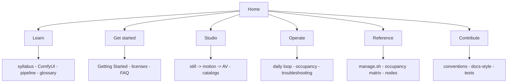

# ez-comfy-stack

[](https://toxicoder.github.io/ez-comfy-stack/latest/)
[](https://toxicoder.github.io/ez-comfy-stack/development/)
[](https://github.com/toxicoder/ez-comfy-stack/actions/workflows/ci.yml)
[](LICENSE)

**Simplified Visual Generative AI** demo for a **single NVIDIA DGX Spark**: ComfyUI in Docker Compose with a **US-safe local studio** (Apache Klein 4B stills, Apache Wan 2.2 silent motion, LTX-2.5 distilled AV), occupancy XOR, and remote-SSH-safe downloads.

| Feature | Default |
| --- | --- |
| Runtime | Docker Compose, one ComfyUI service |
| US-safe models | Klein 4B + Wan 2.2 + LTX-2.5 |
| Occupancy | One heavy GPU job (XOR) |
| Downloads | `download-limit auto` = **85%** of measured Mbps (24h host cache) |
| Restart | `restart: "no"` - type **yes** on start |
| Tests | **Bazelisk** is the only ingress - hermetic **100%** coverage gate via `bazelisk run //:validate` |

**Documentation:** [latest](https://toxicoder.github.io/ez-comfy-stack/latest/) (from `main`) - [development](https://toxicoder.github.io/ez-comfy-stack/development/) (from `development`) - Fumadocs (Next.js) with Orama search, glossary tooltips, Mermaid, and live editable command variables. Docs run through bazelisk too: `bazelisk run //docs:serve` locally, `bazelisk run //docs:docs` for the static export, `bazelisk test //docs:test_docs_site_render` for the content gate (`./docs/manage-docs.sh serve` is the no-Bazel path). Migration notes: [MIGRATION.md](MIGRATION.md).

When to use this sample vs [nvidia-dgx-spark-lab](https://github.com/toxicoder/nvidia-dgx-spark-lab): [docs/start/when-to-use-vs-spark-lab.md](docs/start/when-to-use-vs-spark-lab.md). Licenses: [docs/licenses.md](docs/licenses.md).

## Documentation map



## Quick start

Full walkthrough: **[Getting Started](https://toxicoder.github.io/ez-comfy-stack/latest/getting-started/)** (or the [development](https://toxicoder.github.io/ez-comfy-stack/development/getting-started/) docs if you track that branch). Session variables:

```bash
export SPARK_HOST="${SPARK_HOST:-127.0.0.1}"
export SPARK_USER="${SPARK_USER:-$USER}"
export MODELS_DIR="${MODELS_DIR:-/mnt/models}"
export COMFY_OUTPUT_DIR="${COMFY_OUTPUT_DIR:-/mnt/comfy-output}"
export COMFY_PORT="${COMFY_PORT:-8188}"

# first boot, once per machine: bazelisk + the lint toolchain the gates shell out to
bash scripts/setup-host.sh

# laptop (macOS/Linux/WSL): ./scripts/manage.sh setup-client
# one-shot from the laptop (never auto-starts): ./scripts/manage.sh onboard
./scripts/manage.sh setup --install-docker
bazelisk run //:manage -- doctor
./scripts/manage.sh download-models   # Klein 4B + Wan 2.2 5B + LTX-2.5
./scripts/manage.sh start             # type yes
# open http://${SPARK_HOST}:${COMFY_PORT}
# laptop: ssh -L "${COMFY_PORT}:127.0.0.1:${COMFY_PORT}" "${SPARK_USER}@${SPARK_HOST}"
./scripts/manage.sh stop              # before reboot
```

Non-host verbs lead with the same ingress as everything else, `bazelisk run //:manage -- <verb>`.
`./scripts/manage.sh <verb>` stays the documented escape hatch for `setup`, `download-models`,
`start`, and `stop`, which need docker, sudo, the GPU, or `$HOME`.

## The gates

One-time host bootstrap. Without it `bazelisk test //:lint` passes with no linters installed
at all, so a skipped linter after this point is a real defect:

```bash
bash scripts/setup-host.sh            # or: bazelisk run //:setup-host
```

Everything at once - the green build bar:

```bash
bazelisk run //:validate
```

The fast lane CI runs (bats, pytest, typecheck, JS, inventory):

```bash
bazelisk test //:test-fast
```

Every gate in the repo, including the manual linters, the Playwright visual suite, and the
Compose config check. Needs host linters, the pinned docs-site npm tree, and a Docker CLI:

```bash
bazelisk test //:test-all
```

Linters only, and the repair when one of them is missing:

```bash
bazelisk test //:lint --test_tag_filters=manual
```

```bash
bash scripts/setup-host.sh --check
```

Format what the linters flagged:

```bash
bazelisk run //:fix
```

First-party Python coverage (100% fail-under) and types (Pyright + mypy):

```bash
bazelisk test //:coverage
```

```bash
bazelisk test //tests:typecheck
```

The nothing-goes-unmapped guard (every tracked file is in a Bazel target), and the compose
file the stack actually starts:

```bash
bazelisk test //:owned_files_check
```

```bash
bazelisk test //docker:compose_config
```

Stack health, resolved against the real checkout:

```bash
bazelisk run //:manage -- doctor
```

Docs - generators plus static export, and the local dev server:

```bash
bazelisk run //docs:docs
```

```bash
bazelisk run //docs:serve
```

## Safety

- Compose `restart: "no"` - manual start only
- Heavy confirmation + free RAM/disk headroom
- Download throttle by default; wrap **clears on exit**
- See [docs/reboot-safety.md](docs/reboot-safety.md)

## License

MIT - see [LICENSE](LICENSE).
