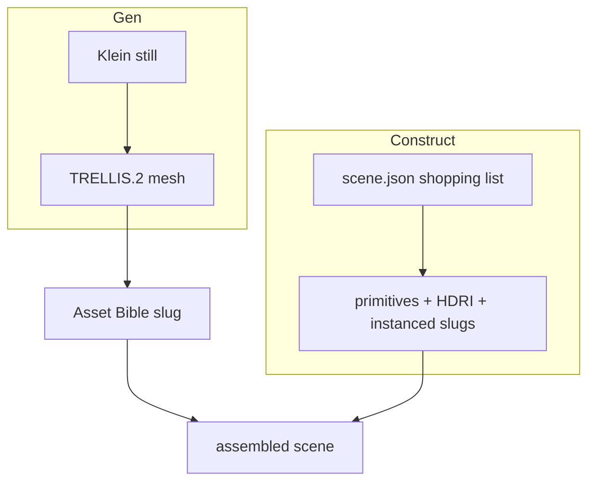

# Asset Bible

**What's on this page**

- **Gen or Construct** - Klein -> TRELLIS.2 for hero pieces, `scene.json` shopping lists for layout
- **Where files go** - `COMFY_OUTPUT_DIR/assets/<kind>/<slug>/`, index, weights, and guides
- **Asset records** - `ez.asset.v1` fields and a `scene.json` that instances slugs
- **Operator verbs** - what ships today (`asset-ls`, `house-views`) and what is still P-A1
- **Occupancy and downloads** - which desk Gen needs, and why TRELLIS.2 stays opt-in
- **Honest limits** - what no US-safe default pack model will generate for you

**What this enables**

- **A versioned catalog** of reusable props, characters, and sets kept as **outputs**
- **Scene files that shop for slugs** instead of embedding mesh bytes
- **Read-only listing now** - `asset-ls` prints the catalog; mint / iterate / promote verbs come later (P-A1)
- **One rule that never moves** - weights stay in `MODELS_DIR`, generated assets stay under `assets/`

**Question this page answers:** where do generated meshes live, and what can I run against them today? Start with [Gen or Construct](#gen-or-construct) to pick a lane, then list what you already have with `asset-ls`.

<Callout type="warning" title="Honesty">
  There is **no** US-safe default-pack model that emits a textured city from one sentence. Whole-scene **fast draft** is Construct (primitives + HDRI + instanced bible assets). Whole-scene **hero** is Construct layout + Gen hero pieces. TRELLIS-on-a-full-scene-still is **DRAFT-ONLY**.
</Callout>
This does **not** replace ez_film, the 5.00s printer, or occupancy. `restart: "no"`, heavy confirm, headroom, and download-limit are unchanged. No Blender in Docker. MCP is the in-tree typed server (`blender-mcp`), not a third-party binary. No new default weights.



---

## Gen or Construct

| Lane | Meaning | Use it for |
| --- | --- | --- |
| **Gen** | Klein still -> TRELLIS.2 | Hero *pieces* (a mug, a jacket, a hero mesh) |
| **Construct** | `scene.json` shopping list | Layout: primitives, HDRI, **instances of bible slugs** |

Pick **Gen** when the object itself is the deliverable. Pick **Construct** when the arrangement is the deliverable and the props can come off the shelf.

`mcp-construct` is the in-tree [Blender MCP](occupancy.md) (`manage.sh blender-mcp`). Typed tools only - no `execute_code`. **`bpy-primitive`** now has one operator verb: `./scripts/manage.sh house-views` builds a greybox set under `assets/sets/<slug>/` (layout + GLB + ten 1024x1280 clay stills). Host Blender stays a [sidecar](blender-gb10-sidecar.md) (dies if compose is up). Playbook: [Dream-house tours](learn/dream-house.md). The dump contract itself: [DCC guide pack](dcc-workflows.md).

---

## Where files go

| Path | What |
| --- | --- |
| `${COMFY_OUTPUT_DIR}/assets/<kind>/<slug>/asset.yaml` | `ez.asset.v1` record |
| `.../mesh/`, `.../views/`, `.../variants/`, `.../prompts.jsonl` | Takes and previews |
| `${COMFY_OUTPUT_DIR}/assets/index.yaml` | Catalog index (written by the library, not by `asset-ls`) |
| `MODELS_DIR` | Weights only - **never** bible assets |
| `guides/` | Docs/guides - **never** generated GLBs |

Kinds: `object` - `character` - `building` - `set` - `scene` - `material` - `hdri` (directories are plural: `objects/`, `characters/`, `sets/`, ...).

Schema and a sample scene that **instances slugs** (no embedded mesh bytes): repo-root `schemas/asset.yaml` and `schemas/scene.json`.

---

## Asset records

A record is one `asset.yaml` per slug. The library (`scripts/lib/asset_bible.py`) parses a restricted YAML subset and fails closed on a bad record.

| Field | Meaning |
| --- | --- |
| `schema` | `ez.asset.v1` |
| `id` | slug - lowercase words joined by single hyphens (`mug-cobalt-chipped`) |
| `kind` | one of the seven kinds above |
| `prompt` / `seed` | what generated it (a non-empty string, and a non-negative integer; the sample record uses **42**) |
| `pipeline` | `klein-trellis2` - `klein-edit` - `bpy-primitive` - `mcp-construct` - `scene-assemble` |
| `parent` | upstream slug, or `null` |
| `takes` | version tags (`[v001, v002]`) |
| `files` | file roles, as a mapping or a list of role names (`preview` / `hero_glb` / `views`) |
| `tags` / `license` / `ready` | search terms, a non-empty license string (`operator-output` in the sample), and the ready flag |

`scene.json` then places those slugs: `instances` carry a `ref` to an asset slug plus translate / rotate / scale, with one `camera` block and an `hdri`. The validator **refuses** embedded mesh bytes, data-URI base64, and oversized strings, so a scene stays a shopping list.

---

## Operator verbs

| Verb | Status |
| --- | --- |
| `asset-ls` | **Shipped** - read-only catalog |
| `house-views` | **Shipped** - occupancy-gated Blender greybox + Instagram clay stills (`bpy-primitive` sets) |
| `asset-new` / `asset-iterate` / `asset-promote` | Coming (P-A1) |

```bash
./scripts/manage.sh asset-ls
./scripts/manage.sh asset-ls --json
./scripts/utilities/asset-ls.sh --output-dir "${COMFY_OUTPUT_DIR}/assets"
```

Empty catalog is success: an empty `assets/` directory is a valid state, not an error.

---

## Occupancy and downloads

Gen (Klein + TRELLIS) wants the GPU to yourself: `./scripts/manage.sh occupancy enter trellis --yes` after a still. Host Blender dumps park Comfy instead. The rule and the two verbs: [Host sidecars overview](studio-sidecars.md#occupancy-rule). Desk commands: [Occupancy desk](occupancy.md).

TRELLIS.2 remains opt-in `download-3d`, not `download-models`. See [Model licenses](licenses.md).

---

## Related

- [Host sidecars overview](studio-sidecars.md) - the 3D, Blender, and host-tools group, and the occupancy rule in full
- [DCC guide pack](dcc-workflows.md) - the clay / depth packs that feed a Gen pass
- [Blender GB10 sidecar](blender-gb10-sidecar.md) - the host binary behind `house-views`
- [Splat sidecar](splat-sidecar.md) - the host splat viewer
- [Vlo video editor](vlo.md) - the host browser NLE
