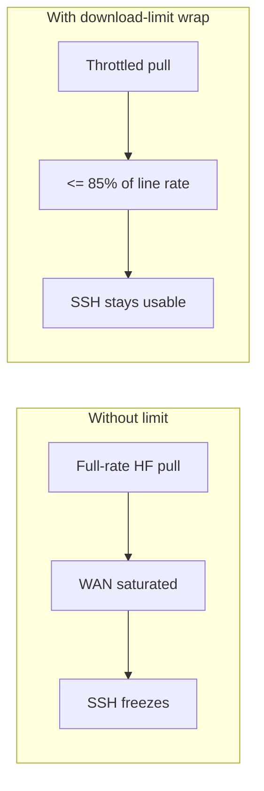
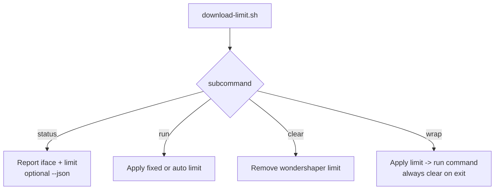
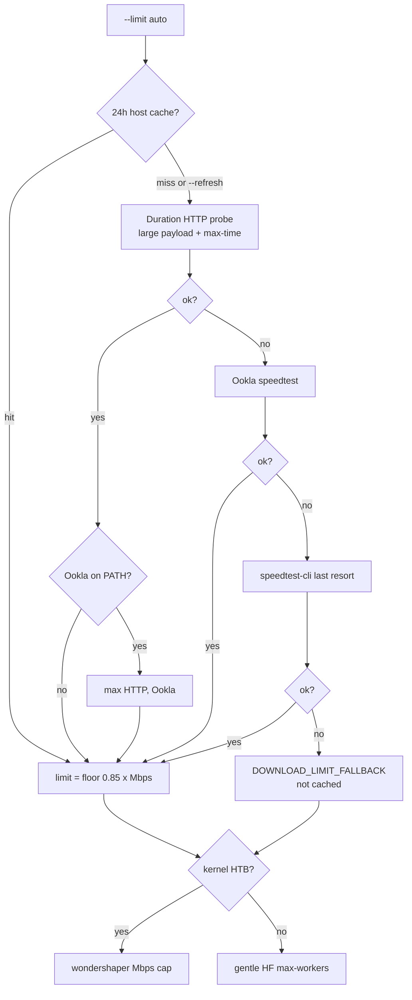
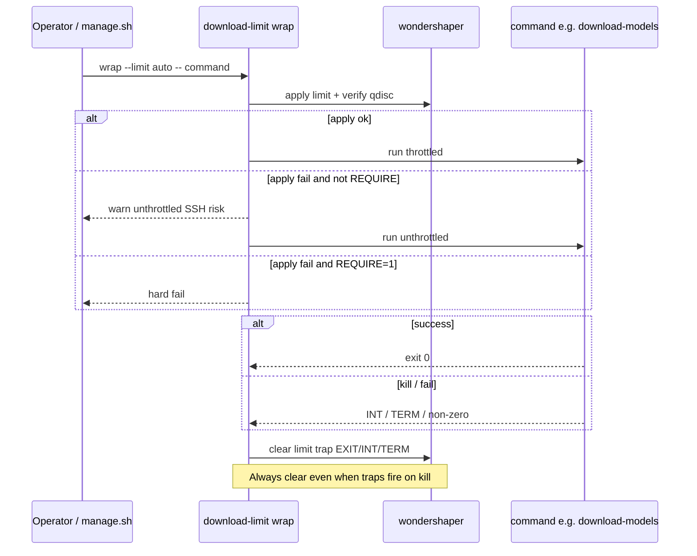
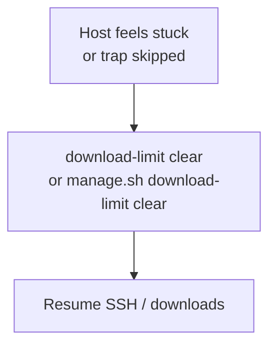

# Download limit

**What's on this page**

- **Commands** - `status`, `run`, `clear`, `wrap`, and the manage verbs
- **Fixed cap vs auto** - `--limit N` in Mbps, or 85 percent of a measured sample
- **Auto mode** - the cache, the HTTP probe, and the speedtest fallbacks
- **No HTB on a Spark kernel** - gentle HF worker mode instead of a hard cap
- **Clear on exit** - the wrap trap, Ctrl+C, and the emergency clear

**What this enables**

- **Pulling multi-GB** Klein / Wan / LTX weights without saturating the uplink and freezing SSH
- **Recovering a host** that feels stuck throttled after a crash
- **Choosing deliberately** between a kernel Mbps cap and gentle worker throttling

**Who this is for:** operators about to pull on a Spark they reach over SSH. Pack ids are not
bandwidth: `--tier` picks the pack ([Download tiers](download-tiers.md)), `--limit` is Mbps.

Wrap **always clears on exit** - do not weaken that.



---

## Why this exists

You cannot walk over to a Spark and wiggle the HDMI cable. Bandwidth left for SSH is how you
recover a host that is pulling 30 GB of LTX. A full-rate Hugging Face pull can starve
interactive SSH. This utility applies kernel-level traffic shaping via **wondershaper** when
HTB is available, and falls back to gentler HF client settings when it is not.

Inspired by the throttled Ollama downloader in `dgx-spark-it-up`, generalized and improved
with **auto** limiting.

---

## Run the commands

| Command | Purpose |
| --- | --- |
| `status [--json] [--refresh]` | Report interface + speed cache; `--refresh` remasures |
| `run --limit 50` | Apply a fixed Mbps cap |
| `run --limit auto` | Measure line rate (or cache), apply 85% |
| `clear` | Remove wondershaper limit (does **not** drop the speed cache) |
| `wrap --limit auto` or `--limit N` | Apply -> run command -> **always clear on exit** |
| `manage.sh download-models --limit N` | Same wrap; **N** is a standing Mbps cap for this download |

```bash
./scripts/utilities/download-limit.sh status [--json] [--refresh]
./scripts/utilities/download-limit.sh run --limit 50
./scripts/utilities/download-limit.sh run --limit auto [--refresh]
./scripts/utilities/download-limit.sh clear
./scripts/utilities/download-limit.sh wrap --limit auto [--refresh] -- <command...>
```

Via manage:

```bash
./scripts/manage.sh download-limit clear
./scripts/manage.sh download-models                 # wrap --limit "${DOWNLOAD_LIMIT:-auto}"
./scripts/manage.sh download-models --limit 40      # fixed 40 Mbps; overrides .env for this run
./scripts/manage.sh download-models --limit off     # no throttle (SSH risk)
```

`--limit N` is integer **Mbps** (megabits, not megabytes per second). 40 Mbps ~ 5 MB/s. `.env`
`DOWNLOAD_LIMIT=40` is the persistent default; the flag wins for one invocation. Wrap still
**clears on exit**.

**Check it worked:** `./scripts/manage.sh download-limit status --json` reports the interface
and the active limit, and a wrapped pull logs `limit=N Mbps` before its first progress line.



---

## How auto mode measures Mbps

When you pass `--limit auto`:

1. **Cache** - reuse a host-local measurement from the last 24h (`${XDG_CACHE_HOME:-~/.cache}/ez-comfy/download-limit-speed.json`). Not stored on `MODELS_DIR` (independent Sparks share that). `--refresh` or `DOWNLOAD_LIMIT_CACHE_TTL_SEC=0` skips the cache.
2. **Clear** any existing bandwidth limits on the default-route interface (wondershaper + best-effort `tc`) so residual caps do not skew a new sample
3. **Duration HTTP probe** first: large Cloudflare `__down?bytes=` payload (default 250 MB) with `--max-time` ~12s. curl **timeout (exit 28) is a valid sample** when >=1 MB arrived - a short completed file under-reads gigabit (TCP slow start)
4. Else Ookla `speedtest` JSON if on PATH (take **max** vs HTTP when both succeed)
5. Else install and try `speedtest-cli --simple` (often under-reads gigabit; last resort)
6. Apply `floor(0.85 x measured)` (minimum 1 Mbps) when the sample is **trusted**, and **write the cache**
7. If all probes fail: **do not** use idle NIC RX as line rate - use default `max-workers=4` and start download. Fallback `DOWNLOAD_LIMIT_FALLBACK` is **not** cached

++ctrl+c++ kills the download process group, progress heartbeat, and HTTP probes (INT->TERM->KILL).

Override HTTP probe: `SPEEDTEST_HTTP_URL`, `SPEEDTEST_HTTP_BYTES`, `SPEEDTEST_HTTP_MAX_TIME`.



Upload is set to a high **legal** "uncapped" rate (clamped for HTB). Extremely large historical
defaults (e.g. 100000 Mbps) produced `Illegal "rate"` on some kernels.

---

## On a Spark kernel without HTB

Many Spark kernels lack `sch_htb` / IFB (`qdisc kind is unknown`). The tool **detects** this
and **does not** spam wondershaper/RTNETLINK.

| Path | Behavior |
| --- | --- |
| HTB available | wondershaper hard Mbps cap at 85% of measured |
| HTB missing (typical Spark) | **Gentle HF mode**: `HF_DOWNLOAD_MAX_WORKERS` from measured Mbps (floor **2**-4), `HF_HUB_ENABLE_HF_TRANSFER=0` - not a hard Mbps cap |
| `DOWNLOAD_LIMIT=off` | Full blast (**SSH risk**) |

Model downloads keep a **real TTY** for the stack-owned progress line (no `2>&1 | tee` on
interactive sessions). Hub/tqdm file-count bars stay disabled. Cache hits still finish in 0s.
Heartbeats every 10s show `du` growth under the target dir. Wrap logs `limit=N Mbps` (kernel
HTB or gentle HF workers) before the first `v` line.

---

## Apply verification and soft-fail

After wondershaper runs, the utility checks that a shaping qdisc is active (`tc qdisc show`, or hermetic mocks). If apply fails or HTB is missing:

| Command | Behavior |
| --- | --- |
| `run` | **Hard-fail** (operator asked for a standing limit) |
| `wrap` | **Soft path**: gentle HF workers + clear on exit |
| `wrap` + `DOWNLOAD_LIMIT_REQUIRE=1` | **Hard-fail** like `run` |

<Callout type="warning" title="Safety impact">
  Gentle mode reduces parallel download stampede but is **not** a kernel Mbps cap. Prefer HTB where available. **Clear-on-exit remains mandatory** for `wrap`.
</Callout>

---

## Clear the limit

`wrap` always clears on `EXIT` / `INT` / `TERM` so a killed download cannot leave the host
permanently throttled.

Downloads run in a **process group**. ++ctrl+c++ (SIGINT) or SIGTERM:

1. Forwards to `hf` / nested bash (not only `tee`)
2. Clears wondershaper limits if any
3. Exits promptly (status 130)

You should not need `kill -9` on leftover download processes after a clean Ctrl+C.



If the host still feels "stuck" throttled after a crash:

```bash
./scripts/utilities/download-limit.sh clear
# or:
./scripts/manage.sh download-limit clear
```

**Check it worked:** `./scripts/manage.sh download-limit status` reports no active limit and
SSH is responsive again. Clearing does not drop the speed cache, so the next `auto` run reuses
the 24h sample.



---

## Advanced

??? abstract "Live speed when preflight fails"

    If auto mode cannot measure speed **before** download:

    1. **Measure phase** (~15s): sample NIC RX while a short HTTP download generates traffic (not the multi-GB model pull - avoids HF locks and kill/restart hangs)
    2. Set target = 85% of live Mbps -> gentle HF max-workers (or kernel HTB only if `sudo -n` works and qdisc applies)
    3. **Download phase**: one **foreground** model download with live tqdm progress

    No interactive sudo during this path. Mock/tests: `LAB_MOCK_LIVE_RX_MBPS`.

---

## Next

1. [Download tiers](download-tiers.md) - the pack ids `--tier` takes, and their sizes
2. [Models and cache](models-and-cache.md) - where the bytes land on `${MODELS_DIR}`
3. [Model packs by family](operate/models-packs.md) - resume, cache hits, and stuck partials
4. [Disk wizard](disk-wizard.md) - free space before a multi-GB pull
5. [Downloads and bandwidth](operate/troubleshooting-downloads.md) - a stalled or refused pull
