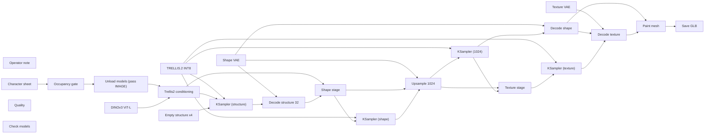

# 3d/character-batch

**What's on this page**

- **Purpose, occupancy, and models** from the on-canvas Note
- **Graph flow** (groups when the canvas is large)
- **Every node id** on this graph
- **Node parameter reference** for each type, with this graph's values and the other legal choices

**What this enables**

- **Queuing this filename** with known widgets
- **Changing a parameter** with a documented generation effect

**Who this is for:** studio users who loaded `3d/character-batch` from Apps or Workflows.

> Generated from `workflows/_lab/3d/character-batch.json`. Do not hand-edit this file. Re-run `bazelisk run //docs:docs`.

## Purpose

Occupancy **trellis**. Outputs under `${COMFY_OUTPUT_DIR}`. Unload the previous family before Queue.

```text
## 3d/character-batch

Klein still -> four textured candidate characters in one queue, so a cast call costs one occupancy session instead of four.

Source: `LoadImage` with a Klein still (`ez_still_*.png` or a clay plate). `EmptyTrellis2LatentStructure` batch_size is 4 and the batch flows through every stage, so SaveGLB writes one .glb per candidate. SaveGLB takes the MESH directly here: MeshToFile3D keeps only batch item 0, which would silently drop 3 of the 4.

UNET: `trellis_2_int8_convrot.safetensors`. CLIP vision: `dino_v3_vit_l.safetensors` (DINOv3 license, opt-in pack). Structure decode stays at 32.

Upsample `target_resolution` is an int and ComfyUI only accepts 1024-2048 in steps of 128; this graph runs the 1024 floor.

SaveGLB writes four files to `output/assets/objects/_lab-characters/character_NNNNN_.glb`. Do not mint an Asset Bible row from this graph.

DINOv3 is Meta's custom commercial-friendly license - not Apache. MIT TRELLIS weights without DINOv3 cannot Queue.

Occupancy: trellis - stop Blender desk, LTX, Wan, Klein denoise. One GB10 job.
```

## How to Queue

1. `bazelisk run //:manage -- start` so `_lab` is seeded
2. Load **3d/character-batch** from **Apps** or **Workflows**
3. Read the on-canvas Note, change widgets, Queue

Do not edit raw `_lab` JSON. Save keepers under `_user/`.

## Graph



## Nodes on this graph

| Id | Title | Type | Group |
| --- | --- | --- | --- |
| 1 | Operator note | `Note` | NOTE |
| 2 | Character sheet | `LoadImage` | INPUT |
| 3 | Occupancy gate | `EZDCCOccupancyGate` | INPUT |
| 4 | Unload models (pass IMAGE) | `EZUnloadModels` | SETTINGS |
| 5 | DINOv3 ViT-L | `CLIPVisionLoader` | MODEL |
| 6 | TRELLIS.2 INT8 | `UNETLoader` | MODEL |
| 7 | Shape VAE | `VAELoader` | MODEL |
| 8 | Texture VAE | `VAELoader` | MODEL |
| 9 | Trellis2 conditioning | `Trellis2Conditioning` | PROMPT |
| 10 | Empty structure x4 | `EmptyTrellis2LatentStructure` | SETTINGS |
| 11 | KSampler (structure) | `KSampler` | SETTINGS |
| 12 | Decode structure 32 | `VaeDecodeStructureTrellis2` | OUTPUT |
| 13 | Shape stage | `Trellis2ShapeStage` | OUTPUT |
| 14 | KSampler (shape) | `KSampler` | SETTINGS |
| 15 | Upsample 1024 | `Trellis2UpsampleStage` | OUTPUT |
| 16 | KSampler (1024) | `KSampler` | SETTINGS |
| 17 | Decode shape | `VaeDecodeShapeTrellis` | OUTPUT |
| 18 | Texture stage | `Trellis2TextureStage` | OUTPUT |
| 19 | KSampler (texture) | `KSampler` | SETTINGS |
| 20 | Decode texture | `VaeDecodeTextureTrellis` | OUTPUT |
| 21 | Paint mesh | `PaintMesh` | OUTPUT |
| 22 | Save GLB | `SaveGLB` | OUTPUT |
| 23 | Quality | `EZQuality` | QUALITY |
| 24 | Check models | `EZModelCheck` | QUALITY |

## Node parameter reference

Every unique node type on this graph. Widgets are in lab JSON order. Choices are ComfyUI v0.43.0 / lab `INPUT_TYPES` - not SD1.5 folklore.

### `Note` - Note

On-canvas operator note (not executed).

!!! warning "Lab notes"

    Every lab graph has one. Purpose, models, sampler, occupancy, run steps.

#### `text`

Type `STRING`.

Markdown-ish operator note.

**How it affects generation:** Does not affect pixels. Read it before Queue.

**This graph:** `## 3d/character-batch Klein still -> four textured candidate characters in one queue, so a cast call costs one occupancy session instead of four. Source: `LoadImage` with a Klein still (`ez_still_*.p...`

```text
## 3d/character-batch

Klein still -> four textured candidate characters in one queue, so a cast call costs one occupancy session instead of four.

Source: `LoadImage` with a Klein still (`ez_still_*.png` or a clay plate). `EmptyTrellis2LatentStructure` batch_size is 4 and the batch flows through every stage, so SaveGLB writes one .glb per candidate. SaveGLB takes the MESH directly here: MeshToFile3D keeps only batch item 0, which would silently drop 3 of the 4.

UNET: `trellis_2_int8_convrot.safetensors`. CLIP vision: `dino_v3_vit_l.safetensors` (DINOv3 license, opt-in pack). Structure decode stays at 32.

Upsample `target_resolution` is an int and ComfyUI only accepts 1024-2048 in steps of 128; this graph runs the 1024 floor.

SaveGLB writes four files to `output/assets/objects/_lab-characters/character_NNNNN_.glb`. Do not mint an Asset Bible row from this graph.

DINOv3 is Meta's custom commercial-friendly license - not Apache. MIT TRELLIS weights without DINOv3 cannot Queue.

Occupancy: trellis - stop Blender desk, LTX, Wan, Klein denoise. One GB10 job.
```

### `LoadImage` - Load Image

Load a still from Comfy input/ (or upload).

!!! warning "Lab notes"

    I2V / edit graphs default example.png until you pick ez_still_*.png. App Mode shows Start image only when this node is wired.

| Socket | Dir | Type | What it carries |
| --- | --- | --- | --- |
| `IMAGE` | out | `IMAGE` | RGB still. |
| `MASK` | out | `MASK` | Alpha if present. |

#### `image`

Type `STRING`.

Filename in input/.

**How it affects generation:** Point at the Klein still you just saved (ez_still_draft_*.png, ez_character_*.png, first.png).

**This graph:** `example.png`

#### `upload`

Type `COMBO`. Range / default: image.

Upload widget type.

**How it affects generation:** Leave image. This is the choose-file control, not a generation knob.

**This graph:** `image`

### `EZDCCOccupancyGate` - Occupancy gate

Pass-through IMAGE that fail-closes on occupancy XOR. Does not start Compose.

!!! warning "Lab notes"

    Missing .occupancy.json passes. idle / blender-desk / llm-desk / mismatch fail.

| Socket | Dir | Type | What it carries |
| --- | --- | --- | --- |
| `image` | in | `IMAGE` | Still to gate. |
| `image` | out | `IMAGE` | Same still if occupancy matches. |

#### `required_mode`

Type `COMBO`.

Heavy GPU mode that must already be entered.

**How it affects generation:** klein / wan / ltx / trellis. Pick the family you are about to Queue.

**This graph:** `trellis`

**Other choices**

| Choice | What it does |
| --- | --- |
| `klein` | Klein 4B stills. |
| `trellis` | TRELLIS.2. |
| `wan` | Wan 5B. |
| `ltx` | LTX-2.5. |

### `EZUnloadModels` - Unload models

Pass-through IMAGE that unloads diffusion models first.

!!! warning "Lab notes"

    Frees the previous UNET before the Trellis load, so two model families never share the GB10.

| Socket | Dir | Type | What it carries |
| --- | --- | --- | --- |
| `image` | in | `IMAGE` | Identity still. |
| `image` | out | `IMAGE` | Same still after unload. |

No widgets. Sockets only.

### `CLIPVisionLoader` - Load CLIP Vision

Load an image encoder for TRELLIS.2 conditioning.

!!! warning "Lab notes"

    Lab: dino_v3_vit_l.safetensors. Occupancy trellis.

| Socket | Dir | Type | What it carries |
| --- | --- | --- | --- |
| `CLIP_VISION` | out | `CLIP_VISION` | Vision tower. |

#### `clip_name`

Type `STRING`.

Vision checkpoint filename.

**How it affects generation:** DINOv3 ViT-L is the TRELLIS.2 pair. A text CLIP will not work here.

**This graph:** `dino_v3_vit_l.safetensors`

### `UNETLoader` - Load Diffusion Model

Load a standalone transformer/UNET from diffusion_models/.

!!! warning "Lab notes"

    Lab files: flux-2-klein-4b-fp8.safetensors, wan2.2_ti2v_5B_fp16.safetensors, ltx-2.5-22b-distilled-transformer-comfy-int8-convrot.safetensors. weight_dtype stays default.

| Socket | Dir | Type | What it carries |
| --- | --- | --- | --- |
| `MODEL` | out | `MODEL` | Denoiser weights. |

#### `unet_name`

Type `STRING`.

Checkpoint filename under MODELS_DIR diffusion_models.

**How it affects generation:** Wrong family = Queue error or a melted picture. Lab pins Apache Klein 4B. Klein 9B / FLUX.2-dev are opt-in NC. MiniMax is banned.

**This graph:** `trellis_2_int8_convrot.safetensors`

#### `weight_dtype`

Type `COMBO`. Range / default: default.

Cast at load.

**How it affects generation:** default keeps the file's dtype (Klein FP8, LTX INT8-convrot, Wan FP16).

**This graph:** `default`

**Other choices**

| Choice | What it does |
| --- | --- |
| `default` | Load weights as stored. Lab UNETLoader always uses this. |
| `fp8_e4m3fn` | Cast to FP8 e4m3fn. Can save memory; may shift Klein/LTX quality. |
| `fp8_e4m3fn_fast` | FP8 e4m3fn with fast optimizations. |
| `fp8_e5m2` | Cast to FP8 e5m2. |

### `VAELoader` - Load VAE

Load the autoencoder that maps pixels <-> latents (and LTX audio).

!!! warning "Lab notes"

    Do not mix families: flux2-vae, wan2.2_vae, ltx-2.5-video-vae-bf16, ltx-2.5-audio-vae-bf16.

| Socket | Dir | Type | What it carries |
| --- | --- | --- | --- |
| `VAE` | out | `VAE` | Encoder/decoder. |

#### `vae_name`

Type `STRING`.

Filename under vae/.

**How it affects generation:** Wrong VAE = color trash or a shape error.

| Instance | Value |
| --- | --- |
| Shape VAE | `trellis_2_shape_vae_bf16.safetensors` |
| Texture VAE | `trellis_2_texture_vae_bf16.safetensors` |

### `Trellis2Conditioning` - TRELLIS.2 Conditioning

Encode a still with CLIP Vision into TRELLIS positive/negative.

| Socket | Dir | Type | What it carries |
| --- | --- | --- | --- |
| `clip_vision_model` | in | `CLIP_VISION` | DINOv3 ViT-L. |
| `image` | in | `IMAGE` | Klein still. |
| `positive` | out | `CONDITIONING` | Shape/texture positive. |
| `negative` | out | `CONDITIONING` | Negative. |

No widgets. Sockets only.

### `EmptyTrellis2LatentStructure` - Empty TRELLIS.2 Latent Structure

Allocate a TRELLIS.2 structure latent (batch only).

!!! warning "Lab notes"

    Occupancy trellis. Unload Klein first.

| Socket | Dir | Type | What it carries |
| --- | --- | --- | --- |
| `LATENT` | out | `LATENT` | Structure noise. |

#### `batch_size`

Type `INT`. Range / default: 1.

Meshes per Queue.

**How it affects generation:** Stay 1 on GB10.

**This graph:** `4`

### `KSampler` - KSampler

Denoise a latent for N steps at a CFG, sampler, and scheduler.

!!! warning "Lab notes"

    Distilled Klein is CFG 1.0 / 4 steps / euler / simple. Raising CFG is not a quality knob. Wan 5B uses uni_pc and CFG 5. LTX distilled uses euler / simple / CFG 1.0 / 20 steps. ACE-Step uses 8 steps / CFG 1.0 / euler. TRELLIS uses 12 steps / CFG 7.5 / euler / normal.

| Socket | Dir | Type | What it carries |
| --- | --- | --- | --- |
| `model` | in | `MODEL` | UNET / transformer after any ModelSampling* patch. |
| `positive` | in | `CONDITIONING` | What to include (CLIP / ACE / LTX prompt). |
| `negative` | in | `CONDITIONING` | What to avoid. Distilled Klein ignores this well - put constraints in the positive. |
| `latent_image` | in | `LATENT` | Noise canvas or encoded start image / video / audio latent. |
| `LATENT` | out | `LATENT` | Denoised latent for VAE decode. |

#### `seed`

Type `INT`. Range / default: 0 ... 2^64-1; lab 42.

Random seed for the noise tensor.

**How it affects generation:** Same seed + same graph ~ same picture or clip. Lab locks 42 on smokes so drafts are comparable.

| Instance | Value |
| --- | --- |
| KSampler (structure) | `42` |
| KSampler (shape) | `42` |
| KSampler (1024) | `42` |
| KSampler (texture) | `43` |

#### `control_after_generate`

Type `COMBO`. Range / default: fixed (lab).

What happens to seed after Queue.

**How it affects generation:** fixed keeps iteration honest while you change the prompt.

**This graph (all 4 instances):** `fixed`

**Other choices**

| Choice | What it does |
| --- | --- |
| `fixed` | Keep this seed on the next Queue. Lab default for reproducible stills and 5 s prints. |
| `increment` | Add 1 after Queue. Use for a sequence of variations. |
| `decrement` | Subtract 1 after Queue. |
| `randomize` | Draw a new seed after Queue. Exploration only. |

#### `steps`

Type `INT`. Range / default: 1-10000; Klein distilled 4; LTX 20; Wan 20; ACE 8; TRELLIS 12.

Denoising iterations.

**How it affects generation:** More steps refine detail with diminishing returns. Distilled Klein is authored at 4 - raising steps is slower, not a quality knob. Do not raise LTX/Wan toward a 90 s denoise.

**This graph (all 4 instances):** `12`

#### `cfg`

Type `FLOAT`. Range / default: 0-100; Klein/LTX/ACE 1.0; Wan 5; TRELLIS 7.5.

Classifier-free guidance scale.

**How it affects generation:** Distilled Klein is CFG 1.0 - raising CFG is the wrong quality lever (use the Positive prompt, resolution, or still-hero). Wan silent 5B uses CFG 5. TRELLIS structure uses 7.5. At CFG 1.0 Comfy skips the negative pass.

| Instance | Value |
| --- | --- |
| KSampler (structure) | `7.5` |
| KSampler (shape) | `7.5` |
| KSampler (1024) | `7.5` |
| KSampler (texture) | `1` |

#### `sampler_name`

Type `COMBO`. Range / default: euler (most lab); uni_pc (Wan).

ODE / SDE algorithm that removes noise.

**How it affects generation:** euler is the lab still/AV/ACE default. uni_pc is the Wan 5B silent default. Ancestral/SDE samplers add extra randomness and weaken seed lock.

**This graph (all 4 instances):** `euler`

**Other choices**

| Choice | What it does |
| --- | --- |
| `euler` | First-order ODE. Lab default for Klein, LTX, ACE, and most stills. Fast and stable at CFG 1.0. |
| `euler_cfg_pp` | Euler with CFG++. Rarely needed on distilled Klein (CFG is already 1.0). |
| `euler_ancestral` | Adds ancestral noise each step. More variation; weaker exact seed lock. |
| `euler_ancestral_cfg_pp` | Ancestral Euler with CFG++. |
| `heun` | Second-order Heun. Slower, sometimes smoother; not a lab default. |
| `heunpp2` | Higher-order Heun variant. |
| `exp_heun_2_x0` | Exponential Heun (x0 prediction). |
| `exp_heun_2_x0_sde` | Exponential Heun SDE. Extra stochasticity. |
| `dpm_2` | DPM-Solver-2. Two function evals per step. |
| `dpm_2_ancestral` | Ancestral DPM-2. |
| `lms` | Linear multistep. Older; keep for experiments only. |
| `dpm_fast` | Fast DPM. Coarse, good for previews. |
| `dpm_adaptive` | Adaptive DPM. Step count is a hint, not a hard budget. |
| `dpmpp_2s_ancestral` | DPM++ 2S ancestral. Common SD1.5 pick; not a Klein default. |
| `dpmpp_2s_ancestral_cfg_pp` | DPM++ 2S ancestral with CFG++. |
| `dpmpp_sde` | DPM++ SDE. Stochastic, slower. |
| `dpmpp_sde_gpu` | DPM++ SDE on GPU noise. |
| `dpmpp_2m` | DPM++ 2M. Smooth; often used on SD-family, not distilled Klein. |
| `dpmpp_2m_cfg_pp` | DPM++ 2M with CFG++. |
| `dpmpp_2m_sde` | DPM++ 2M SDE. |
| `dpmpp_2m_sde_gpu` | DPM++ 2M SDE GPU noise. |
| `dpmpp_2m_sde_heun` | DPM++ 2M SDE Heun. |
| `dpmpp_2m_sde_heun_gpu` | DPM++ 2M SDE Heun GPU. |
| `dpmpp_3m_sde` | DPM++ 3M SDE. |
| `dpmpp_3m_sde_gpu` | DPM++ 3M SDE GPU. |
| `ddpm` | Classic DDPM. Slow; do not use on 121-frame LTX. |
| `lcm` | Latent Consistency. Needs an LCM-tuned model; not lab Klein/Wan/LTX. |
| `ipndm` | iPNDM multistep. |
| `ipndm_v` | iPNDM (v-prediction). |
| `deis` | DEIS multistep. |
| `cfgpp_ud10_ab` | CFG++ UD10 AB. Added in ComfyUI 0.35; not a lab default. |
| `res_multistep` | Res multistep. Some turbo recipes. |
| `res_multistep_cfg_pp` | Res multistep CFG++. |
| `res_multistep_ancestral` | Ancestral res multistep. |
| `res_multistep_ancestral_cfg_pp` | Ancestral res multistep CFG++. |
| `gradient_estimation` | Gradient-estimation sampler. |
| `gradient_estimation_cfg_pp` | Gradient-estimation CFG++. |
| `er_sde` | ER-SDE sampler. |
| `seeds_2` | SEEDS-2. |
| `seeds_3` | SEEDS-3. |
| `sa_solver` | SA-Solver. |
| `sa_solver_pece` | SA-Solver PECE. |
| `ddim` | DDIM. Deterministic; not a lab default. |
| `uni_pc` | UniPC. Lab Wan 5B silent graphs use this with CFG 5. |
| `uni_pc_bh2` | UniPC BH2 variant. |

#### `scheduler`

Type `COMBO`. Range / default: simple (most lab); normal (TRELLIS).

How sigmas are spaced across steps.

**How it affects generation:** simple is even spacing and matches distilled Klein / LTX / ACE. normal is the TRELLIS pair. Do not copy karras from an SD1.5 recipe onto Klein.

| Instance | Value |
| --- | --- |
| KSampler (structure) | `normal` |
| KSampler (shape) | `normal` |
| KSampler (1024) | `simple` |
| KSampler (texture) | `normal` |

**Other choices**

| Choice | What it does |
| --- | --- |
| `simple` | Even sigma spacing. Lab default for Klein, Wan, LTX, and ACE. |
| `normal` | Linear timestep schedule. TRELLIS structure/texture stages use this. |
| `karras` | Karras sigmas. Often sharper on SD-family; not the lab default. |
| `exponential` | Exponential sigma decay. |
| `sgm_uniform` | SGM uniform. SD3-family default; Wan uses ModelSamplingSD3 shift instead. |
| `ddim_uniform` | Uniform DDIM schedule. |
| `beta` | Beta-distribution timesteps. |
| `linear_quadratic` | Linear then quadratic (Mochi-style). |
| `kl_optimal` | KL-optimal sigma curve. |

#### `denoise`

Type `FLOAT`. Range / default: 0-1; lab 1.0.

Fraction of the latent to replace with denoised signal.

**How it affects generation:** 1.0 is full generation (T2I / T2V / ACE). Values below 1 keep structure from an encoded start image (Klein edit / clay). Lab I2V uses dedicated latent nodes, not denoise<1 on empty noise.

**This graph (all 4 instances):** `1`

### `VaeDecodeStructureTrellis2` - TRELLIS.2 Decode Structure

Decode structure latent to voxels.

| Socket | Dir | Type | What it carries |
| --- | --- | --- | --- |
| `samples` | in | `LATENT` | Structure latent. |
| `vae` | in | `VAE` | TRELLIS VAE. |
| `voxel` | out | `VOXEL` | Voxel grid. |

#### `resolution`

Type `COMBO`. Range / default: 32 or 64; lab 32.

Voxel grid size.

**How it affects generation:** 32 is the lab structure decode. 64 is the only other upstream option and is the finer grid.

**This graph:** `32`

**Other choices**

| Choice | What it does |
| --- | --- |
| `32` | Lab default. |
| `64` | Finer voxel grid; slower. |

### `Trellis2ShapeStage` - TRELLIS.2 Shape Stage

Sample structure from a voxel latent.

| Socket | Dir | Type | What it carries |
| --- | --- | --- | --- |
| `positive` | in | `CONDITIONING` | Vision cond. |
| `negative` | in | `CONDITIONING` | Negative. |
| `voxel` | in | `VOXEL` | Structure decode voxels. |
| `positive` | out | `CONDITIONING` | Pass-through. |
| `negative` | out | `CONDITIONING` | Pass-through. |
| `LATENT` | out | `LATENT` | Shape latent. |

No widgets. Sockets only.

### `Trellis2UpsampleStage` - TRELLIS.2 Upsample Stage

Upsample the shape latent toward 1024.

!!! warning "Lab notes"

    Lab queues the 1024 floor. download-3d --tier trellis2.

| Socket | Dir | Type | What it carries |
| --- | --- | --- | --- |
| `positive` | in | `CONDITIONING` | Cond. |
| `negative` | in | `CONDITIONING` | Cond. |
| `shape_latent` | in | `LATENT` | Shape latent. |
| `vae` | in | `VAE` | TRELLIS VAE. |
| `positive` | out | `CONDITIONING` | Cond. |
| `negative` | out | `CONDITIONING` | Cond. |
| `LATENT` | out | `LATENT` | Upsampled shape. |

#### `target_resolution`

Type `INT`. Range / default: 1024-2048 step 128; lab 1024.

Structure resolution the upsampled shape stage renders at.

**How it affects generation:** ComfyUI accepts only 1024-2048 in steps of 128 and defaults to 1024; every lab 3D graph queues that floor. There is no 512 or 256 on this widget (the old lab note about 512 predates the rename).

**This graph:** `1024`

### `VaeDecodeShapeTrellis` - TRELLIS Decode Shape

Decode shape latent to a mesh.

| Socket | Dir | Type | What it carries |
| --- | --- | --- | --- |
| `samples` | in | `LATENT` | Shape latent. |
| `vae` | in | `VAE` | VAE. |
| `mesh` | out | `MESH` | Untextured mesh. |
| `shape_subdivides` | out | `SHAPE_SUBDIVIDES` | Subdivision payload for texture decode. |

No widgets. Sockets only.

### `Trellis2TextureStage` - TRELLIS.2 Texture Stage

Sample voxel colors for the mesh.

| Socket | Dir | Type | What it carries |
| --- | --- | --- | --- |
| `positive` | in | `CONDITIONING` | Cond. |
| `negative` | in | `CONDITIONING` | Cond. |
| `shape_latent` | in | `LATENT` | Shape. |
| `positive` | out | `CONDITIONING` | Cond. |
| `negative` | out | `CONDITIONING` | Cond. |
| `LATENT` | out | `LATENT` | Texture latent. |

No widgets. Sockets only.

### `VaeDecodeTextureTrellis` - TRELLIS Decode Texture

Decode texture latent to voxel colors.

| Socket | Dir | Type | What it carries |
| --- | --- | --- | --- |
| `samples` | in | `LATENT` | Texture latent. |
| `vae` | in | `VAE` | VAE. |
| `shape_subdivides` | in | `SHAPE_SUBDIVIDES` | From shape decode. |
| `voxel_colors` | out | `VOXEL` | Colors for PaintMesh. |

No widgets. Sockets only.

### `PaintMesh` - Paint Mesh

Apply voxel colors onto the mesh.

| Socket | Dir | Type | What it carries |
| --- | --- | --- | --- |
| `mesh` | in | `MESH` | Shape mesh. |
| `voxel_colors` | in | `VOXEL` | Decoded colors. |
| `mesh` | out | `MESH` | Painted mesh. |

No widgets. Sockets only.

### `SaveGLB` - Save 3D Model

Write the .glb under the output folder. Output node; no output sockets.

!!! warning "Lab notes"

    Every 3d/* App writes assets/objects/_lab-<name>/<stem>, so the five meshes land in one directory. Needs MeshToFile3D upstream.

| Socket | Dir | Type | What it carries |
| --- | --- | --- | --- |
| `mesh` | in | `MESH` | MultiType socket: accepts MESH or any FILE_3D_* payload. Lab wires MeshToFile3D's model_3d into it. |

#### `filename_prefix`

Type `STRING`.

Output stem under the ComfyUI output folder.

**How it affects generation:** Every 3d/* graph lands the .glb under <output>/assets/objects/... The directory part of the prefix is created on demand. Hidden prompt and extra_pnginfo are injected by the backend and are not widgets.

**This graph:** `assets/objects/_lab-characters/character`

### `EZQuality` - Quality

Per-graph quality combo. JS overlays family-specific sampler, UNET, CLIP, and VAE widgets.

!!! warning "Lab notes"

    Per-graph quality combo. presets.py is the only tier definition and the frontend reads a table generated from it. The combo lists only the tiers this graph's family can honor (presets.tiers_for_family) plus lab and custom, so a Klein graph never offers the FLUX 3 or Qwen-Image rows and a Wan graph never offers a weight swap it has no loader for; a graph with no sampler and no loader to write carries no combo at all. The combo is DERIVED from the widgets, not typed: it names the tier whose owned parameters the widgets actually hold, lab when they match the load-time authored values, custom otherwise, and it re-derives on load, graph change, widget edit, and Queue. custom is not absorbing - putting the owned widgets back on a tier's values re-derives that tier. A tier value that cannot be written (weight not installed, widget not built, a tier outside the family) is a FAILED apply: the combo drops to custom and the caption names what diverged, and the CLI states the refusal on stderr and writes the graph unchanged. Writes resolve per node instance, so every sampler and loader the family reaches in a graph is written. Only parameters the family's tiers own are compared, so a CFG edit on a steps-only family keeps the level. A combo whose node mode is nonzero is ignored. Never --tier quality.

| Socket | Dir | Type | What it carries |
| --- | --- | --- | --- |
| `quality` | out | `STRING` | Selected quality id. |

#### `quality`

Type `COMBO`. Range / default: lab.

Derived from the widgets: the named tier they match, lab for the authored values, custom otherwise.

**How it affects generation:** Named qualities may swap UNET, CLIP, and VAE, per node instance. A tier value that cannot be written is a failed apply, so the combo drops to custom rather than claiming a swap the prompt does not contain. The combo lists only the tiers this family can honor, so a tier that would write no widget here is never offered. Quality does not touch the Width / Height or Duration widgets; the one size effect is Free Commercial Use (<$10M) on Klein stills, where a generic 16:9 / 9:16 Format row retargets to the LTX feeder size (1280x704 / 768x1280). On Klein, high and Free Commercial Use (<$10M) are the same profile (Apache Klein 4B base, 24 steps, CFG 3.5 - never 9B / FLUX.2-dev) and ultra/max swap in Klein 9B or FLUX.2-dev when those files are on disk (FLUX Non-Commercial, not YouTube-ok); ultra/max are not offered on audio and trellis. Wan / LTX / film / audio / trellis tiers set steps only, never CFG or weights, and the trellis ladder writes the three guided stages, leaving the unguided texture stage (CFG 1) on its authored steps. flux3-* need the gated FLUX 3 pull (download-image --tier flux3 / flux3-base / flux3-nvfp4) and are the only tiers that write on a graph pinning FLUX 3 Klein weights.

**This graph:** `lab`

**Other choices**

| Choice | What it does |
| --- | --- |
| `custom` | Widgets match no tier, so they queue as they are. No overlay. |
| `draft` | Faster Apache Klein 4B (NVFP4 if on disk). |
| `lab` | Authored lab widgets. Default. |
| `standard` | Distilled 4B, 8 steps, CFG 1.0. |
| `high` | Klein base 4B + CFG 3.5 when on disk; else extra distilled steps at CFG 1.0. |
| `Free Commercial Use (<$10M)` | Klein 4B stills (never 9B / FLUX.2-dev) + LTX-2.5 steps. Optional SeedVR2 polish on the PNG, not 4K. Wan / audio / trellis are no-ops. |
| `ultra` | Klein 9B distilled when on disk (FLUX Non-Commercial). Else high. |
| `max` | Klein 9B base or FLUX.2-dev when on disk (FLUX Non-Commercial). Else high. |
| `flux3-fast` | FLUX 3 Image Klein distilled INT8 (flux3-image-klein-int8-convrot.safetensors), 16 steps, CFG 1.0. Gated FLUX Kommunity; writes only on a FLUX 3 graph. |
| `flux3-quality` | FLUX 3 Image Klein base INT8 (flux3-image-klein-base-int8-convrot.safetensors), 50 steps, CFG 3.5. Gated FLUX Kommunity; writes only on a FLUX 3 graph. |
| `flux3-nvfp4` | FLUX 3 Image Klein base NVFP4 (flux3-image-klein-base-nvfp4.safetensors), 50 steps, CFG 3.5. Gated FLUX Kommunity; writes only on a FLUX 3 graph. |

### `EZModelCheck` - Check models

Manual disk check for occupancy + Quality weights. Queue does not run this node.

!!! warning "Lab notes"

    Click Check models (canvas button or App occupancy chip). Reports Ready, or missing files plus the host download command. Not an output node.

#### `status`

Type `STRING`.

Last check result.

**How it affects generation:** JS overwrites after Check models. Queue ignores this node.

**This graph:** `Click Check models. Queue does not run this node.`
