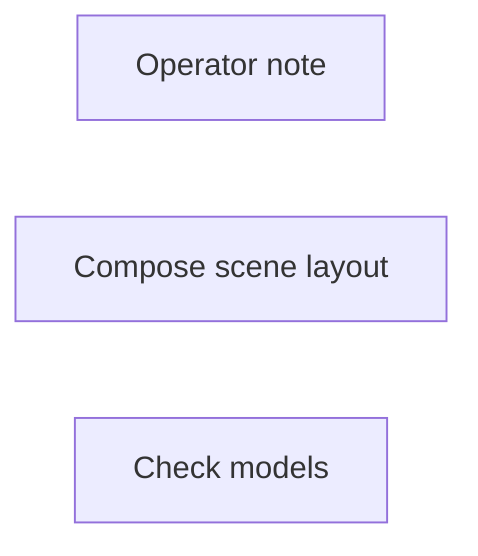

# 3d/set-dressing

**What's on this page**

- **Purpose, occupancy, and models** from the on-canvas Note
- **Graph flow** (groups when the canvas is large)
- **Every node id** on this graph
- **Node parameter reference** for each type, with this graph's values and the other legal choices

**What this enables**

- **Queuing this filename** with known widgets
- **Changing a parameter** with a documented generation effect

**Who this is for:** studio users who loaded `3d/set-dressing` from Apps or Workflows.

> Generated from `workflows/_lab/3d/set-dressing.json`. Do not hand-edit this file. Re-run `bazelisk run //docs:docs`.

## Purpose

Occupancy **none**. Outputs under `${COMFY_OUTPUT_DIR}`. Unload the previous family before Queue.

```text
## 3d/set-dressing

Asset Bible slugs -> one `scene.json` shopping list: where each `.glb` stands, how it is turned, how big, plus one camera and one lighting reference.

A world in this stack is instanced `.glb` assets plus this document, assembled off-line in Blender or a host viewer. This graph prints no mesh and loads no model, so it costs no GPU time and queues beside a running trellis job. This stack mints no gaussian splat and no captured point cloud.

`Compose scene layout` writes `output/scenes/<filename>_NNNNN.json` against `schemas/scene.json`, never `${MODELS_DIR}`. The counter suffix keeps a re-Queue from clobbering the draft you are editing; `overwrite` is the only way to replace a file.

`assets` takes one Asset Bible slug per line, optionally `slug:relative/path.glb`. An unknown slug, a path outside the bible, a `scene_id` that is not lowercase-hyphenated, or a camera part that is not a number leaves the file unwritten and the summary line says why: the App fails soft rather than raising on the canvas.

Print the slugs you list first - `3d/world-elements` for a prop that must match its ground, `3d/hero-from-photos` for a hero asset. The document is a shopping list, and a slug nobody printed shows up in the DCC as an empty row.

Occupancy: none - stop nothing GPU. One GB10 job.
```

## How to Queue

1. `bazelisk run //:manage -- start` so `_lab` is seeded
2. Load **3d/set-dressing** from **Apps** or **Workflows**
3. Read the on-canvas Note, change widgets, Queue

Do not edit raw `_lab` JSON. Save keepers under `_user/`.

## Graph



## Nodes on this graph

| Id | Title | Type | Group |
| --- | --- | --- | --- |
| 1 | Operator note | `Note` | NOTE |
| 2 | Compose scene layout | `EZSceneLayout` | SETTINGS |
| 3 | Check models | `EZModelCheck` | QUALITY |

## Node parameter reference

Every unique node type on this graph. Widgets are in lab JSON order. Choices are ComfyUI v0.43.0 / lab `INPUT_TYPES` - not SD1.5 folklore.

### `Note` - Note

On-canvas operator note (not executed).

!!! warning "Lab notes"

    Every lab graph has one. Purpose, models, sampler, occupancy, run steps.

#### `text`

Type `STRING`.

Markdown-ish operator note.

**How it affects generation:** Does not affect pixels. Read it before Queue.

**This graph:** `## 3d/set-dressing Asset Bible slugs -> one `scene.json` shopping list: where each `.glb` stands, how it is turned, how big, plus one camera and one lighting reference. A world in this stack is insta...`

```text
## 3d/set-dressing

Asset Bible slugs -> one `scene.json` shopping list: where each `.glb` stands, how it is turned, how big, plus one camera and one lighting reference.

A world in this stack is instanced `.glb` assets plus this document, assembled off-line in Blender or a host viewer. This graph prints no mesh and loads no model, so it costs no GPU time and queues beside a running trellis job. This stack mints no gaussian splat and no captured point cloud.

`Compose scene layout` writes `output/scenes/<filename>_NNNNN.json` against `schemas/scene.json`, never `${MODELS_DIR}`. The counter suffix keeps a re-Queue from clobbering the draft you are editing; `overwrite` is the only way to replace a file.

`assets` takes one Asset Bible slug per line, optionally `slug:relative/path.glb`. An unknown slug, a path outside the bible, a `scene_id` that is not lowercase-hyphenated, or a camera part that is not a number leaves the file unwritten and the summary line says why: the App fails soft rather than raising on the canvas.

Print the slugs you list first - `3d/world-elements` for a prop that must match its ground, `3d/hero-from-photos` for a hero asset. The document is a shopping list, and a slug nobody printed shows up in the DCC as an empty row.

Occupancy: none - stop nothing GPU. One GB10 job.
```

### `EZSceneLayout` - Compose 3D scene layout

Write a validated scene.json shopping list of instanced .glb slugs. No mesh bytes, no splat.

!!! warning "Lab notes"

    Second half of 3d/world-elements: one Queue prints the mesh and this document. Writes output/scenes/<filename>_NNNNN.json and never MODELS_DIR. Bad input returns a summary line instead of raising.

| Socket | Dir | Type | What it carries |
| --- | --- | --- | --- |
| `scene` | out | `STRING` | Path of the scene document; empty when the write was refused. |
| `summary` | out | `STRING` | One status line: how many instances landed, or why not. |

#### `scene_id`

Type `STRING`.

Lowercase-hyphenated scene id.

**How it affects generation:** Name the set you are dressing, e.g. lab-world. Anything else refuses the write.

**This graph:** `lab-set`

#### `assets`

Type `STRING`. Range / default: multiline.

One Asset Bible slug per line, optionally slug:relative/path.glb.

**How it affects generation:** Only slugs the Asset Bible already mints; an unknown slug leaves the file unwritten.

**This graph:** `hero-olive-jacket mug-cobalt-chipped`

#### `camera_pos`

Type `STRING`.

Camera position as "x, y, z" in metres.

**How it affects generation:** Blank falls back to the camera default in schemas/scene.json.

**This graph:** `2.1, 1.6, 3.4`

#### `camera_look`

Type `STRING`.

Camera look-at as "x, y, z".

**How it affects generation:** Blank falls back to the schema default.

**This graph:** `0, 1.2, 0`

#### `camera_fov`

Type `INT`. Range / default: 10-120.

Vertical field of view in degrees.

**How it affects generation:** 35 is the authored default.

**This graph:** `35`

#### `hdri`

Type `STRING`.

Lighting reference the DCC loads.

**How it affects generation:** polyhaven:<name> or none.

**This graph:** `none`

#### `filename`

Type `STRING`.

Scene basename under output/scenes/.

**How it affects generation:** The file lands as <filename>_NNNNN.json; the suffix keeps a re-Queue from clobbering.

**This graph:** `set-dressing`

#### `overwrite`

Type `BOOLEAN`. Range / default: false.

Replace an existing scene file.

**How it affects generation:** Off refuses to touch a file that already exists.

**This graph:** `false`

### `EZModelCheck` - Check models

Manual disk check for occupancy + Detail weights. Queue does not run this node.

!!! warning "Lab notes"

    Click Check models (canvas button or App occupancy chip). Reports Ready, or missing files plus the host download command. Not an output node.

#### `status`

Type `STRING`.

Last check result.

**How it affects generation:** JS overwrites after Check models. Queue ignores this node.

**This graph:** `Click Check models. Queue does not run this node.`
