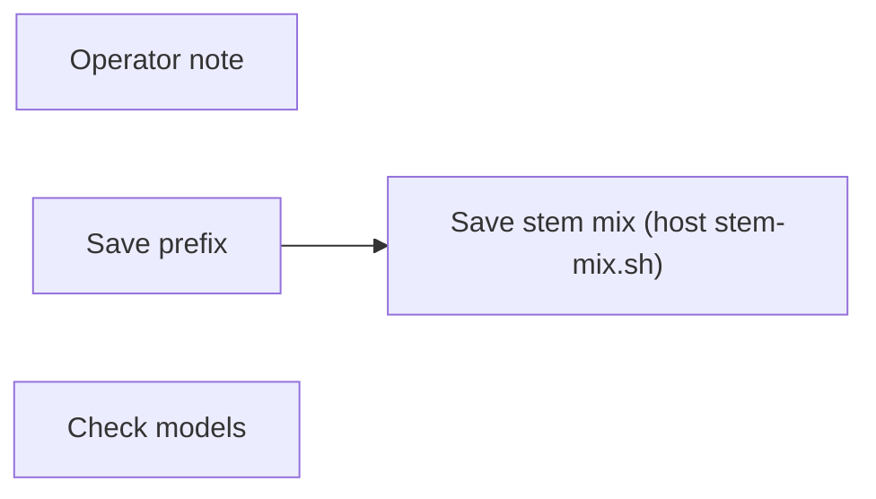

# audio/stem-mix

**What's on this page**

- **Purpose, occupancy, and models** from the on-canvas Note
- **Graph flow** (groups when the canvas is large)
- **Every node id** on this graph
- **Node parameter reference** for each type, with this graph's values and the other legal choices

**What this enables**

- **Queuing this filename** with known widgets
- **Changing a parameter** with a documented generation effect

**Who this is for:** studio users who loaded `audio/stem-mix` from Apps or Workflows.

> Generated from `workflows/_lab/audio/stem-mix.json`. Do not hand-edit this file. Re-run `bazelisk run //docs:docs`.

## Purpose

Occupancy **audio**. Outputs under `${COMFY_OUTPUT_DIR}`. Unload the previous family before Queue.

```text
## audio/stem-mix

Picture-lock stem mix. Occupancy **audio** - stop Klein / Wan / LTX first. ACE-Step
score is a later session if `score: acestep-instrumental`.

This canvas has no audio source: SaveAudio's audio slot stays empty on purpose, so
Queue is not how this App is run and an empty Queue writes nothing. The mix is a host
ffmpeg verb. Run it from a repo shell:

  bazelisk run //:manage -- stem-mix --film go-see --shot 01 --bg PATH [--dx PATH] [--fx PATH] [--mx PATH] [--video PATH]

`--film` and `--shot` are required (the verb stops without them) and `--bg` is the bed
its usage line asks for. The stems are file paths the verb opens, not switches on this
canvas: --bg is the demuxed LTX world bed, --dx is Kokoro / Qwen3-TTS dialogue, --fx is
the optional Templates LTX-2.5 T2A pass (same distilled transformer; not a vendored
subgraph), and --mx is the ACE-Step instrumental. There is no Include DX / FX / MX row
any more - a yes/no box cannot name a path, so those rows could only ever have lied.

The one row the App panel shows, Save prefix, is wired into SaveAudio's filename_prefix
and ships as ez_stem_mix_gosee_01: the film slug and the shot id, lowercase and
path-safe. Keep it matching --film / --shot so the canvas master and the host mix at
films/<slug>/stems/<id>/mix.m4a (mix.mp4 with --video) name the same cut. Duck beds
-15 dB under DX. YouTube loudnorm I=-14.

A2V lock (talking-head): mix DX first, then Templates -> LTX-2.5 A2V freeze. Mouths will
not match (banned lip-sync OSS stays out). Foley V2A LoRA is not in v1.

Do not start Docker. Do not co-resident ACE-Step with LTX.

Occupancy: audio - stop Klein / Wan / LTX session. One GB10 job.
```

## How to Queue

1. `bazelisk run //:manage -- start` so `_lab` is seeded
2. Load **audio/stem-mix** from **Apps** or **Workflows**
3. Read the on-canvas Note, change widgets, Queue

Do not edit raw `_lab` JSON. Save keepers under `_user/`.

## Graph



## Nodes on this graph

| Id | Title | Type | Group |
| --- | --- | --- | --- |
| 1 | Operator note | `Note` | NOTE |
| 2 | Save prefix | `PrimitiveNode` | STEMS |
| 3 | Save stem mix (host stem-mix.sh) | `SaveAudio` | STEMS |
| 4 | Check models | `EZModelCheck` | QUALITY |

## Node parameter reference

Every unique node type on this graph. Widgets are in lab JSON order. Choices are ComfyUI v0.43.0 / lab `INPUT_TYPES` - not SD1.5 folklore.

### `Note` - Note

On-canvas operator note (not executed).

!!! warning "Lab notes"

    Every lab graph has one. Purpose, models, sampler, occupancy, run steps.

#### `text`

Type `STRING`.

Markdown-ish operator note.

**How it affects generation:** Does not affect pixels. Read it before Queue.

**This graph:** `## audio/stem-mix Picture-lock stem mix. Occupancy **audio** - stop Klein / Wan / LTX first. ACE-Step score is a later session if `score: acestep-instrumental`. This canvas has no audio source: SaveA...`

```text
## audio/stem-mix

Picture-lock stem mix. Occupancy **audio** - stop Klein / Wan / LTX first. ACE-Step
score is a later session if `score: acestep-instrumental`.

This canvas has no audio source: SaveAudio's audio slot stays empty on purpose, so
Queue is not how this App is run and an empty Queue writes nothing. The mix is a host
ffmpeg verb. Run it from a repo shell:

  bazelisk run //:manage -- stem-mix --film go-see --shot 01 --bg PATH [--dx PATH] [--fx PATH] [--mx PATH] [--video PATH]

`--film` and `--shot` are required (the verb stops without them) and `--bg` is the bed
its usage line asks for. The stems are file paths the verb opens, not switches on this
canvas: --bg is the demuxed LTX world bed, --dx is Kokoro / Qwen3-TTS dialogue, --fx is
the optional Templates LTX-2.5 T2A pass (same distilled transformer; not a vendored
subgraph), and --mx is the ACE-Step instrumental. There is no Include DX / FX / MX row
any more - a yes/no box cannot name a path, so those rows could only ever have lied.

The one row the App panel shows, Save prefix, is wired into SaveAudio's filename_prefix
and ships as ez_stem_mix_gosee_01: the film slug and the shot id, lowercase and
path-safe. Keep it matching --film / --shot so the canvas master and the host mix at
films/<slug>/stems/<id>/mix.m4a (mix.mp4 with --video) name the same cut. Duck beds
-15 dB under DX. YouTube loudnorm I=-14.

A2V lock (talking-head): mix DX first, then Templates -> LTX-2.5 A2V freeze. Mouths will
not match (banned lip-sync OSS stays out). Foley V2A LoRA is not in v1.

Do not start Docker. Do not co-resident ACE-Step with LTX.

Occupancy: audio - stop Klein / Wan / LTX session. One GB10 job.
```

### `PrimitiveNode` - Primitive

A typed constant (string or float) with seed-style control.

!!! warning "Lab notes"

    Music Duration (FLOAT) and Prompt Forge Context (STRING). widgets[1] is always control_after_generate.

| Socket | Dir | Type | What it carries |
| --- | --- | --- | --- |
| `value` | out | `FLOAT\|STRING` | Wired into duration / context / lyrics. |

#### `value`

Type `FLOAT|STRING`.

The constant.

**How it affects generation:** FLOAT seconds drive ACE latent length. STRING context is bible/research for Enhance.

**This graph:** `ez_stem_mix_gosee_01`

#### `control_after_generate`

Type `COMBO`. Range / default: fixed.

Whether the primitive mutates after Queue.

**How it affects generation:** fixed keeps duration/context pinned.

**This graph:** `fixed`

**Other choices**

| Choice | What it does |
| --- | --- |
| `fixed` | Keep this seed on the next Queue. Lab default for reproducible stills and 5 s prints. |
| `increment` | Add 1 after Queue. Use for a sequence of variations. |
| `decrement` | Subtract 1 after Queue. |
| `randomize` | Draw a new seed after Queue. Exploration only. |

### `SaveAudio` - Save Audio

Write a FLAC/wav master.

!!! warning "Lab notes"

    Music graphs pair this with SaveAudioMP3 and EZAudioMetadata. Stem mix uses ez_stem_mix.

| Socket | Dir | Type | What it carries |
| --- | --- | --- | --- |
| `audio` | in | `AUDIO` | Decoded ACE or mix. |

#### `filename_prefix`

Type `STRING`.

Save stem.

**How it affects generation:** Album tracks use NN - Song Title. Tags come from EZAudioMetadata.

**This graph:** `ez_stem_mix_gosee_01`

### `EZModelCheck` - Check models

Manual disk check for occupancy + Detail weights. Queue does not run this node.

!!! warning "Lab notes"

    Click Check models (canvas button or App occupancy chip). Reports Ready, or missing files plus the host download command. Not an output node.

#### `status`

Type `STRING`.

Last check result.

**How it affects generation:** JS overwrites after Check models. Queue ignores this node.

**This graph:** `Click Check models. Queue does not run this node.`
