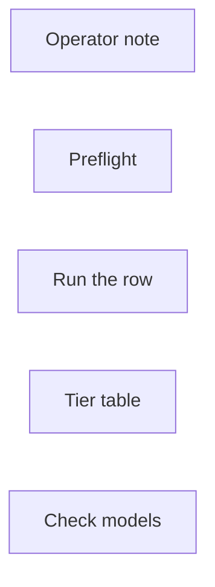

# labs/nvidia/lyra-1

**What's on this page**

- **Purpose, occupancy, and models** from the on-canvas Note
- **Graph flow** (groups when the canvas is large)
- **Every node id** on this graph
- **Node parameter reference** for each type, with this graph's values and the other legal choices

**What this enables**

- **Queuing this filename** with known widgets
- **Changing a parameter** with a documented generation effect

**Who this is for:** studio users who loaded `labs/nvidia/lyra-1` from Apps or Workflows.

> Generated from `workflows/_lab/labs/nvidia/lyra-1.json`. Do not hand-edit this file. Re-run `bazelisk run //docs:docs`.

## Purpose

Occupancy **none**. Outputs under `${COMFY_OUTPUT_DIR}`. Unload the previous family before Queue.

```text
## labs/nvidia/lyra-1

Project Lyra 1.x - Generates a camera-controlled walkthrough video of a 3D-consistent world from one image.

Status: opt-in. Install: git-clone. Artifact: source-build. Arm64: unknown. GB10: unverified. Comfy shape: host-cli.
Input: one image plus a camera trajectory
Output: a walkthrough fly-through video
Licenses: code Apache-2.0. Weights NVIDIA Open Model License. Commercial use permitted.
Footprint: 80 GB VRAM, 100 GB disk. Weights: nvidia/Lyra/lyra_static.pt@0.1, nvidia/Lyra/lyra_dynamic.pt@0.1.
Artifact ref: https://github.com/nv-tlabs/lyra.git
Upstream: https://github.com/nv-tlabs/lyra
Also: https://huggingface.co/nvidia/Lyra
Sources: https://github.com/nv-tlabs/lyra/blob/main/README.md, https://github.com/nv-tlabs/Project-Lyra

Nothing in this graph touches the GPU. The row's work runs outside the Comfy process through the operator CLI, so the App claims no occupancy and stops no heavy job: the one-heavy-job rule is the CLI's to enforce, next to the heavy confirm and the headroom preflight.

Operator verbs (host shell):
  bazelisk run //:manage -- nvidia-lab status
  bazelisk run //:manage -- nvidia-lab plan lyra-1
  bazelisk run //:manage -- nvidia-lab install lyra-1
  bazelisk run //:manage -- nvidia-lab run lyra-1 --input <path> [--params <json>]

Canvas:
1. Preflight prints whether this Spark could run the row today - the catalog row, an aarch64 host, the binary that row's install kind needs, and the artifact ref.
2. Set the input path and the params JSON on the job card in graph view, then Queue to hand the row to the CLI. The card refuses a row whose status is not opt-in before anything runs.
3. The tier table prints all 18 rows with their status and licenses.

Gate notes: nv-tlabs/lyra is the canonical repository; nv-tlabs/Project-Lyra is only the GitHub Pages site (index.html, styles, assets) and holds no code. The code is Apache-2.0 and the weights carry the NVIDIA Open Model License, which permits commercial use. The README states Lyra was tested only on H100 and A100, needs the Cosmos Predict 1 backbone pulled separately, and builds Triton and custom kernels.
Reopen: n/a - installable, but budget a long per-clip run and prove it on GB10 first.
Verify: bazelisk test //tests:bats_nvidia_lab_test

Occupancy: none - stop nothing GPU. One GB10 job.
```

## How to Queue

1. `bazelisk run //:manage -- start` so `_lab` is seeded
2. Load **labs/nvidia/lyra-1** from **Apps** or **Workflows**
3. Read the on-canvas Note, change widgets, Queue

Do not edit raw `_lab` JSON. Save keepers under `_user/`.

## Graph



## Nodes on this graph

| Id | Title | Type | Group |
| --- | --- | --- | --- |
| 1 | Operator note | `Note` | NOTE |
| 2 | Preflight | `EZNvidiaLabPreflight` | SETTINGS |
| 3 | Run the row | `EZNvidiaLabJob` | SETTINGS |
| 4 | Tier table | `EZNvidiaLabCatalog` | SETTINGS |
| 5 | Check models | `EZModelCheck` | QUALITY |

## Node parameter reference

Every unique node type on this graph. Widgets are in lab JSON order. Choices are ComfyUI v0.45.0 / lab `INPUT_TYPES` - not SD1.5 folklore.

### `Note` - Note

On-canvas operator note (not executed).

!!! warning "Lab notes"

    Every lab graph has one. Purpose, models, sampler, occupancy, run steps.

#### `text`

Type `STRING`.

Markdown-ish operator note.

**How it affects generation:** Does not affect pixels. Read it before Queue.

**This graph:** `## labs/nvidia/lyra-1 Project Lyra 1.x - Generates a camera-controlled walkthrough video of a 3D-consistent world from one image. Status: opt-in. Install: git-clone. Artifact: source-build. Arm64: un...`

```text
## labs/nvidia/lyra-1

Project Lyra 1.x - Generates a camera-controlled walkthrough video of a 3D-consistent world from one image.

Status: opt-in. Install: git-clone. Artifact: source-build. Arm64: unknown. GB10: unverified. Comfy shape: host-cli.
Input: one image plus a camera trajectory
Output: a walkthrough fly-through video
Licenses: code Apache-2.0. Weights NVIDIA Open Model License. Commercial use permitted.
Footprint: 80 GB VRAM, 100 GB disk. Weights: nvidia/Lyra/lyra_static.pt@0.1, nvidia/Lyra/lyra_dynamic.pt@0.1.
Artifact ref: https://github.com/nv-tlabs/lyra.git
Upstream: https://github.com/nv-tlabs/lyra
Also: https://huggingface.co/nvidia/Lyra
Sources: https://github.com/nv-tlabs/lyra/blob/main/README.md, https://github.com/nv-tlabs/Project-Lyra

Nothing in this graph touches the GPU. The row's work runs outside the Comfy process through the operator CLI, so the App claims no occupancy and stops no heavy job: the one-heavy-job rule is the CLI's to enforce, next to the heavy confirm and the headroom preflight.

Operator verbs (host shell):
  bazelisk run //:manage -- nvidia-lab status
  bazelisk run //:manage -- nvidia-lab plan lyra-1
  bazelisk run //:manage -- nvidia-lab install lyra-1
  bazelisk run //:manage -- nvidia-lab run lyra-1 --input <path> [--params <json>]

Canvas:
1. Preflight prints whether this Spark could run the row today - the catalog row, an aarch64 host, the binary that row's install kind needs, and the artifact ref.
2. Set the input path and the params JSON on the job card in graph view, then Queue to hand the row to the CLI. The card refuses a row whose status is not opt-in before anything runs.
3. The tier table prints all 18 rows with their status and licenses.

Gate notes: nv-tlabs/lyra is the canonical repository; nv-tlabs/Project-Lyra is only the GitHub Pages site (index.html, styles, assets) and holds no code. The code is Apache-2.0 and the weights carry the NVIDIA Open Model License, which permits commercial use. The README states Lyra was tested only on H100 and A100, needs the Cosmos Predict 1 backbone pulled separately, and builds Triton and custom kernels.
Reopen: n/a - installable, but budget a long per-clip run and prove it on GB10 first.
Verify: bazelisk test //tests:bats_nvidia_lab_test

Occupancy: none - stop nothing GPU. One GB10 job.
```

### `EZNvidiaLabPreflight` - NVIDIA lab preflight

Answer whether one catalog row could run on this Spark today.

!!! warning "Lab notes"

    Category EZ Comfy/NVIDIA Lab. Checks the catalog row exists, the host is aarch64, the binary that row's install verb needs is on PATH (docker for docker-pull, git for git-clone), the artifact ref is shaped like a pull spec or a clone URL, and what upstream says about GB10. There is no network probe: the container has no egress guarantee, so 'reachable' is the shape of the ref. Missing tooling is ok=False plus a reason, never an error. Installs nothing. An unverified GB10 is a note, not a blocker; unsupported is.

| Socket | Dir | Type | What it carries |
| --- | --- | --- | --- |
| `report` | out | `STRING` | Every check with its verdict line and each blocking reason. |
| `ok` | out | `BOOLEAN` | False whenever a reason exists. |

#### `tool_id`

Type `STRING`. Range / default: artifixer.

Catalog row id to check.

**How it affects generation:** kebab-case id from catalog.json. An empty id or one no row carries is a reason, not a crash. The opt-in rows are the only install paths; every other row is a card.

**This graph:** `lyra-1`

### `EZNvidiaLabJob` - NVIDIA lab job

Run one opt-in catalog row through the operator CLI's nvidia-lab verb.

!!! warning "Lab notes"

    Category EZ Comfy/NVIDIA Lab. Refuses a row whose status is not opt-in before anything runs, and refuses an empty input_path or malformed params_json. The CLI (scripts/utilities/nvidia-lab.sh via ./scripts/manage.sh) does the heavy confirm, the headroom preflight, and the occupancy XOR; this node spawns nothing of its own and touches no Compose, restart policy, or memory limit. Exit code and the tail of stdout/stderr come back as the report. The graphs in labs/nvidia leave input_path blank on purpose, so the panel never queues a job with no input.

| Socket | Dir | Type | What it carries |
| --- | --- | --- | --- |
| `report` | out | `STRING` | The argv, the output tails, and a verdict of ok or refused. |
| `ok` | out | `BOOLEAN` | True only when the CLI exited 0. |

#### `tool_id`

Type `STRING`. Range / default: artifixer.

Catalog row id to run.

**How it affects generation:** Must name a row whose status is opt-in; a blocked-license, blocked-platform, or deferred row is refused before the CLI starts.

**This graph:** `lyra-1`

#### `input_path`

Type `STRING`. Range / default: existing file path.

Input file handed to the tool.

**How it affects generation:** The node refuses an empty path or one that is not a readable file. Authored blank in the lab graphs: it is the operator's to type in graph view.

#### `params_json`

Type `STRING`. Range / default: JSON object, lab {}.

Parameters passed through to the CLI.

**How it affects generation:** Multiline JSON box. Malformed JSON is refused with the parser's line and message. Dynamic prompts are off so a brace in the blob is never read as a prompt slot.

**This graph:** `{}`

### `EZNvidiaLabCatalog` - NVIDIA lab catalog

Print every NVIDIA lab row with its status, code license, weights license, and commercial-use verdict.

!!! warning "Lab notes"

    Category EZ Comfy/NVIDIA Lab. Reads the pack's own catalog.json with stdlib json, so a missing or malformed catalog prints the reason instead of failing the Queue. Nothing is installed and nothing is downloaded. An output node: the report shows on the canvas after Queue. A footprint of 0 in the catalog is not a size, it is the pack's way of saying upstream publishes no figure, so the list view prints 'vram not published' rather than 0 GB.

| Socket | Dir | Type | What it carries |
| --- | --- | --- | --- |
| `report` | out | `STRING` | The tier report: one aligned line per row on table, one labelled block per row on list. |

#### `detail`

Type `COMBO`. Range / default: table (lab).

Report shape.

**How it affects generation:** table is one aligned line per row (id, status, code license, weights license, commercial). list adds arm64, GB10, install, artifact, footprint, weights, and graph per row.

**This graph:** `table`

**Other choices**

| Choice | What it does |
| --- | --- |
| `list` | One block per row with arm64, gb10, install, footprint, graph. |
| `table` | One aligned line per row (lab default). |

### `EZModelCheck` - Check models

Manual disk check for occupancy + Detail weights. Queue does not run this node.

!!! warning "Lab notes"

    Click Check models (canvas button or App occupancy chip). Reports Ready, or missing files plus the host download command. Not an output node.

#### `status`

Type `STRING`.

Last check result.

**How it affects generation:** JS overwrites after Check models. Queue ignores this node.

**This graph:** `Click Check models. Queue does not run this node.`
