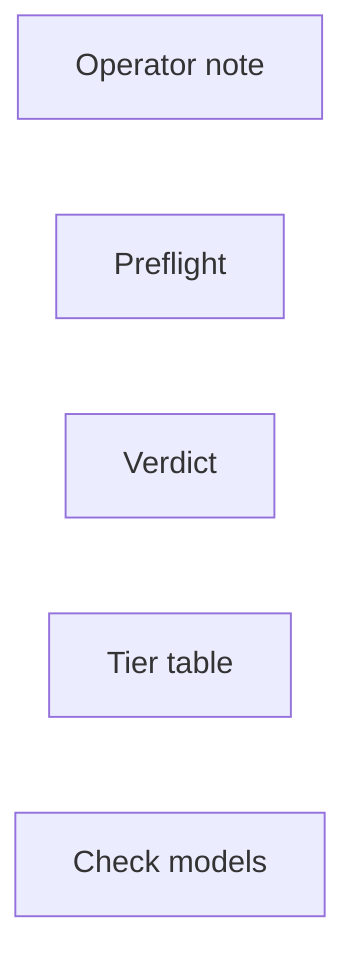

# labs/nvidia/nurec-ga

**What's on this page**

- **Purpose, occupancy, and models** from the on-canvas Note
- **Graph flow** (groups when the canvas is large)
- **Every node id** on this graph
- **Node parameter reference** for each type, with this graph's values and the other legal choices

**What this enables**

- **Queuing this filename** with known widgets
- **Changing a parameter** with a documented generation effect

**Who this is for:** studio users who loaded `labs/nvidia/nurec-ga` from Apps or Workflows.

> Generated from `workflows/_lab/labs/nvidia/nurec-ga.json`. Do not hand-edit this file. Re-run `bazelisk run //docs:docs`.

## Purpose

Occupancy **none**. Outputs under `${COMFY_OUTPUT_DIR}`. Unload the previous family before Queue.

```text
## labs/nvidia/nurec-ga

Omniverse NuRec GA (NGC nre-ga) - Trains and serves Gaussian-Neural 3DGRT and 3DGUT scenes over gRPC and renders novel views from them.

Status: deferred. Install: docker-pull. Artifact: container-image. Arm64: partial. GB10: unverified. Comfy shape: sidecar.
Input: real-world sensor logs or a trained scene
Output: rendered novel views and a USD scene
Licenses: code Apache-2.0 (the open SDK at github.com/NVIDIA/NuRec). Weights not published; the container itself is under the NGC license, whose text is not reachable without an NGC session. Commercial use unknown.
Footprint: 48 GB VRAM, 60 GB disk. Weights: none.
Artifact ref: nvcr.io/nvidia/nre/nurec-ga
Upstream: https://catalog.ngc.nvidia.com/orgs/nvidia/nre/containers/nre-ga
Also: https://docs.nvidia.com/nurec/release-notes/index.html, https://docs.nvidia.com/nurec/basics/hardware.html
Sources: https://docs.nvidia.com/nurec/release-notes/index.html, https://docs.nvidia.com/nurec/basics/hardware.html, https://docs.nvidia.com/nurec/basics/software.html

Nothing in this graph touches the GPU. The row's work runs outside the Comfy process through the operator CLI, so the App claims no occupancy and stops no heavy job: the one-heavy-job rule is the CLI's to enforce, next to the heavy confirm and the headroom preflight.

Operator verbs (host shell):
  bazelisk run //:manage -- nvidia-lab status
  bazelisk run //:manage -- nvidia-lab plan nurec-ga

Canvas:
1. Preflight prints whether this Spark could run the row today - the catalog row, an aarch64 host, the binary that row's install kind needs, and the artifact ref.
2. The verdict card prints the blocking reason and the sentence that would reopen the row.
3. The tier table prints all 18 rows with their status and licenses.

Gate notes: The catalog row the operator linked is the pre-rename name: NVIDIA renamed nre/nre-ga and nre/nre-tools-ga to nre/nurec-ga and nre/nurec-tools-ga. NVIDIA states general Linux aarch64 is not a supported user platform and that Grace-Blackwell enablement reaches you only through the -arm64 or -multiarch tags, which build as non-gating nightly or on-demand jobs and may not exist for a given release. Container security scanning covers x86_64 only, the floor is more than 24 GB with 48 GB recommended on an R580 driver or newer, and the container license text plus any NGC entitlement requirement could not be confirmed from a public page.
Reopen: Re-test when NVIDIA publishes a gated -arm64 or -multiarch tag for a release-branch build and states the container license and entitlement terms in public.
Verify: bazelisk test //tests:bats_nvidia_lab_test

Occupancy: none - stop nothing GPU. One GB10 job.
```

## How to Queue

1. `bazelisk run //:manage -- start` so `_lab` is seeded
2. Load **labs/nvidia/nurec-ga** from **Apps** or **Workflows**
3. Read the on-canvas Note, change widgets, Queue

Do not edit raw `_lab` JSON. Save keepers under `_user/`.

## Graph



## Nodes on this graph

| Id | Title | Type | Group |
| --- | --- | --- | --- |
| 1 | Operator note | `Note` | NOTE |
| 2 | Preflight | `EZNvidiaLabPreflight` | SETTINGS |
| 3 | Verdict | `EZNvidiaLabVerdict` | SETTINGS |
| 4 | Tier table | `EZNvidiaLabCatalog` | SETTINGS |
| 5 | Check models | `EZModelCheck` | QUALITY |

## Node parameter reference

Every unique node type on this graph. Widgets are in lab JSON order. Choices are ComfyUI v0.45.0 / lab `INPUT_TYPES` - not SD1.5 folklore.

### `Note` - Note

On-canvas operator note (not executed).

!!! warning "Lab notes"

    Every lab graph has one. Purpose, models, sampler, occupancy, run steps.

#### `text`

Type `STRING`.

Markdown-ish operator note.

**How it affects generation:** Does not affect pixels. Read it before Queue.

**This graph:** `## labs/nvidia/nurec-ga Omniverse NuRec GA (NGC nre-ga) - Trains and serves Gaussian-Neural 3DGRT and 3DGUT scenes over gRPC and renders novel views from them. Status: deferred. Install: docker-pull....`

```text
## labs/nvidia/nurec-ga

Omniverse NuRec GA (NGC nre-ga) - Trains and serves Gaussian-Neural 3DGRT and 3DGUT scenes over gRPC and renders novel views from them.

Status: deferred. Install: docker-pull. Artifact: container-image. Arm64: partial. GB10: unverified. Comfy shape: sidecar.
Input: real-world sensor logs or a trained scene
Output: rendered novel views and a USD scene
Licenses: code Apache-2.0 (the open SDK at github.com/NVIDIA/NuRec). Weights not published; the container itself is under the NGC license, whose text is not reachable without an NGC session. Commercial use unknown.
Footprint: 48 GB VRAM, 60 GB disk. Weights: none.
Artifact ref: nvcr.io/nvidia/nre/nurec-ga
Upstream: https://catalog.ngc.nvidia.com/orgs/nvidia/nre/containers/nre-ga
Also: https://docs.nvidia.com/nurec/release-notes/index.html, https://docs.nvidia.com/nurec/basics/hardware.html
Sources: https://docs.nvidia.com/nurec/release-notes/index.html, https://docs.nvidia.com/nurec/basics/hardware.html, https://docs.nvidia.com/nurec/basics/software.html

Nothing in this graph touches the GPU. The row's work runs outside the Comfy process through the operator CLI, so the App claims no occupancy and stops no heavy job: the one-heavy-job rule is the CLI's to enforce, next to the heavy confirm and the headroom preflight.

Operator verbs (host shell):
  bazelisk run //:manage -- nvidia-lab status
  bazelisk run //:manage -- nvidia-lab plan nurec-ga

Canvas:
1. Preflight prints whether this Spark could run the row today - the catalog row, an aarch64 host, the binary that row's install kind needs, and the artifact ref.
2. The verdict card prints the blocking reason and the sentence that would reopen the row.
3. The tier table prints all 18 rows with their status and licenses.

Gate notes: The catalog row the operator linked is the pre-rename name: NVIDIA renamed nre/nre-ga and nre/nre-tools-ga to nre/nurec-ga and nre/nurec-tools-ga. NVIDIA states general Linux aarch64 is not a supported user platform and that Grace-Blackwell enablement reaches you only through the -arm64 or -multiarch tags, which build as non-gating nightly or on-demand jobs and may not exist for a given release. Container security scanning covers x86_64 only, the floor is more than 24 GB with 48 GB recommended on an R580 driver or newer, and the container license text plus any NGC entitlement requirement could not be confirmed from a public page.
Reopen: Re-test when NVIDIA publishes a gated -arm64 or -multiarch tag for a release-branch build and states the container license and entitlement terms in public.
Verify: bazelisk test //tests:bats_nvidia_lab_test

Occupancy: none - stop nothing GPU. One GB10 job.
```

### `EZNvidiaLabPreflight` - NVIDIA lab preflight

Answer whether one catalog row could run on this Spark today.

!!! warning "Lab notes"

    Category EZ Comfy/NVIDIA Lab. Checks the catalog row exists, the host is aarch64, the binary that row's install verb needs is on PATH (docker for docker-pull, git for git-clone), the artifact ref is shaped like a pull spec or a clone URL, and what upstream says about GB10. There is no network probe: the container has no egress guarantee, so 'reachable' is the shape of the ref. Missing tooling is ok=False plus a reason, never an error. Installs nothing. An unverified GB10 is a note, not a blocker; unsupported is.

| Socket | Dir | Type | What it carries |
| --- | --- | --- | --- |
| `report` | out | `STRING` | Every check with its verdict line and each blocking reason. |
| `ok` | out | `BOOLEAN` | False whenever a reason exists. |

#### `tool_id`

Type `STRING`. Range / default: artifixer.

Catalog row id to check.

**How it affects generation:** kebab-case id from catalog.json. An empty id or one no row carries is a reason, not a crash. The opt-in rows are the only install paths; every other row is a card.

**This graph:** `nurec-ga`

### `EZNvidiaLabVerdict` - NVIDIA lab verdict

Print why one row is off the install path, the sentence that would reopen it, and the command that re-checks it.

!!! warning "Lab notes"

    Category EZ Comfy/NVIDIA Lab. Reads the catalog only and runs nothing, so a blocked row is answerable on a host that cannot install it. An opt-in row says nothing blocks it. An output node: the verdict shows on the canvas after Queue.

| Socket | Dir | Type | What it carries |
| --- | --- | --- | --- |
| `verdict` | out | `STRING` | The row's gate notes, its reopen line, and its verify command. |

#### `tool_id`

Type `STRING`. Range / default: nurec-ga.

Catalog row id to answer for.

**How it affects generation:** kebab-case id from catalog.json. The lab graphs pin it to the graph's own row; another id prints that row's verdict instead.

**This graph:** `nurec-ga`

### `EZNvidiaLabCatalog` - NVIDIA lab catalog

Print every NVIDIA lab row with its status, code license, weights license, and commercial-use verdict.

!!! warning "Lab notes"

    Category EZ Comfy/NVIDIA Lab. Reads the pack's own catalog.json with stdlib json, so a missing or malformed catalog prints the reason instead of failing the Queue. Nothing is installed and nothing is downloaded. An output node: the report shows on the canvas after Queue. A footprint of 0 in the catalog is not a size, it is the pack's way of saying upstream publishes no figure, so the list view prints 'vram not published' rather than 0 GB.

| Socket | Dir | Type | What it carries |
| --- | --- | --- | --- |
| `report` | out | `STRING` | The tier report: one aligned line per row on table, one labelled block per row on list. |

#### `detail`

Type `COMBO`. Range / default: table (lab).

Report shape.

**How it affects generation:** table is one aligned line per row (id, status, code license, weights license, commercial). list adds arm64, GB10, install, artifact, footprint, weights, and graph per row.

**This graph:** `table`

**Other choices**

| Choice | What it does |
| --- | --- |
| `list` | One block per row with arm64, gb10, install, footprint, graph. |
| `table` | One aligned line per row (lab default). |

### `EZModelCheck` - Check models

Manual disk check for occupancy + Detail weights. Queue does not run this node.

!!! warning "Lab notes"

    Click Check models (canvas button or App occupancy chip). Reports Ready, or missing files plus the host download command. Not an output node.

#### `status`

Type `STRING`.

Last check result.

**How it affects generation:** JS overwrites after Check models. Queue ignores this node.

**This graph:** `Click Check models. Queue does not run this node.`
