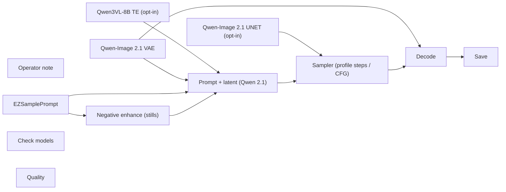

# labs/opt-in/still-qwen-image

**What's on this page**

- **Purpose, occupancy, and models** from the on-canvas Note
- **Graph flow** (groups when the canvas is large)
- **Every node id** on this graph
- **Node parameter reference** for each type, with this graph's values and the other legal choices

**What this enables**

- **Queuing this filename** with known widgets
- **Changing a parameter** with a documented generation effect

**Who this is for:** studio users who loaded `labs/opt-in/still-qwen-image` from Apps or Workflows.

> Generated from `workflows/_lab/labs/opt-in/still-qwen-image.json`. Do not hand-edit this file. Re-run `bazelisk run //docs:docs`.

## Purpose

Occupancy **klein**. Outputs under `${COMFY_OUTPUT_DIR}`. Unload the previous family before Queue.

```text
## labs/opt-in/still-qwen-image

Qwen-Image 2.1 square still. Opt-in only - Qwen RESEARCH LICENSE AGREEMENT, so Klein 4B (photos/still-draft) stays the Apache default still and this graph is never in `download-models`.

Pixels: `Resolution` sets one square side (default 1024, steps of 32). The Qwen 2.1 encoder builds the latent itself from that one number, so this app has **no Format / platform picker** - a wide or tall frame needs a reference image, which is an edit pass and a different app.
Quality: the combo offers only the four Qwen tiers this graph can honor - qwen_image_2.1_int8_convrot.safetensors plus the turbo, NVFP4, and turbo-NVFP4 twins. It rewrites the UNET, the Qwen3VL text encoder, the VAE, steps, and CFG. It never touches pixels. Quality never swaps to Klein, FLUX 3, or any other family: those live in their own apps.
Models: qwen_image_2.1_int8_convrot.safetensors + qwen3vl_8b_int8_convrot.safetensors (CLIP type qwen_image) + qwen_image_2.1_vae_bf16.safetensors.
Pull: `bazelisk run //scripts:run-utility -- download-image run --tier qwen-image` - it auto-includes the `qwen-image-te` text encoder and `qwen-image-vae`. The weights come from `Comfy-Org/Qwen-Image-2.1` on Hugging Face (the NVFP4 twins from the community quantization repos under `--tier qwen-image-nvfp4` / `--tier qwen-image-turbo-nvfp4`).
License: Qwen RESEARCH LICENSE AGREEMENT, not Apache. Research and personal use only; commercial use needs a separate paid Qwen license. Ship the license text plus the NOTICE with the weights, keep "Built with Qwen" in product docs, and do not name a product after Qwen.
Weights missing: click Check models - it names the command, and Queue keeps the authored loaders (nothing swaps in weights you have not pulled).
Prompt enhance is **off** here: this app carries no prompt rewriter, so **Sample prompt** reaches the Qwen3VL encoder exactly as written. **Rewrite negative** stays - it rewrites the negative list so it cannot fight the positive.
Save prefix `ez_still_qwen_image`. Empty of lettering - composite titles later.
Handoff: video/silent/still-to-video-5s, video/av/still-to-video-8s, photos/text-swap.

Occupancy: klein - stop Wan, LTX, podcast, music. One GB10 job.
```

## How to Queue

1. `./scripts/manage.sh start` so `_lab` is seeded
2. Load **labs/opt-in/still-qwen-image** from **Apps** or **Workflows**
3. Read the on-canvas Note, change widgets, Queue

Do not edit raw `_lab` JSON. Save keepers under `_user/`.

## Graph



## Nodes on this graph

| Id | Title | Type | Group |
| --- | --- | --- | --- |
| 1 | Operator note | `Note` | NOTE |
| 2 | Qwen-Image 2.1 UNET (opt-in) | `UNETLoader` | MODEL |
| 3 | Qwen3VL-8B TE (opt-in) | `CLIPLoader` | MODEL |
| 4 | Qwen-Image 2.1 VAE | `VAELoader` | MODEL |
| 5 | EZSamplePrompt | `EZSamplePrompt` | PROMPT |
| 6 | Negative enhance (stills) | `EZNegativePromptEnhance` | PROMPT |
| 7 | Prompt + latent (Qwen 2.1) | `TextEncodeQwenImage21` | SETTINGS |
| 8 | Sampler (profile steps / CFG) | `KSampler` | SETTINGS |
| 9 | Decode | `VAEDecode` | OUTPUT |
| 10 | Save | `SaveImage` | OUTPUT |
| 11 | Check models | `EZModelCheck` | QUALITY |
| 12 | Quality | `EZQuality` | QUALITY |

## Node parameter reference

Every unique node type on this graph. Widgets are in lab JSON order. Choices are ComfyUI v0.43.0 / lab `INPUT_TYPES` - not SD1.5 folklore.

### `Note` - Note

On-canvas operator note (not executed).

!!! warning "Lab notes"

    Every lab graph has one. Purpose, models, sampler, occupancy, run steps.

#### `text`

Type `STRING`.

Markdown-ish operator note.

**How it affects generation:** Does not affect pixels. Read it before Queue.

**This graph:** `## labs/opt-in/still-qwen-image Qwen-Image 2.1 square still. Opt-in only - Qwen RESEARCH LICENSE AGREEMENT, so Klein 4B (photos/still-draft) stays the Apache default still and this graph is never in ...`

```text
## labs/opt-in/still-qwen-image

Qwen-Image 2.1 square still. Opt-in only - Qwen RESEARCH LICENSE AGREEMENT, so Klein 4B (photos/still-draft) stays the Apache default still and this graph is never in `download-models`.

Pixels: `Resolution` sets one square side (default 1024, steps of 32). The Qwen 2.1 encoder builds the latent itself from that one number, so this app has **no Format / platform picker** - a wide or tall frame needs a reference image, which is an edit pass and a different app.
Quality: the combo offers only the four Qwen tiers this graph can honor - qwen_image_2.1_int8_convrot.safetensors plus the turbo, NVFP4, and turbo-NVFP4 twins. It rewrites the UNET, the Qwen3VL text encoder, the VAE, steps, and CFG. It never touches pixels. Quality never swaps to Klein, FLUX 3, or any other family: those live in their own apps.
Models: qwen_image_2.1_int8_convrot.safetensors + qwen3vl_8b_int8_convrot.safetensors (CLIP type qwen_image) + qwen_image_2.1_vae_bf16.safetensors.
Pull: `bazelisk run //scripts:run-utility -- download-image run --tier qwen-image` - it auto-includes the `qwen-image-te` text encoder and `qwen-image-vae`. The weights come from `Comfy-Org/Qwen-Image-2.1` on Hugging Face (the NVFP4 twins from the community quantization repos under `--tier qwen-image-nvfp4` / `--tier qwen-image-turbo-nvfp4`).
License: Qwen RESEARCH LICENSE AGREEMENT, not Apache. Research and personal use only; commercial use needs a separate paid Qwen license. Ship the license text plus the NOTICE with the weights, keep "Built with Qwen" in product docs, and do not name a product after Qwen.
Weights missing: click Check models - it names the command, and Queue keeps the authored loaders (nothing swaps in weights you have not pulled).
Prompt enhance is **off** here: this app carries no prompt rewriter, so **Sample prompt** reaches the Qwen3VL encoder exactly as written. **Rewrite negative** stays - it rewrites the negative list so it cannot fight the positive.
Save prefix `ez_still_qwen_image`. Empty of lettering - composite titles later.
Handoff: video/silent/still-to-video-5s, video/av/still-to-video-8s, photos/text-swap.

Occupancy: klein - stop Wan, LTX, podcast, music. One GB10 job.
```

### `UNETLoader` - Load Diffusion Model

Load a standalone transformer/UNET from diffusion_models/.

!!! warning "Lab notes"

    Lab files: flux-2-klein-4b-fp8.safetensors, wan2.2_ti2v_5B_fp16.safetensors, ltx-2.5-22b-distilled-transformer-comfy-int8-convrot.safetensors. weight_dtype stays default.

| Socket | Dir | Type | What it carries |
| --- | --- | --- | --- |
| `MODEL` | out | `MODEL` | Denoiser weights. |

#### `unet_name`

Type `STRING`.

Checkpoint filename under MODELS_DIR diffusion_models.

**How it affects generation:** Wrong family = Queue error or a melted picture. Lab pins Apache Klein 4B. Klein 9B / FLUX.2-dev are opt-in NC. MiniMax is banned.

**This graph:** `qwen_image_2.1_int8_convrot.safetensors`

#### `weight_dtype`

Type `COMBO`. Range / default: default.

Cast at load.

**How it affects generation:** default keeps the file's dtype (Klein FP8, LTX INT8-convrot, Wan FP16).

**This graph:** `default`

**Other choices**

| Choice | What it does |
| --- | --- |
| `default` | Load weights as stored. Lab UNETLoader always uses this. |
| `fp8_e4m3fn` | Cast to FP8 e4m3fn. Can save memory; may shift Klein/LTX quality. |
| `fp8_e4m3fn_fast` | FP8 e4m3fn with fast optimizations. |
| `fp8_e5m2` | Cast to FP8 e5m2. |

### `CLIPLoader` - Load CLIP

Load a text encoder. The type combo must match the UNET family.

!!! warning "Lab notes"

    Lab types: flux2 (Qwen3-4B), wan (UMT5), ltxv (Gemma4-with-proj). Wrong type is a Queue error, not a bad prompt. MiniMax type is banned.

| Socket | Dir | Type | What it carries |
| --- | --- | --- | --- |
| `CLIP` | out | `CLIP` | Text encoder for CLIPTextEncode / ACE / LTX. |

#### `clip_name`

Type `STRING`.

Filename under text_encoders.

**How it affects generation:** Must match the family (qwen_3_4b, umt5_xxl, gemma4-12b-with-proj).

**This graph:** `qwen3vl_8b_int8_convrot.safetensors`

#### `type`

Type `COMBO`.

CLIPType enum. Picks tokenizer + template.

**How it affects generation:** flux2 wraps Klein strings in a Qwen chat template - do not paste <|im_start|>. wan is UMT5. ltxv is Gemma4-with-proj.

**This graph:** `qwen_image`

**Other choices**

| Choice | What it does |
| --- | --- |
| `flux2` | Klein 4B / Qwen3-4B text encoder. Lab stills. |
| `wan` | Wan 2.2 UMT5-XXL. Lab silent motion. |
| `ltxv` | LTX-2.5 Gemma4-with-proj. Lab AV. |
| `ace` | ACE-Step text encoder. Music graphs use CheckpointLoaderSimple instead. |
| `stable_diffusion` | SD1.x CLIP. Not a lab default. |
| `stable_cascade` | Stable Cascade CLIP. |
| `sd3` | SD3 CLIP stack. |
| `stable_audio` | Stable Audio T5. |
| `mochi` | Mochi T5. |
| `pixart` | PixArt. |
| `cosmos` | Cosmos T5. |
| `lumina2` | Lumina-2 Gemma. |
| `hidream` | HiDream. |
| `chroma` | Chroma. |
| `omnigen2` | OmniGen2. |
| `qwen_image` | Qwen-Image. |
| `hunyuan_image` | Hunyuan image. |
| `ovis` | Ovis. |
| `longcat_image` | LongCat image. Optional stub only. |
| `cogvideox` | CogVideoX T5. |
| `lens` | Lens. |
| `pixeldit` | PixelDit. |
| `ideogram4` | Ideogram. |
| `boogu` | Boogu. |
| `krea2` | Krea. |
| `joyimage` | JoyImage Qwen3-VL. |
| `mage` | Mage. |
| `minimax` | MiniMax. Banned in this studio (US Excluded Territory). Do not pick. |

#### `device`

Type `COMBO`. Range / default: default.

Where to load the encoder.

**How it affects generation:** default uses GPU. cpu is a debug escape hatch.

**This graph:** `default`

**Other choices**

| Choice | What it does |
| --- | --- |
| `default` | Load on the Comfy compute device (GPU). Lab default. |
| `cpu` | Force CPU. Much slower; only for debugging a CLIP load. |

### `VAELoader` - Load VAE

Load the autoencoder that maps pixels <-> latents (and LTX audio).

!!! warning "Lab notes"

    Do not mix families: flux2-vae, wan2.2_vae, ltx-2.5-video-vae-bf16, ltx-2.5-audio-vae-bf16.

| Socket | Dir | Type | What it carries |
| --- | --- | --- | --- |
| `VAE` | out | `VAE` | Encoder/decoder. |

#### `vae_name`

Type `STRING`.

Filename under vae/.

**How it affects generation:** Wrong VAE = color trash or a shape error.

**This graph:** `qwen_image_2.1_vae_bf16.safetensors`

### `EZSamplePrompt` - Sample Prompt

STRING source with a sample-prompt combo plus Custom textarea.

| Socket | Dir | Type | What it carries |
| --- | --- | --- | --- |
| `prompt` | out | `STRING` | Resolved prompt. |

#### `sample`

Type `COMBO`. Range / default: custom.

Sample or Custom.

**How it affects generation:** Custom uses the textarea as typed.

**This graph:** `custom`

#### `prompt`

Type `STRING`.

Custom textarea.

**How it affects generation:** Ignored when a sample is selected.

**This graph:** `A photoreal still of a tropical coastal city rooftop terrace at golden hour, shot on a 50 mm lens. Warm rim light on the railing, palm fronds moving in a sea breeze, hazy skyline behind. Natural skin...`

```text
A photoreal still of a tropical coastal city rooftop terrace at golden hour, shot on a 50 mm lens. Warm rim light on the railing, palm fronds moving in a sea breeze, hazy skyline behind. Natural skin tones, true-to-life texture, no lettering.
```

#### `catalog`

Type `STRING`.

Catalog id (labs/assist/prompt-forge).

**How it affects generation:** Leave as stamped.

**This graph:** `labs/opt-in/still-qwen-image`

### `EZNegativePromptEnhance` - Negative Prompt Enhance

Rewrite a negative CLIP seed against the final positive. Stays on when Rewrite prompt is off.

| Socket | Dir | Type | What it carries |
| --- | --- | --- | --- |
| `positive` | in | `STRING` | Final positive CLIP string (enhance output, Prompt Join, or shot bundle). |
| `prompt` | out | `STRING` | Negative string. |

#### `prompt`

Type `STRING`.

Negative seed (artifacts, not style).

**How it affects generation:** FLUX-family models do not use negatives well. Keep this short; put constraints in the positive.

**This graph:** `game-engine cutscene, Pixar rounded cartoon, illustration, muddy textures, melted geometry, duplicate limbs, watermarks, oversharpen halos, muddy blacks`

```text
game-engine cutscene, Pixar rounded cartoon, illustration, muddy textures, melted geometry, duplicate limbs, watermarks, oversharpen halos, muddy blacks
```

#### `enhance`

Type `BOOLEAN`.

Rewrite negative. App label: Rewrite negative.

**How it affects generation:** Stays on when Rewrite prompt is off. Off skips the LLM; the conflict filter still runs.

**This graph:** `true`

#### `family`

Type `COMBO`.

Which negative family.

**How it affects generation:** Must match the UNET on the canvas.

**This graph:** `klein`

**Other choices**

| Choice | What it does |
| --- | --- |
| `klein` | Klein stills. |
| `wan` | Wan silent. |
| `ltx` | LTX AV. |
| `zimage` | Z-Image Turbo (CFG 1; list is documentation). |
| `longcat` | LongCat-Video. |
| `dreamx` | DreamX-Creator AV. |
| `s2v` | Wan S2V; wav owns speech. |

### `TextEncodeQwenImage21` - Text Encode Qwen Image 2.1

Encode prompt and negative for Qwen-Image 2.1 and build its square latent.

!!! warning "Lab notes"

    Labs opt-in only (labs/opt-in/still-qwen-image). This one node replaces the CLIP boxes plus the empty-latent node: Qwen 2.1 samples from a 64-channel latent at 16x, so nothing else on the graph can size the frame. Resolution is the only pixel control.

| Socket | Dir | Type | What it carries |
| --- | --- | --- | --- |
| `clip` | in | `CLIP` | Qwen3VL-8B text encoder (CLIPLoader type qwen_image). |
| `prompt` | in | `STRING` | Wired from the sample-prompt node so the widget is a preview. |
| `negative_prompt` | in | `STRING` | Wired from Rewrite negative. |
| `vae` | in | `VAE` | Only used to encode reference images; a plain t2i Queue ignores it. |
| `positive` | out | `CONDITIONING` | Positive cond for KSampler. |
| `negative` | out | `CONDITIONING` | Negative cond for KSampler. |
| `latent` | out | `LATENT` | Square 64-channel noise canvas at resolution. |

#### `prompt`

Type `STRING`.

Prompt the Qwen3VL encoder sees.

**How it affects generation:** Plain sentences. Qwen 2.1 renders lettering poorly, so leave titles to a composite pass.

**This graph:** `A photoreal still of a tropical coastal city rooftop terrace at golden hour, shot on a 50 mm lens. Warm rim light on the railing, palm fronds moving in a sea breeze, hazy skyline behind. Natural skin...`

```text
A photoreal still of a tropical coastal city rooftop terrace at golden hour, shot on a 50 mm lens. Warm rim light on the railing, palm fronds moving in a sea breeze, hazy skyline behind. Natural skin tones, true-to-life texture, no lettering.
```

#### `negative_prompt`

Type `STRING`.

Negative list.

**How it affects generation:** Keep the stills negative; Rewrite negative rewrites it against the final positive.

**This graph:** `game-engine cutscene, Pixar rounded cartoon, illustration, muddy textures, melted geometry, duplicate limbs, watermarks, oversharpen halos, muddy blacks`

```text
game-engine cutscene, Pixar rounded cartoon, illustration, muddy textures, melted geometry, duplicate limbs, watermarks, oversharpen halos, muddy blacks
```

#### `resolution`

Type `INT`. Range / default: 32 - 4096, step 32.

Square side in pixels; the latent is resolution // 16.

**How it affects generation:** 1024 is the published default. Multiples of 32 only. One number makes a square frame - there is no aspect-ratio widget on this node.

**This graph:** `1024`

### `KSampler` - KSampler

Denoise a latent for N steps at a CFG, sampler, and scheduler.

!!! warning "Lab notes"

    Distilled Klein is CFG 1.0 / 4 steps / euler / simple. Raising CFG is not a quality knob. Wan 5B uses uni_pc and CFG 5. LTX distilled uses euler / simple / CFG 1.0 / 20 steps. ACE-Step uses 8 steps / CFG 1.0 / euler. TRELLIS uses 12 steps / CFG 7.5 / euler / normal.

| Socket | Dir | Type | What it carries |
| --- | --- | --- | --- |
| `model` | in | `MODEL` | UNET / transformer after any ModelSampling* patch. |
| `positive` | in | `CONDITIONING` | What to include (CLIP / ACE / LTX prompt). |
| `negative` | in | `CONDITIONING` | What to avoid. Distilled Klein ignores this well - put constraints in the positive. |
| `latent_image` | in | `LATENT` | Noise canvas or encoded start image / video / audio latent. |
| `LATENT` | out | `LATENT` | Denoised latent for VAE decode. |

#### `seed`

Type `INT`. Range / default: 0 ... 2^64-1; lab 42.

Random seed for the noise tensor.

**How it affects generation:** Same seed + same graph ~ same picture or clip. Lab locks 42 on smokes so drafts are comparable.

**This graph:** `42`

#### `control_after_generate`

Type `COMBO`. Range / default: fixed (lab).

What happens to seed after Queue.

**How it affects generation:** fixed keeps iteration honest while you change the prompt.

**This graph:** `fixed`

**Other choices**

| Choice | What it does |
| --- | --- |
| `fixed` | Keep this seed on the next Queue. Lab default for reproducible stills and 5 s prints. |
| `increment` | Add 1 after Queue. Use for a sequence of variations. |
| `decrement` | Subtract 1 after Queue. |
| `randomize` | Draw a new seed after Queue. Exploration only. |

#### `steps`

Type `INT`. Range / default: 1-10000; Klein distilled 4; LTX 20; Wan 20; ACE 8; TRELLIS 12.

Denoising iterations.

**How it affects generation:** More steps refine detail with diminishing returns. Distilled Klein is authored at 4 - raising steps is slower, not a quality knob. Do not raise LTX/Wan toward a 90 s denoise.

**This graph:** `50`

#### `cfg`

Type `FLOAT`. Range / default: 0-100; Klein/LTX/ACE 1.0; Wan 5; TRELLIS 7.5.

Classifier-free guidance scale.

**How it affects generation:** Distilled Klein is CFG 1.0 - raising CFG is the wrong quality lever (use the Positive prompt, resolution, or still-hero). Wan silent 5B uses CFG 5. TRELLIS structure uses 7.5. At CFG 1.0 Comfy skips the negative pass.

**This graph:** `3.5`

#### `sampler_name`

Type `COMBO`. Range / default: euler (most lab); uni_pc (Wan).

ODE / SDE algorithm that removes noise.

**How it affects generation:** euler is the lab still/AV/ACE default. uni_pc is the Wan 5B silent default. Ancestral/SDE samplers add extra randomness and weaken seed lock.

**This graph:** `euler`

**Other choices**

| Choice | What it does |
| --- | --- |
| `euler` | First-order ODE. Lab default for Klein, LTX, ACE, and most stills. Fast and stable at CFG 1.0. |
| `euler_cfg_pp` | Euler with CFG++. Rarely needed on distilled Klein (CFG is already 1.0). |
| `euler_ancestral` | Adds ancestral noise each step. More variation; weaker exact seed lock. |
| `euler_ancestral_cfg_pp` | Ancestral Euler with CFG++. |
| `heun` | Second-order Heun. Slower, sometimes smoother; not a lab default. |
| `heunpp2` | Higher-order Heun variant. |
| `exp_heun_2_x0` | Exponential Heun (x0 prediction). |
| `exp_heun_2_x0_sde` | Exponential Heun SDE. Extra stochasticity. |
| `dpm_2` | DPM-Solver-2. Two function evals per step. |
| `dpm_2_ancestral` | Ancestral DPM-2. |
| `lms` | Linear multistep. Older; keep for experiments only. |
| `dpm_fast` | Fast DPM. Coarse, good for previews. |
| `dpm_adaptive` | Adaptive DPM. Step count is a hint, not a hard budget. |
| `dpmpp_2s_ancestral` | DPM++ 2S ancestral. Common SD1.5 pick; not a Klein default. |
| `dpmpp_2s_ancestral_cfg_pp` | DPM++ 2S ancestral with CFG++. |
| `dpmpp_sde` | DPM++ SDE. Stochastic, slower. |
| `dpmpp_sde_gpu` | DPM++ SDE on GPU noise. |
| `dpmpp_2m` | DPM++ 2M. Smooth; often used on SD-family, not distilled Klein. |
| `dpmpp_2m_cfg_pp` | DPM++ 2M with CFG++. |
| `dpmpp_2m_sde` | DPM++ 2M SDE. |
| `dpmpp_2m_sde_gpu` | DPM++ 2M SDE GPU noise. |
| `dpmpp_2m_sde_heun` | DPM++ 2M SDE Heun. |
| `dpmpp_2m_sde_heun_gpu` | DPM++ 2M SDE Heun GPU. |
| `dpmpp_3m_sde` | DPM++ 3M SDE. |
| `dpmpp_3m_sde_gpu` | DPM++ 3M SDE GPU. |
| `ddpm` | Classic DDPM. Slow; do not use on 121-frame LTX. |
| `lcm` | Latent Consistency. Needs an LCM-tuned model; not lab Klein/Wan/LTX. |
| `ipndm` | iPNDM multistep. |
| `ipndm_v` | iPNDM (v-prediction). |
| `deis` | DEIS multistep. |
| `cfgpp_ud10_ab` | CFG++ UD10 AB. Added in ComfyUI 0.35; not a lab default. |
| `res_multistep` | Res multistep. Some turbo recipes. |
| `res_multistep_cfg_pp` | Res multistep CFG++. |
| `res_multistep_ancestral` | Ancestral res multistep. |
| `res_multistep_ancestral_cfg_pp` | Ancestral res multistep CFG++. |
| `gradient_estimation` | Gradient-estimation sampler. |
| `gradient_estimation_cfg_pp` | Gradient-estimation CFG++. |
| `er_sde` | ER-SDE sampler. |
| `seeds_2` | SEEDS-2. |
| `seeds_3` | SEEDS-3. |
| `sa_solver` | SA-Solver. |
| `sa_solver_pece` | SA-Solver PECE. |
| `ddim` | DDIM. Deterministic; not a lab default. |
| `uni_pc` | UniPC. Lab Wan 5B silent graphs use this with CFG 5. |
| `uni_pc_bh2` | UniPC BH2 variant. |

#### `scheduler`

Type `COMBO`. Range / default: simple (most lab); normal (TRELLIS).

How sigmas are spaced across steps.

**How it affects generation:** simple is even spacing and matches distilled Klein / LTX / ACE. normal is the TRELLIS pair. Do not copy karras from an SD1.5 recipe onto Klein.

**This graph:** `simple`

**Other choices**

| Choice | What it does |
| --- | --- |
| `simple` | Even sigma spacing. Lab default for Klein, Wan, LTX, and ACE. |
| `normal` | Linear timestep schedule. TRELLIS structure/texture stages use this. |
| `karras` | Karras sigmas. Often sharper on SD-family; not the lab default. |
| `exponential` | Exponential sigma decay. |
| `sgm_uniform` | SGM uniform. SD3-family default; Wan uses ModelSamplingSD3 shift instead. |
| `ddim_uniform` | Uniform DDIM schedule. |
| `beta` | Beta-distribution timesteps. |
| `linear_quadratic` | Linear then quadratic (Mochi-style). |
| `kl_optimal` | KL-optimal sigma curve. |

#### `denoise`

Type `FLOAT`. Range / default: 0-1; lab 1.0.

Fraction of the latent to replace with denoised signal.

**How it affects generation:** 1.0 is full generation (T2I / T2V / ACE). Values below 1 keep structure from an encoded start image (Klein edit / clay). Lab I2V uses dedicated latent nodes, not denoise<1 on empty noise.

**This graph:** `1.0`

### `VAEDecode` - VAE Decode

Decode image/video latents to pixels.

| Socket | Dir | Type | What it carries |
| --- | --- | --- | --- |
| `samples` | in | `LATENT` | KSampler output (video or still). |
| `vae` | in | `VAE` | Matching family VAE. |
| `IMAGE` | out | `IMAGE` | Frames or still. |

No widgets. Sockets only.

### `SaveImage` - Save Image

Write PNG stills under the output folder.

| Socket | Dir | Type | What it carries |
| --- | --- | --- | --- |
| `images` | in | `IMAGE` | Decoded still or last-frame. |

#### `filename_prefix`

Type `STRING`.

Save prefix.

**How it affects generation:** Lab prefixes start with ez_. Last-frame savers on shot graphs feed concat-shots.

**This graph:** `ez_still_qwen_image`

### `EZModelCheck` - Check models

Manual disk check for occupancy + Quality weights. Queue does not run this node.

!!! warning "Lab notes"

    Click Check models (canvas button or App occupancy chip). Reports Ready, or missing files plus the host download command. Not an output node.

#### `status`

Type `STRING`.

Last check result.

**How it affects generation:** JS overwrites after Check models. Queue ignores this node.

**This graph:** `Click Check models. Queue does not run this node.`

### `EZQuality` - Quality

Per-graph quality combo. JS overlays family-specific sampler, UNET, CLIP, and VAE widgets.

!!! warning "Lab notes"

    Per-graph quality combo. presets.py is the only tier definition and the frontend reads a table generated from it. The combo lists only the tiers this graph's family can honor (presets.tiers_for_family) plus lab and custom, so a Klein graph never offers the FLUX 3 or Qwen-Image rows and a Wan graph never offers a weight swap it has no loader for; a graph with no sampler and no loader to write carries no combo at all. The combo is DERIVED from the widgets, not typed: it names the tier whose owned parameters the widgets actually hold, lab when they match the load-time authored values, custom otherwise, and it re-derives on load, graph change, widget edit, and Queue. custom is not absorbing - putting the owned widgets back on a tier's values re-derives that tier. A tier value that cannot be written (weight not installed, widget not built, a tier outside the family) is a FAILED apply: the combo drops to custom and the caption names what diverged, and the CLI states the refusal on stderr and writes the graph unchanged. Writes resolve per node instance, so every sampler and loader the family reaches in a graph is written. Only parameters the family's tiers own are compared, so a CFG edit on a steps-only family keeps the level. A combo whose node mode is nonzero is ignored. Never --tier quality.

| Socket | Dir | Type | What it carries |
| --- | --- | --- | --- |
| `quality` | out | `STRING` | Selected quality id. |

#### `quality`

Type `COMBO`. Range / default: lab.

Derived from the widgets: the named tier they match, lab for the authored values, custom otherwise.

**How it affects generation:** Named qualities may swap UNET, CLIP, and VAE, per node instance. A tier value that cannot be written is a failed apply, so the combo drops to custom rather than claiming a swap the prompt does not contain. The combo lists only the tiers this family can honor, so a tier that would write no widget here is never offered. Quality does not touch the Width / Height or Duration widgets; the one size effect is Free Commercial Use (<$10M) on Klein stills, where a generic 16:9 / 9:16 Format row retargets to the LTX feeder size (1280x704 / 768x1280). On Klein, high and Free Commercial Use (<$10M) are the same profile (Apache Klein 4B base, 24 steps, CFG 3.5 - never 9B / FLUX.2-dev) and ultra/max swap in Klein 9B or FLUX.2-dev when those files are on disk (FLUX Non-Commercial, not YouTube-ok); ultra/max are not offered on audio and trellis. Wan / LTX / film / audio / trellis tiers set steps only, never CFG or weights, and the trellis ladder writes the three guided stages, leaving the unguided texture stage (CFG 1) on its authored steps. flux3-* need the gated FLUX 3 pull (download-image --tier flux3 / flux3-base / flux3-nvfp4) and are the only tiers that write on a graph pinning FLUX 3 Klein weights.

**This graph:** `lab`

**Other choices**

| Choice | What it does |
| --- | --- |
| `custom` | Widgets match no tier, so they queue as they are. No overlay. |
| `draft` | Faster Apache Klein 4B (NVFP4 if on disk). |
| `lab` | Authored lab widgets. Default. |
| `standard` | Distilled 4B, 8 steps, CFG 1.0. |
| `high` | Klein base 4B + CFG 3.5 when on disk; else extra distilled steps at CFG 1.0. |
| `Free Commercial Use (<$10M)` | Klein 4B stills (never 9B / FLUX.2-dev) + LTX-2.5 steps. Optional SeedVR2 polish on the PNG, not 4K. Wan / audio / trellis are no-ops. |
| `ultra` | Klein 9B distilled when on disk (FLUX Non-Commercial). Else high. |
| `max` | Klein 9B base or FLUX.2-dev when on disk (FLUX Non-Commercial). Else high. |
| `flux3-fast` | FLUX 3 Image Klein distilled INT8 (flux3-image-klein-int8-convrot.safetensors), 16 steps, CFG 1.0. Gated FLUX Kommunity; writes only on a FLUX 3 graph. |
| `flux3-quality` | FLUX 3 Image Klein base INT8 (flux3-image-klein-base-int8-convrot.safetensors), 50 steps, CFG 3.5. Gated FLUX Kommunity; writes only on a FLUX 3 graph. |
| `flux3-nvfp4` | FLUX 3 Image Klein base NVFP4 (flux3-image-klein-base-nvfp4.safetensors), 50 steps, CFG 3.5. Gated FLUX Kommunity; writes only on a FLUX 3 graph. |
