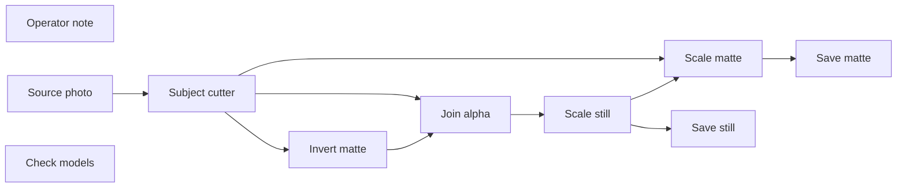

# photos/background-removal

**What's on this page**

- **Purpose, occupancy, and models** from the on-canvas Note
- **Graph flow** (groups when the canvas is large)
- **Every node id** on this graph
- **Node parameter reference** for each type, with this graph's values and the other legal choices

**What this enables**

- **Queuing this filename** with known widgets
- **Changing a parameter** with a documented generation effect

**Who this is for:** studio users who loaded `photos/background-removal` from Apps or Workflows.

> Generated from `workflows/_lab/photos/background-removal.json`. Do not hand-edit this file. Re-run `bazelisk run //docs:docs`.

## Purpose

Occupancy **none**. Outputs under `${COMFY_OUTPUT_DIR}`. Unload the previous family before Queue.

```text
## photos/background-removal

Isolate ONE focal character or object from a photo and keep it as an asset the other
Apps can reuse. Load a photo, pick what fills the space the subject leaves, Queue once.

This is not `photos/cutout`. That graph preps a subject for the image-to-3D printers:
it hands over a grey matte a person can repaint before the mesh stage. This one is the
extractor - it drops an isolated subject into the still Apps, and it is the only cutout
graph in the lane that can write a file with genuine emptiness behind the edge.

EZCutout (first-party, `custom_nodes/ez_image/cutout.py`) runs BiRefNet with its weight
loaded inside the node, so this canvas carries no UNETLoader, CLIPLoader, or VAELoader:
one stack, not two, and no GPU session. It fails soft - no BiRefNet weights, a missing
timm / kornia / einops / transformers, or EZ_CUTOUT=0 passes the photo through untouched
and says which one on the node.

Backdrop is the decision that matters. white, black, grey, green, and blue paint that
colour into the vacated pixels and the still stays fully opaque; green and blue are the
chroma keys a compositor downstream pulls. transparent is the only pick that writes real
alpha, so the PNG is genuinely empty behind the subject. keep original changes no pixel
at all - read the matte with it, never key with it.

Queue writes `ez_bgremove_NNNNN_.png` (the subject on its backdrop) and
`ez_bgremove_matte_NNNNN_.png` (the grey matte that produced it, printed so you can
repair an edge by hand). The alpha is stock ComfyUI: the node's save_mask runs through
Invert Mask into Join Image with Alpha, which is the node that actually writes the fourth
channel, and the joined still is what goes to disk. save_mask carries the real alpha under
transparent and an opaque grid under every painted backdrop, which is what stops a painted
plate from keying itself back out. The join sits ahead of **Upscale**, and one dropdown
drives both prints, so the alpha grows with the still instead of drifting off it.

Dilate grows the keep edge outward and feather softens it, both clamped to 0-32; this
graph ships 6 and 4 so hair, fur, and fur trim survive the cut. Pull both toward 2 for a
hard-edged product shot.

One subject per Queue is the contract. BiRefNet answers with one focal thing, so a group
shot, a cluttered street, or a subject wearing the colour of its wall wants a crop or a
reshoot first.

Handoff: `photos/thumbnail` and `photos/banner-wide` both take the isolated subject as
their start still.

Occupancy: none - stop nothing GPU. One GB10 job.
```

## How to Queue

1. `bazelisk run //:manage -- start` so `_lab` is seeded
2. Load **photos/background-removal** from **Apps** or **Workflows**
3. Read the on-canvas Note, change widgets, Queue

Do not edit raw `_lab` JSON. Save keepers under `_user/`.

## Graph



## Nodes on this graph

| Id | Title | Type | Group |
| --- | --- | --- | --- |
| 1 | Operator note | `Note` | NOTE |
| 2 | Source photo | `LoadImage` | INPUT |
| 3 | Subject cutter | `EZCutout` | SETTINGS |
| 4 | Invert matte | `InvertMask` | SETTINGS |
| 5 | Join alpha | `JoinImageWithAlpha` | SETTINGS |
| 6 | Scale still | `EZImageUpscale` | OUTPUT |
| 7 | Scale matte | `EZImageUpscale` | OUTPUT |
| 8 | Save still | `SaveImage` | OUTPUT |
| 9 | Save matte | `SaveImage` | OUTPUT |
| 10 | Check models | `EZModelCheck` | QUALITY |

## Node parameter reference

Every unique node type on this graph. Widgets are in lab JSON order. Choices are ComfyUI v0.45.0 / lab `INPUT_TYPES` - not SD1.5 folklore.

### `Note` - Note

On-canvas operator note (not executed).

!!! warning "Lab notes"

    Every lab graph has one. Purpose, models, sampler, occupancy, run steps.

#### `text`

Type `STRING`.

Markdown-ish operator note.

**How it affects generation:** Does not affect pixels. Read it before Queue.

**This graph:** `## photos/background-removal Isolate ONE focal character or object from a photo and keep it as an asset the other Apps can reuse. Load a photo, pick what fills the space the subject leaves, Queue onc...`

```text
## photos/background-removal

Isolate ONE focal character or object from a photo and keep it as an asset the other
Apps can reuse. Load a photo, pick what fills the space the subject leaves, Queue once.

This is not `photos/cutout`. That graph preps a subject for the image-to-3D printers:
it hands over a grey matte a person can repaint before the mesh stage. This one is the
extractor - it drops an isolated subject into the still Apps, and it is the only cutout
graph in the lane that can write a file with genuine emptiness behind the edge.

EZCutout (first-party, `custom_nodes/ez_image/cutout.py`) runs BiRefNet with its weight
loaded inside the node, so this canvas carries no UNETLoader, CLIPLoader, or VAELoader:
one stack, not two, and no GPU session. It fails soft - no BiRefNet weights, a missing
timm / kornia / einops / transformers, or EZ_CUTOUT=0 passes the photo through untouched
and says which one on the node.

Backdrop is the decision that matters. white, black, grey, green, and blue paint that
colour into the vacated pixels and the still stays fully opaque; green and blue are the
chroma keys a compositor downstream pulls. transparent is the only pick that writes real
alpha, so the PNG is genuinely empty behind the subject. keep original changes no pixel
at all - read the matte with it, never key with it.

Queue writes `ez_bgremove_NNNNN_.png` (the subject on its backdrop) and
`ez_bgremove_matte_NNNNN_.png` (the grey matte that produced it, printed so you can
repair an edge by hand). The alpha is stock ComfyUI: the node's save_mask runs through
Invert Mask into Join Image with Alpha, which is the node that actually writes the fourth
channel, and the joined still is what goes to disk. save_mask carries the real alpha under
transparent and an opaque grid under every painted backdrop, which is what stops a painted
plate from keying itself back out. The join sits ahead of **Upscale**, and one dropdown
drives both prints, so the alpha grows with the still instead of drifting off it.

Dilate grows the keep edge outward and feather softens it, both clamped to 0-32; this
graph ships 6 and 4 so hair, fur, and fur trim survive the cut. Pull both toward 2 for a
hard-edged product shot.

One subject per Queue is the contract. BiRefNet answers with one focal thing, so a group
shot, a cluttered street, or a subject wearing the colour of its wall wants a crop or a
reshoot first.

Handoff: `photos/thumbnail` and `photos/banner-wide` both take the isolated subject as
their start still.

Occupancy: none - stop nothing GPU. One GB10 job.
```

### `LoadImage` - Load Image

Load a still from Comfy input/ (or upload).

!!! warning "Lab notes"

    I2V / edit graphs default example.png until you pick ez_still_*.png. App Mode shows Start image only when this node is wired.

| Socket | Dir | Type | What it carries |
| --- | --- | --- | --- |
| `IMAGE` | out | `IMAGE` | RGB still. |
| `MASK` | out | `MASK` | Alpha if present. |

#### `image`

Type `STRING`.

Filename in input/.

**How it affects generation:** Point at the Klein still you just saved (ez_still_draft_*.png, ez_character_*.png, first.png).

**This graph:** `example.png`

#### `upload`

Type `COMBO`. Range / default: image.

Upload widget type.

**How it affects generation:** Leave image. This is the choose-file control, not a generation knob.

**This graph:** `image`

### `EZCutout` - Cutout (BiRefNet)

Matte a photo so one character or object can be reused: painted onto a backdrop, or lifted out with real alpha.

!!! warning "Lab notes"

    photos/cutout, ahead of any 3d App, and photos/background-removal, which is the extract-into-an-asset graph. A busy room behind the product teaches the TRELLIS.2 structure stage that the room is part of the object. transparent is the only backdrop that writes genuine emptiness; every painted backdrop keeps save_mask opaque so the plate cannot key itself back out. Fail-soft: no weights, no timm/kornia/einops/transformers, or EZ_CUTOUT=0 passes the input through unchanged with a status line.

| Socket | Dir | Type | What it carries |
| --- | --- | --- | --- |
| `image` | in | `IMAGE` | Photo to matte - the original, not a crop. |
| `image` | out | `IMAGE` | Subject on the chosen backdrop, ready for LoadImage in a 3d App. |
| `matte` | out | `IMAGE` | Grey alpha copy so SaveImage can write the matte. |
| `mask` | out | `MASK` | Raw grown subject mask for anything that composites. (B, H, W) with one frame - the rank a Comfy MASK means. |
| `save_mask` | out | `MASK` | Alpha to feed InvertMask ahead of JoinImageWithAlpha: the real matte under transparent, an opaque grid under any painte... |

#### `backdrop`

Type `COMBO`.

What fills the pixels the subject leaves.

**How it affects generation:** white is the lab default: a clean plate reads as one object. grey is a neutral plate. green (#00B140) and blue (#0047BB) are chroma keys a compositor downstream pulls. transparent leaves the pixels alone so the joined alpha carries the emptiness - the only pick that writes real transparency, and only in a graph that wires save_mask through InvertMask and JoinImageWithAlpha. keep original changes nothing but the matte and mask. An unrecognised name blends as white.

**This graph:** `white`

**Other choices**

| Choice | What it does |
| --- | --- |
| `white` | Paint the vacated pixels white. |
| `black` | Paint them black. |
| `grey` | Paint them mid grey. |
| `green` | Chroma green #00B140. |
| `blue` | Chroma blue #0047BB. |
| `transparent` | Keep the pixels; the alpha carries the emptiness. |
| `keep original` | Keep every pixel; only matte and mask change. |

#### `dilate`

Type `INT`. Range / default: 0-32.

Grow the matte outward by this many pixels.

**How it affects generation:** 2 keeps thin hair and product edges inside the cut.

**This graph:** `6`

#### `feather`

Type `INT`. Range / default: 0-32.

Soften the matte edge over this many pixels.

**How it affects generation:** 2 avoids a hard sticker outline on the cut still.

**This graph:** `4`

### `InvertMask` - Invert Mask

Flip a MASK: out = 1.0 - mask. No widgets.

!!! warning "Lab notes"

    photos/background-removal puts it between EZCutout.save_mask and JoinImageWithAlpha, which keys on the inverse of what you hand it. Keeping the flip in a node named Invert is deliberate - the polarity quirk stays visible on the canvas instead of hiding inside the first-party cut.

| Socket | Dir | Type | What it carries |
| --- | --- | --- | --- |
| `mask` | in | `MASK` | MASK to flip - 1 means keep. |
| `MASK` | out | `MASK` | 1.0 - mask at the same rank and the same HxW. It is arithmetic, so it never repairs a rank the input arrived with. |

No widgets. Sockets only.

### `JoinImageWithAlpha` - Join Image with Alpha

Attach a MASK as the alpha channel of an IMAGE, returning a 4-channel tensor. No widgets.

!!! warning "Lab notes"

    photos/background-removal, ahead of the EZImageUpscale rung so one Upscale pick scales RGB and alpha together. It computes alpha = 1.0 - mask, so feed it an InvertMask output, not the matte directly, and it bilinear-resizes the mask to the image's own size, so a matte can never arrive at the wrong HxW. Stock SaveImage has no mask input at the pinned tag - the (H, W, 4) tensor is what makes Pillow write RGBA. At that same tag it opens with batch_size = max(len(image), len(alpha)) and repeats both inputs up to that batch, so an alpha without a frame dim inflates the batch and the file count: a (H, W) grid is read as H frames, the one cut tiles H times, and SaveImage writes a PNG per entry. Hand it a (B, H, W) MASK with one frame - which is what EZCutout's sockets are.

| Socket | Dir | Type | What it carries |
| --- | --- | --- | --- |
| `image` | in | `IMAGE` | RGB still that carries the alpha. |
| `alpha` | in | `MASK` | Inverted matte (1 = transparent) as (B, H, W) with one frame. Resized to image HxW by this node. |
| `IMAGE` | out | `IMAGE` | 4-channel tensor. SaveImage writes it as RGBA. |

No widgets. Sockets only.

### `EZImageUpscale` - Upscale still

Optional lanczos upscale after a still decode. none passes the tensor through.

!!! warning "Lab notes"

    Wired before SaveImage on stills, creator stills, and DCC still plates. One App dropdown drives every output.

| Socket | Dir | Type | What it carries |
| --- | --- | --- | --- |
| `image` | in | `IMAGE` | Decoded still. |
| `IMAGE` | out | `IMAGE` | Possibly upscaled still. |
| `upscale` | out | `STRING` | Combo id for additional EZImageUpscale nodes. |

#### `upscale`

Type `COMBO`. Range / default: none / 2x / 4x / 4K.

Upscale mode.

**How it affects generation:** none is a passthrough. 2x and 4x are lanczos. 4K fits the still in a 3840x2160 box (portrait 2160x3840). No extra weights.

**This graph (all 2 instances):** `none`

**Other choices**

| Choice | What it does |
| --- | --- |
| `none` | Pass through. |
| `2x` | Double pixels. |
| `4x` | Quadruple pixels. |
| `4K` | Fit in a 4K box. |

### `SaveImage` - Save Image

Write PNG stills under the output folder.

| Socket | Dir | Type | What it carries |
| --- | --- | --- | --- |
| `images` | in | `IMAGE` | Decoded still or last-frame. |

#### `filename_prefix`

Type `STRING`.

Save prefix.

**How it affects generation:** Lab prefixes start with ez_. Last-frame savers on shot graphs feed concat-shots.

| Instance | Value |
| --- | --- |
| Save still | `ez_bgremove` |
| Save matte | `ez_bgremove_matte` |

### `EZModelCheck` - Check models

Manual disk check for occupancy + Detail weights. Queue does not run this node.

!!! warning "Lab notes"

    Click Check models (canvas button or App occupancy chip). Reports Ready, or missing files plus the host download command. Not an output node.

#### `status`

Type `STRING`.

Last check result.

**How it affects generation:** JS overwrites after Check models. Queue ignores this node.

**This graph:** `Click Check models. Queue does not run this node.`
