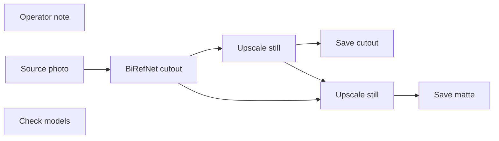

# photos/cutout

**What's on this page**

- **Purpose, occupancy, and models** from the on-canvas Note
- **Graph flow** (groups when the canvas is large)
- **Every node id** on this graph
- **Node parameter reference** for each type, with this graph's values and the other legal choices

**What this enables**

- **Queuing this filename** with known widgets
- **Changing a parameter** with a documented generation effect

**Who this is for:** studio users who loaded `photos/cutout` from Apps or Workflows.

> Generated from `workflows/_lab/photos/cutout.json`. Do not hand-edit this file. Re-run `bazelisk run //docs:docs`.

## Purpose

Occupancy **none**. Outputs under `${COMFY_OUTPUT_DIR}`. Unload the previous family before Queue.

```text
## photos/cutout

Background removal for image-to-3D. Load a photo of **one** character or object and
this graph cuts it out of its backdrop, so the mesh printer downstream is handed a
clean subject instead of a subject welded to a living room.

EZCutout (first-party, `custom_nodes/ez_image/cutout.py`) runs BiRefNet with its weight
loaded inside the node and fails soft: no weight, a missing dependency, or EZ_CUTOUT=0
passes the photo through untouched and says so on the node. Queue writes
`ez_cutout_NNNNN_.png` (the subject over the Backdrop you picked, white by default) and
`ez_cutout_matte_NNNNN_.png` (the grey matte that produced it), so a matte you distrust
can be repainted by hand and fed back in. The node's MASK slot is there when you want to
send the raw alpha somewhere else.

Backdrop is white, black, or keep original. Dilate grows the keep edge outward and
feather softens it; the node clamps both to 0-32. This graph ships dilate 6 and feather
4 so hair, fur, and fur trim survive the cut - drop toward 2 for a hard-edged product.

There is no UNETLoader, CLIPLoader, or VAELoader in this graph on purpose. The node owns
its own weight, this is a light pre-pass, and a loader here would make it a two-stack
App.

One subject per Queue. A busy scene, a mirror, a window full of glass, or a subject the
same tone as its backdrop is where a matte goes wrong; crop or reshoot first.

Handoff: `photos/multi-view` for the other cameras on this same subject, then
`3d/hero-from-photos` for the mesh.

Occupancy: none - stop nothing GPU. One GB10 job.
```

## How to Queue

1. `bazelisk run //:manage -- start` so `_lab` is seeded
2. Load **photos/cutout** from **Apps** or **Workflows**
3. Read the on-canvas Note, change widgets, Queue

Do not edit raw `_lab` JSON. Save keepers under `_user/`.

## Graph



## Nodes on this graph

| Id | Title | Type | Group |
| --- | --- | --- | --- |
| 1 | Operator note | `Note` | NOTE |
| 2 | Source photo | `LoadImage` | INPUT |
| 3 | BiRefNet cutout | `EZCutout` | SETTINGS |
| 4 | Save cutout | `SaveImage` | OUTPUT |
| 5 | Save matte | `SaveImage` | OUTPUT |
| 6 | Upscale still | `EZImageUpscale` | OUTPUT |
| 7 | Upscale still | `EZImageUpscale` | OUTPUT |
| 8 | Check models | `EZModelCheck` | QUALITY |

## Node parameter reference

Every unique node type on this graph. Widgets are in lab JSON order. Choices are ComfyUI v0.43.0 / lab `INPUT_TYPES` - not SD1.5 folklore.

### `Note` - Note

On-canvas operator note (not executed).

!!! warning "Lab notes"

    Every lab graph has one. Purpose, models, sampler, occupancy, run steps.

#### `text`

Type `STRING`.

Markdown-ish operator note.

**How it affects generation:** Does not affect pixels. Read it before Queue.

**This graph:** `## photos/cutout Background removal for image-to-3D. Load a photo of **one** character or object and this graph cuts it out of its backdrop, so the mesh printer downstream is handed a clean subject i...`

```text
## photos/cutout

Background removal for image-to-3D. Load a photo of **one** character or object and
this graph cuts it out of its backdrop, so the mesh printer downstream is handed a
clean subject instead of a subject welded to a living room.

EZCutout (first-party, `custom_nodes/ez_image/cutout.py`) runs BiRefNet with its weight
loaded inside the node and fails soft: no weight, a missing dependency, or EZ_CUTOUT=0
passes the photo through untouched and says so on the node. Queue writes
`ez_cutout_NNNNN_.png` (the subject over the Backdrop you picked, white by default) and
`ez_cutout_matte_NNNNN_.png` (the grey matte that produced it), so a matte you distrust
can be repainted by hand and fed back in. The node's MASK slot is there when you want to
send the raw alpha somewhere else.

Backdrop is white, black, or keep original. Dilate grows the keep edge outward and
feather softens it; the node clamps both to 0-32. This graph ships dilate 6 and feather
4 so hair, fur, and fur trim survive the cut - drop toward 2 for a hard-edged product.

There is no UNETLoader, CLIPLoader, or VAELoader in this graph on purpose. The node owns
its own weight, this is a light pre-pass, and a loader here would make it a two-stack
App.

One subject per Queue. A busy scene, a mirror, a window full of glass, or a subject the
same tone as its backdrop is where a matte goes wrong; crop or reshoot first.

Handoff: `photos/multi-view` for the other cameras on this same subject, then
`3d/hero-from-photos` for the mesh.

Occupancy: none - stop nothing GPU. One GB10 job.
```

### `LoadImage` - Load Image

Load a still from Comfy input/ (or upload).

!!! warning "Lab notes"

    I2V / edit graphs default example.png until you pick ez_still_*.png. App Mode shows Start image only when this node is wired.

| Socket | Dir | Type | What it carries |
| --- | --- | --- | --- |
| `IMAGE` | out | `IMAGE` | RGB still. |
| `MASK` | out | `MASK` | Alpha if present. |

#### `image`

Type `STRING`.

Filename in input/.

**How it affects generation:** Point at the Klein still you just saved (ez_still_draft_*.png, ez_character_*.png, first.png).

**This graph:** `example.png`

#### `upload`

Type `COMBO`. Range / default: image.

Upload widget type.

**How it affects generation:** Leave image. This is the choose-file control, not a generation knob.

**This graph:** `image`

### `EZCutout` - Cutout (BiRefNet)

Matte a photo so one character or object can be turned into a 3D model.

!!! warning "Lab notes"

    photos/cutout, ahead of any 3d App. A busy room behind the product teaches the TRELLIS.2 structure stage that the room is part of the object. Fail-soft: no weights, no timm/kornia/einops/transformers, or EZ_CUTOUT=0 passes the input through unchanged with a status line.

| Socket | Dir | Type | What it carries |
| --- | --- | --- | --- |
| `image` | in | `IMAGE` | Photo to matte - the original, not a crop. |
| `image` | out | `IMAGE` | Subject on the chosen backdrop, ready for LoadImage in a 3d App. |
| `matte` | out | `IMAGE` | Grey alpha copy so SaveImage can write the matte. |
| `mask` | out | `MASK` | Subject mask for anything that composites. |

#### `backdrop`

Type `COMBO`.

What fills the pixels the subject leaves.

**How it affects generation:** white is the lab default: a clean plate reads as one object. keep original changes nothing but the matte and mask.

**This graph:** `white`

**Other choices**

| Choice | What it does |
| --- | --- |
| `white` | Paint the vacated pixels white. |
| `black` | Paint them black. |
| `keep original` | Keep every pixel; only matte and mask change. |

#### `dilate`

Type `INT`. Range / default: 0-32.

Grow the matte outward by this many pixels.

**How it affects generation:** 2 keeps thin hair and product edges inside the cut.

**This graph:** `6`

#### `feather`

Type `INT`. Range / default: 0-32.

Soften the matte edge over this many pixels.

**How it affects generation:** 2 avoids a hard sticker outline on the cut still.

**This graph:** `4`

### `SaveImage` - Save Image

Write PNG stills under the output folder.

| Socket | Dir | Type | What it carries |
| --- | --- | --- | --- |
| `images` | in | `IMAGE` | Decoded still or last-frame. |

#### `filename_prefix`

Type `STRING`.

Save prefix.

**How it affects generation:** Lab prefixes start with ez_. Last-frame savers on shot graphs feed concat-shots.

| Instance | Value |
| --- | --- |
| Save cutout | `ez_cutout` |
| Save matte | `ez_cutout_matte` |

### `EZImageUpscale` - Upscale still

Optional lanczos upscale after a still decode. none passes the tensor through.

!!! warning "Lab notes"

    Wired before SaveImage on stills, creator stills, and DCC still plates. One App dropdown drives every output.

| Socket | Dir | Type | What it carries |
| --- | --- | --- | --- |
| `image` | in | `IMAGE` | Decoded still. |
| `IMAGE` | out | `IMAGE` | Possibly upscaled still. |
| `upscale` | out | `STRING` | Combo id for additional EZImageUpscale nodes. |

#### `upscale`

Type `COMBO`. Range / default: none / 2x / 4x / 4K.

Upscale mode.

**How it affects generation:** none is a passthrough. 2x and 4x are lanczos. 4K fits the still in a 3840x2160 box (portrait 2160x3840). No extra weights.

**This graph (all 2 instances):** `none`

**Other choices**

| Choice | What it does |
| --- | --- |
| `none` | Pass through. |
| `2x` | Double pixels. |
| `4x` | Quadruple pixels. |
| `4K` | Fit in a 4K box. |

### `EZModelCheck` - Check models

Manual disk check for occupancy + Quality weights. Queue does not run this node.

!!! warning "Lab notes"

    Click Check models (canvas button or App occupancy chip). Reports Ready, or missing files plus the host download command. Not an output node.

#### `status`

Type `STRING`.

Last check result.

**How it affects generation:** JS overwrites after Check models. Queue ignores this node.

**This graph:** `Click Check models. Queue does not run this node.`
