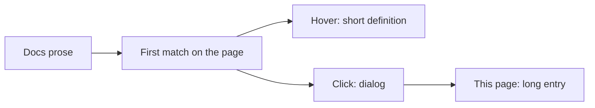

# Glossary

**What's on this page**

- **How a dotted word works** - hover, click, the dialog, and the eight categories
- **All terms** - the long entries, generated from one JSON file
- **Related** - the pages that teach what these words describe

**What this enables**

- **Looking up** Klein, Wan, LTX, `--tier`, Queue, latent, and headroom without leaving the page
- **Teaching** vocabulary once so Create and Operate pages can stay task-focused
- **Reading** any docs page and getting a hover definition on first use of a term
- **Editing** one file to add or rename a term everywhere at once

This is the dictionary, not the course. If you are new to the stack, start at
[How the studio works](learn/index.md) and come back here when a word stops you. Every
entry below is generated from a single JSON file, so the wording you read here is the same
wording that pops up in the hover bubble on any other page.

---

## How a dotted word works

<Callout type="info" title="Dotted words open a definition">
  Across the docs, the **first** time a glossary term appears on a page it is underlined with dots.

  - **Hover** (or keyboard focus) to read the short definition
  - **Click** or press ++enter++ / ++space++ to open the dialog
  - **Open full glossary entry** jumps here
  - ++esc++ or the backdrop closes the dialog

  Terms inside code, headings, and links stay plain so copy-paste and navigation do not fight the modal.

  Categories below are Models, Modalities, Studio, Downloads, Hardware and safety, Film, Audio, then Licenses.
</Callout>

---

## All terms

Add or change a term in `includes/glossary.json` (unique `id` and aliases); the hover bubble
and this page both read from it. Conventions:
[Conventions](project-conventions.md).

<GlossaryBody />

---

## Related

- **Start here instead** - [How the studio works](learn/index.md)
- **The canvas vocabulary** - [ComfyUI basics](learn/comfyui.md)
- **The model vocabulary** - [Klein, Wan, and LTX](learn/pipeline.md)
- **Then install** - [Getting Started](getting-started.md)
