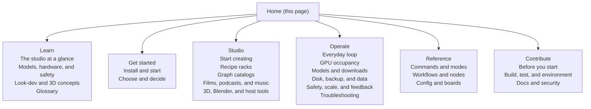
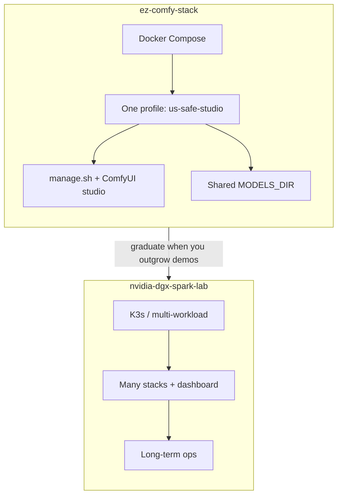
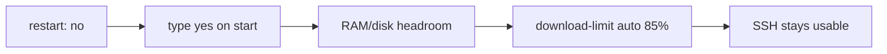

# Home

**What's on this page**

- **Choose a path** - five cards that send you to the right page now
- **Documentation map** - the seven tabs and the groups inside each one
- **What this stack is** - the demo scope, and when to graduate to the lab
- **Default stack** - models, ports, host paths, and the memory limit
- **Safety first** - the four SSH-safe guards and why they exist
- **Related** - the next page from the front door

**What this enables**

- **Finding** the right page in one screen instead of scrolling a dump
- **Starting** in the tab that matches your job, not the one you guessed
- **Spinning up** a **US-safe local studio** (Klein 4B + Wan 2.2 + LTX-2.5) on one Spark
- **Knowing** which defaults keep SSH usable before you change anything

**Who this is for:** first-time visitors, and anyone who lost their place in the docs.

This is the front door of **ez-comfy-stack**: ComfyUI in Docker on **one** NVIDIA DGX Spark
(GB10), tuned for US-safe local work. Read the cards below, pick the one that matches why
you opened this page, and follow it. Come back here when you want the map of what else
exists.

---

## Choose a path

<Cards>
  <Card title="New to the studio">
    ---

    What ComfyUI, Klein, Wan, LTX, latents, and Queue mean - then a glossary dialog on dotted terms.

    [How the studio works](learn/index.md)
  </Card>
  <Card title="First install">
    ---

    Clone -> setup -> doctor -> download -> start (type **yes**) -> Queue a still -> stop.

    [Getting Started](getting-started.md)
  </Card>
  <Card title="Make something">
    ---

    Still -> silent 5 s -> AV 8 s, or pick a thumbnail / GIF / 90s film from the catalog.

    [The still-to-motion-to-AV pipeline](visual-generative-ai.md)
  </Card>
  <Card title="Something broke">
    ---

    `doctor` first. Missing Models, LTX 720, Kitchen fallback, stuck downloads.

    [Troubleshooting](troubleshooting.md)
  </Card>
  <Card title="Quick reference">
    ---

    Stop, update this branch, start, download a pack, or free disk. Commands you can copy.

    [Quick reference](operate/quick-reference.md)
  </Card>
</Cards>

---

## Documentation map

The sidebar has seven tabs. Each tab holds a few short groups, and the pages inside a group
read in order, so the sidebar is the course outline.

| Tab | Groups | Open it when |
| --- | --- | --- |
| **Home** | this page | You want the map and a starting point |
| **Learn** | The studio at a glance - Models, hardware, and safety - Look-dev and 3D concepts - Glossary | You want the ideas before you touch widgets |
| **Get started** | Install and start - Choose and decide | You are installing, or deciding what to pull |
| **Studio** | Start creating - Recipe racks - Graph catalogs - Films, podcasts, and music - 3D, Blender, and host tools | You are making media in the browser |
| **Operate** | Everyday loop - GPU occupancy - Models and downloads - Disk, backup, and data - Safety, scale, and feedback - Troubleshooting | You run the box day to day, or something broke |
| **Reference** | Commands and modes - Workflows and nodes - Config and boards | You need the exact flag, graph, or schema |
| **Contribute** | Before you start - Build, test, and environment - Docs and security | You are landing changes in the repo |

Two shortcuts people look for first:

| When | Read |
| --- | --- |
| **What is this?** | [How the studio works](learn/index.md) - [Glossary](glossary.md) |
| **This repo or the lab?** | [This stack or nvidia-dgx-spark-lab](start/when-to-use-vs-spark-lab.md) |
| **First run** | [Getting Started](getting-started.md) - [FAQ](start/faq.md) |
| **Licenses before a 30 GB pull** | [Model licenses](licenses.md) |
| **Still -> silent 5 s -> AV 8 s** | [The still-to-motion-to-AV pipeline](visual-generative-ai.md) |
| **Something broke** | [Troubleshooting](troubleshooting.md) |
| **Exact CLI / widgets** | [manage.sh reference](manage-cli.md) - [Workflow details](create/workflows-index.md) |
| **Contributing** | [Conventions](project-conventions.md) - [Contributing](contribute/contributing.md) |

---

## What this stack is

This is a **sample / demo** repository for **Visual Generative AI** on a **single NVIDIA
DGX Spark (GB10)**. It is deliberately smaller than
[nvidia-dgx-spark-lab](https://github.com/toxicoder/nvidia-dgx-spark-lab): Docker Compose
instead of K3s, one unified profile instead of a full lab.

Long-term multi-workload operations should use the full lab project. Use
**ez-comfy-stack** when you want faster experimentation -
[This stack or nvidia-dgx-spark-lab](start/when-to-use-vs-spark-lab.md).

---

## Default stack

| Item | Value |
| --- | --- |
| Runtime | ComfyUI (Docker) |
| Pipeline | **studio** - Klein 4B still -> Wan 2.2 5 s silent -> LTX-2.5 AV ([licenses](licenses.md)) |
| Image tier | **fast** - FLUX.2 Klein 4B distilled FP8 (Apache) |
| Wan tier | **5b** - Wan 2.2 TI2V-5B (Apache, silent) |
| LTX tier | **2.5** - LTX-2.5 distilled INT8-convrot (Community License, gated) |
| Models | host `${MODELS_DIR}` (default `/mnt/models`) |
| Outputs | host `${COMFY_OUTPUT_DIR}` (default `/mnt/comfy-output`) |
| UI | port **`${COMFY_PORT}`** (default **8188**) |
| Memory limit | **90g** (host headroom reserved for SSH) |

Klein 9B and FLUX.2-dev are **opt-in FLUX Non-Commercial** packs (`download-image --tier 9b`
/ `flux2-dev`), not defaults and not YouTube-ok. Nunchaku 9B and MiniMax H3 stay banned.
Session variables and port-forward copy-paste live on [Getting Started](getting-started.md).
Opt-in audio: [Local podcast](podcast.md) and [Local music](music.md) (not part of
`download-models`).

---

## Safety first

<Callout type="warning" title="Remote Spark rules">
  These defaults protect SSH recoverability on a remotely managed host. Do not weaken them for demos.
</Callout>

| Guard | Behavior |
| --- | --- |
| **No auto-start** | Compose `restart: "no"` after reboot |
| **Heavy confirmation** | Type `yes` on `start` |
| **Headroom preflight** | Free host RAM/disk checked before start |
| **Download throttle** | `download-limit auto` = **85%** of measured Mbps, cached 24h (when HTB works) |

Why those exist: [Hardware, memory, and safety](learn/hardware.md). Operator details:
[Reboot safety](reboot-safety.md) - [Download limit](download-limit.md).

---

## Related

Start at the top of the Learn tab and work down; each page names what comes after it.

- **Understand the studio** - [How the studio works](learn/index.md)
- **Learn the canvas** - [ComfyUI basics](learn/comfyui.md)
- **Install and run it** - [Getting Started](getting-started.md)
- **Make your first clip** - [The still-to-motion-to-AV pipeline](visual-generative-ai.md)
- **Look terms up** - [Glossary](glossary.md)
