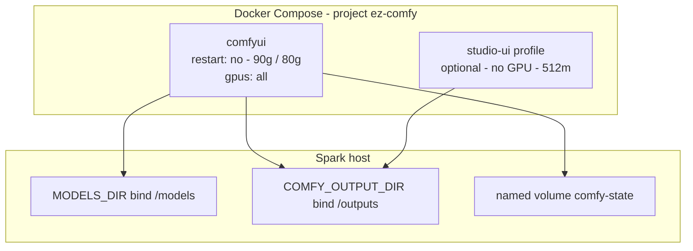
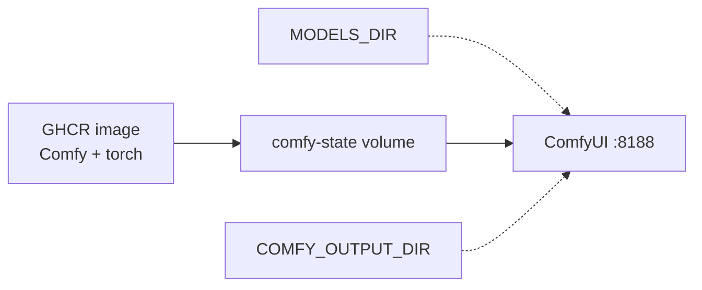
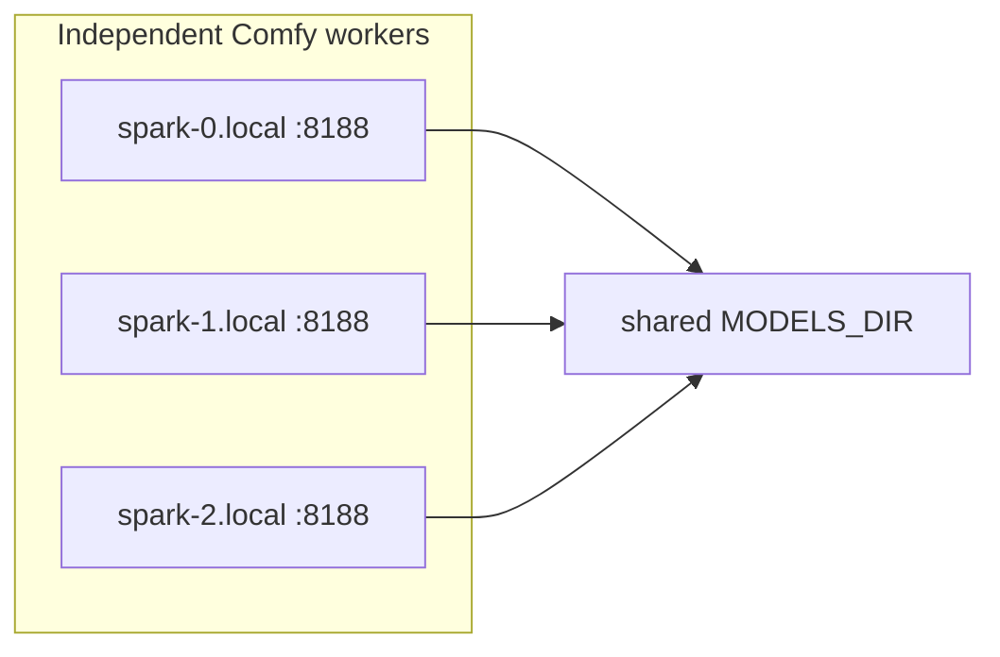

# Architecture

**What's on this page**

- **Compose services** - `comfyui` plus the optional `studio-ui` profile
- **Three stores** - GHCR image vs `${MODELS_DIR}` vs `comfy-state`
- **One heavy GPU job** - pointer to the occupancy rule
- **Host sidecars vs Compose** - what is a container and what is not
- **Spark farm** - independent workers sharing one `${MODELS_DIR}`
- **Related** - the operator and reference pages

**What this enables**

- **Naming** what `start` / `stop` / `cleanup` actually touch
- **Keeping** SSH-safe defaults (`restart: "no"`, 90g/80g, headroom)
- **Telling** a Compose service from a host sidecar before you file a bug
- **Knowing** when to stay on this Compose demo vs [nvidia-dgx-spark-lab](https://github.com/toxicoder/nvidia-dgx-spark-lab)

**Who this is for:** operators who want the box explained, and contributors about to touch
compose or the entrypoint.

This is a **sample Compose studio** on one NVIDIA DGX Spark (GB10). It is not K3s and not
multi-node NCCL. Bazelisk is the contributor test/lint/docs graph, not a cluster control
plane. Graduate to the lab when you outgrow a demo:
[This stack or nvidia-dgx-spark-lab](../start/when-to-use-vs-spark-lab.md).

```bash
export SPARK_HOST="${SPARK_HOST:-127.0.0.1}"
export SPARK_USER="${SPARK_USER:-$USER}"
export MODELS_DIR="${MODELS_DIR:-/mnt/models}"
export COMFY_OUTPUT_DIR="${COMFY_OUTPUT_DIR:-/mnt/comfy-output}"
export COMFY_PORT="${COMFY_PORT:-8188}"
export DOWNLOAD_LIMIT="${DOWNLOAD_LIMIT:-auto}"
```

<Callout type="error" title="Do not weaken SSH-safe defaults">
  Compose `restart: "no"`, type **yes** on `start`, headroom preflight (`MIN_HOST_FREE_GIB` 28), and download-limit **clear-on-exit** stay in force. Occupancy does **not** start Compose and does **not** turn this into two GPU jobs.
</Callout>
---

## Compose services

Source of truth: `docker/docker-compose.yml` (operator entry: `./scripts/manage.sh`).

| Service | Profile | GPU | Memory | Restart | Port |
| --- | --- | --- | --- | --- | --- |
| **comfyui** (`ez-comfy-studio`) | default | `gpus: all` | `mem_limit` **90g**, `mem_reservation` **80g**, `shm_size` 16gb, `cpus: 16.0` | `"no"` | `${COMFY_PORT}` -> 8188 |
| **studio-ui** (`ez-comfy-studio-ui`) | `studio-ui` | **none** | `mem_limit` 512m | `"no"` | `${STUDIO_UI_PORT:-8190}` -> 8190 |

Default `./scripts/manage.sh start` starts **comfyui only**. The jobstore board is opt-in:
[studio-ui](../reference/studio-ui.md).



---

## Three stores

| Store | Holds | Destroyed by |
| --- | --- | --- |
| **GHCR image** | ComfyUI + PyTorch (no Klein / Wan / LTX weights) | Re-pull / rebuild |
| **`${MODELS_DIR}`** | Weights + `comfy/` relative symlinks | You, `reap-models`, or disk-wizard - **not** `cleanup` |
| **`comfy-state` volume** (`ez-comfy-state`) | Comfy install, venv, lab `ez_*` packs | `cleanup` (type **DELETE**) only |

Generated media, LoadImage inputs, Comfy `user/`, occupancy JSON, and operator `_user` node
packs live on **`${COMFY_OUTPUT_DIR}`**. Inside the container that tree is `/outputs`
(`COMFY_OUTPUT_DIR=/outputs`) plus the `comfy-user` bind at `/comfy-state/ComfyUI/user`.
`cleanup` does not delete the host tree. Layout:
[Hardware, memory, and safety](hardware.md) - [Models and cache](../models-and-cache.md) -
[Backup and restore](../operate/backup-restore.md).



---

## One heavy GPU job

GB10 is **one** GPU, so the stack runs one heavy job at a time. `occupancy enter` parks a job
by unloading weights; `stop` takes the container down; `occupancy enter idle` clears the
sidecars and Compose. CLI modes are `idle`, `blender-desk`, `llm-desk`, `klein`, `trellis`,
`wan`, and `ltx`. The rule, the park and stop table, and the list of what dies when Compose
is up: [Why one heavy job at a time](occupancy.md). Mode lookup:
[Occupancy matrix](../operate/occupancy-matrix.md).

---

## Host sidecars vs Compose

Sidecars are **host processes**, not Compose services. They are never in `docker/Dockerfile`.

| Process | Where | Occupancy |
| --- | --- | --- |
| **ComfyUI** | Compose `comfyui` | `klein` / `trellis` / `wan` / `ltx` |
| **studio-ui** | Optional Compose profile | No GPU |
| **Blender** | Host `PATH` | `blender-desk` (Workbench). Cycles CUDA refused while Compose is up |
| **llama-server 35B** | Host `127.0.0.1:30000` | `llm-desk` **is** the GPU job |
| **NVENC / SuperSplat** | Host | XOR with **compose-up** (park is not enough) |

MCP stdio servers (`blender-mcp`, `research-mcp`) are host Python, not containers:
[MCP](../operate/mcp.md). Sidecar catalog: [Host sidecars overview](../studio-sidecars.md).

---

## Spark farm (independent workers)

Three Sparks can share **one** `${MODELS_DIR}` (NFS over the fabric, or rsync replicas). Each
node still runs **its own** Compose `comfyui` with `restart: "no"` and local **yes** on
`start`. That is throughput + one weight copy - **not** slicing one sampler.

There is **no** in-tree NCCL, no multi-GPU graph, and no MiniMax H3. Tensor-parallel LLMs
belong in nvidia-dgx-spark-lab.



Runbook: [Spark farm](../spark-farm.md).

---

## Related

- **Previous lesson** - [Hardware, memory, and safety](hardware.md) - the memory maths
- **The rule itself** - [Why one heavy job at a time](occupancy.md)
- **Mode x legal GPU jobs** - [Occupancy matrix](../operate/occupancy-matrix.md)
- **First install** - [Getting Started](../getting-started.md)
- **Next in the tab** - [Clay blockout to finished clip](clay-to-finish.md)
