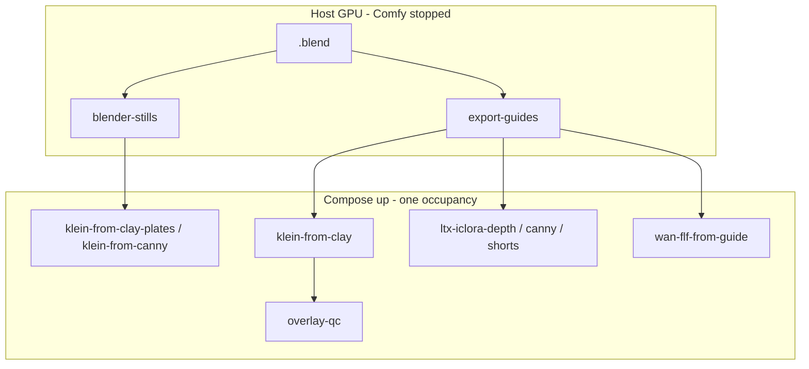

# Blender creator suite

**What's on this page**

- **Run Blender on the host** - the two dump contracts and the park step
- **Dump creator stills** - one camera, one plate
- **Print a guided 5.00s clip** - depth, canny, shorts, and first-last
- **Skip a stage** - what to drop when Blender is missing
- **Related** - the pages this suite feeds

**What this enables**

- **Blocking** camera and layout in Blender, then finishing look and motion in Comfy
- **Shipping** creator plates (hero, packshot, IG, shorts) from one clay still
- **Printing** depth- or edge-guided 5.00s clips that keep the camera you blocked
- **Choosing** the right dump contract before you spend a Blender session

**Who this is for:** studio users who already Queued Klein-from-clay or a 5 s LTX clip and want a Blender-shaped desk for both stills and video.

This is the host-Blender half of the pipeline: you dump geometry-derived plates, then Comfy
finishes them. Two contracts cover everything below - a single-frame **still pack** for
creator plates, and a timed **5.00s shot pack** for control-guided prints. Pick the right one
before you open Blender.

---

## Run Blender on the host

Blender stays on the **host**. It is never in `docker/Dockerfile`. Park Comfy (`occupancy enter blender-desk`) for Workbench dumps. Do not run Cycles CUDA next to a loaded denoise. The rule behind the park step: [Why one heavy job at a time](occupancy.md).



---

## Dump creator stills

Not the 5.00s pack. Not the ten-camera [dream-house tour](dream-house.md). One camera, one plate.

```bash
./scripts/manage.sh occupancy enter blender-desk
./scripts/manage.sh blender-stills --film go-see --plate mug --blend /path/to/prop.blend --size 1024x1024
./scripts/manage.sh occupancy enter klein --yes
# Apps -> klein-from-clay-plates  (or klein-from-canny)
```

`--install-inputs` copies `first.png` into `${COMFY_OUTPUT_DIR}/input` as `ez_clay_still_<plate>.png` (compose may stay up).

| Size | Use |
| --- | --- |
| 1280x704 | LTX / hero feeder |
| 768x1280 | Shorts / hook |
| 1024x1280 | Instagram 4:5 (generic) |
| 1024x1024 | Product packshot |
| 1280x720 | Thumbnail only - Klein, never LTX |

---

## Print a guided 5.00s clip

```bash
./scripts/manage.sh occupancy enter blender-desk
./scripts/manage.sh export-guides --film go-see --shot 12 --blend /path/to/shot.blend --print ltx-iclora-depth
./scripts/manage.sh occupancy enter klein --yes
# klein-from-clay -> overlay-qc -> occupancy enter ltx --yes -> ltx-iclora-depth
```

Portrait 5.00s: `--width 768 --height 1280`, then **ltx-iclora-depth-shorts**. Silent first-last: **wan-flf-from-guide** after `download-wan --tier fun-inp`.

Pack files and print modes: [DCC guide pack](../dcc-workflows.md). Golden film loop: [Clay blockout to finished clip](clay-to-finish.md).

Path D: dump on the laptop, rsync `guides/`, Spark only runs Comfy.

Stay on `:8188` after the dump (no `--install-inputs`): [Stay in Comfy after a Blender dump](comfy-first-blender.md) - **dcc/guide-still**.

---

## Skip a stage

| If | Skip |
| --- | --- |
| No Blender / Path D not ready | Dumps. Queue language stills (`klein-still-draft`, `klein-dream-house`). Overlay QC is skipped, not faked |
| Need a walkable house | `blender-stills`. Use [house-views](dream-house.md) |
| Talking-head / VO-locked picture | Union Control. Use A2V freeze (`motion/av/audio-to-video-8s`) |
| Engine-final Cycles beauty | Path A (`dcc-final`) - not this suite |

Occupancy: `export-guides` and `blender-stills` die (exit 2) if Compose is up and **not**
parked. Safety is unchanged: `restart: "no"`, type **yes** on start, headroom, download-limit
clear-on-exit.

---

## Related

- **Previous lesson** - [Clay blockout to finished clip](clay-to-finish.md) - the golden film loop
- **Next lesson** - [Stay in Comfy after a Blender dump](comfy-first-blender.md)
- **Then** - [Dream-house tours](dream-house.md) - the ten-camera tour
- **Pack contract** - [DCC guide pack](../dcc-workflows.md)
- **The GPU rule** - [Why one heavy job at a time](occupancy.md)
