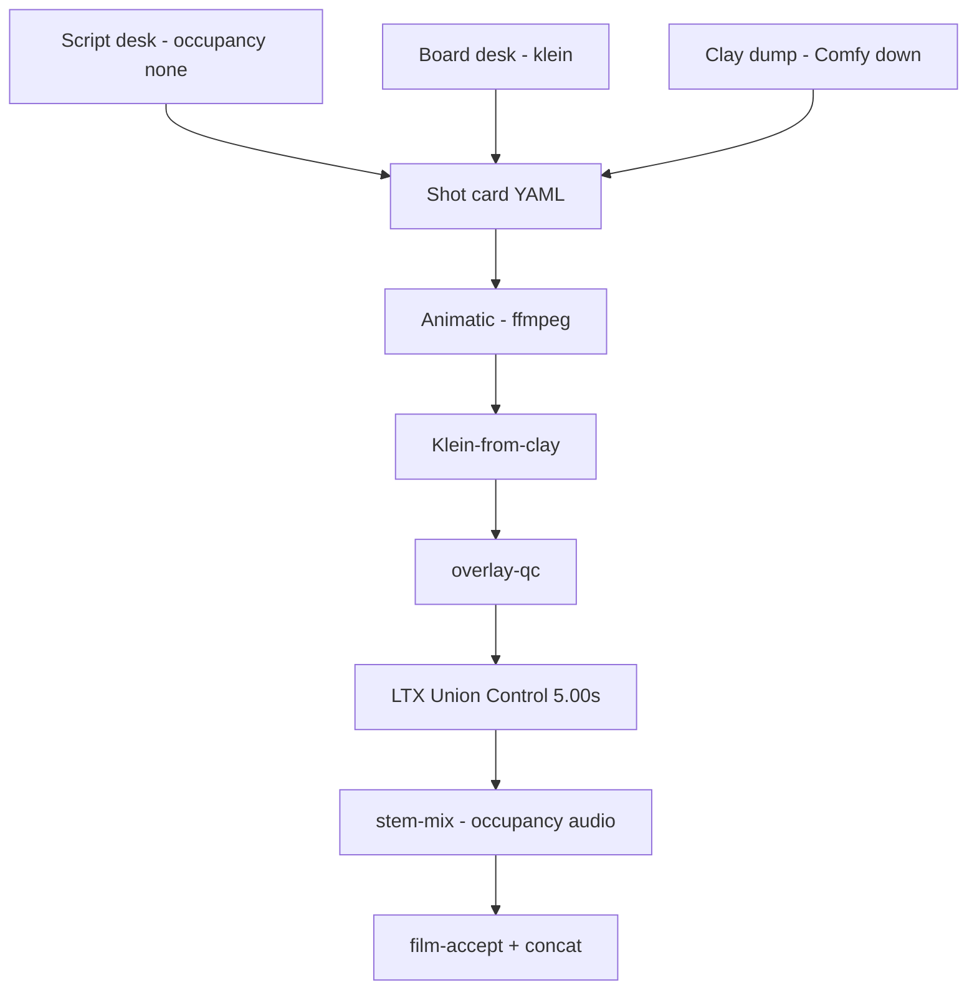

# Clay blockout to finished clip

**What's on this page**

- **Why not one prompt** - who owns camera, materials, motion, and sound
- **Golden path (script door)** - the nine steps from beat sheet to concat
- **Skip rules** - what to drop when Blender or dialogue is missing
- **Occupancy** - which steps need the GPU to yourself
- **Related** - the playbooks this concept feeds

**What this enables**

- **Directing** camera and timing in a grey blockout instead of hoping a prompt remembers the cut
- **Finishing** materials with Klein and motion with LTX Union Control
- **Treating** LTX joint AV as a world bed, then mixing stems to YouTube loudness
- **Skipping** a stage cleanly when Blender or dialogue is not in the shot

**Who this is for:** studio users who have Queued a 5 s LTX clip and want a short that keeps the camera they blocked.

Follow this page when a prompt is not holding the camera. You end up with a clip whose cuts
came from a 3D blockout, whose look came from a Klein plate, and whose loudness came from
stems mixed after picture lock. The commands are on the operator pages; this page is the
mental model and the order of operations.

---

## Why not one prompt

2026 production pipelines that keep camera and timing split the job: the 3D clay owns geometry
and cuts, a look plate owns materials, control-guided video restyles the clip, and audio is
mixed after picture lock. Joint LTX AV is a bed, not a master.

This stack's Path B is that split. MiniMax H3 clay graphs are banned (US Excluded Territory).
Cloud render-to-real endpoints are not lab defaults.

---

## Golden path (script door)

1. Load **inspire/beat-sheet**. Fill logline, script, audio policy, 18 cards. Occupancy **none**.
2. `./scripts/manage.sh shot-sheet run --film go-see` writes `films/gosee/shots.yaml`. Does not overwrite lab YAML.
3. Optional board: **stills/identity-sheet** then **stills/storyboard-6up** (seed 42, 1280x704).
4. Optional clay: `manage.sh stop` then `export-guides --film go-see --shot 12`. Workbench clay + depth + canny, not Cycles beauty. Path D: dump on the laptop, rsync `guides/`. Creator plates (not 5.00s): `blender-stills` then **klein-from-clay-plates** - [Blender creator suite](blender-creator.md).
5. `manage.sh film-animatic --film go-see` - clay.mp4 or 5.00 s still holds, cap 90 s. Compose may stay up.
6. Start Comfy. Queue **dcc/clay-hero** on `first.png`, or stay on `:8188` with **dcc/guide-still** ([Stay in Comfy after a Blender dump](comfy-first-blender.md)). Then `overlay-qc --film go-see --shot 12 --look PATH`. Iterate the look, not the print.
7. Stop Klein. `download-ltx --tier iclora` if needed. Queue **dcc/depth-control-8s** or Templates -> LTX-2.5 Union Control (depth from `depth.mp4`). MagCache off. Distilled-only. Refuse 19B Union.
8. Stop LTX. Occupancy **audio**. `stem-mix --film go-see --shot 12 --bg PATH` (optional `--dx`). Duck -15 dB, YouTube loudnorm I=-14. App: **audio/stem-mix**.
9. `film-accept` then concat. Disclosure sidecar stays.

Printers stay **5.00 s / 1280x704 / 121 frames (`1+8n`) @ 24 fps**. Do not type a 90 s latent.
Do not type 120 (VAE floors to 113 frames).

---

## Skip rules

| If | Skip |
| --- | --- |
| No Blender / Path D not ready | Film clay dump. Look plate owns composition. Overlay QC is skipped, not faked. Instagram clay tour still Queues on `start` / `--seed-inputs` layout plates; language-only -> **stills/dream-house**. |
| Empty dialogue | DX stem |
| Shorts "world SFX, no score" | MX. Do not load ACE-Step next to LTX. |
| Talking-head / VO-locked picture | Union Control. Use A2V freeze (`motion/av/audio-to-video-8s`). Mouths will not match. |

---

## Occupancy

Steps 4 and 7 want the GPU to yourself: `export-guides` and `house-views` die (exit 2) if
compose is up, and you stop the visual session before ACE-Step. `overlay-qc`,
`film-animatic`, and `stem-mix` are host ffmpeg and **may** run while Comfy is up. The rule,
the park and stop verbs, and the full list of heavy jobs:
[Why one heavy job at a time](occupancy.md).

Instagram stills of one place (not a 5.00s print): [Dream-house tours](dream-house.md). That
dump is 1024x1280, not the LTX 1280x704 pack.

Safety is unchanged: `restart: "no"`, type **yes** on start, headroom, download-limit
clear-on-exit.

---

## Related

- **Previous lesson** - [Architecture](architecture.md) - what `start` / `stop` touch
- **Next lesson** - [Blender creator suite](blender-creator.md) - the dump contracts
- **Then** - [Stay in Comfy after a Blender dump](comfy-first-blender.md) - the `:8188` loop
- **Playbook** - [DCC guide pack](../dcc-workflows.md)
- **Shot YAML** - [Short films](../shorts.md) - and Apps: [ComfyUI Apps](../studio-apps.md)
