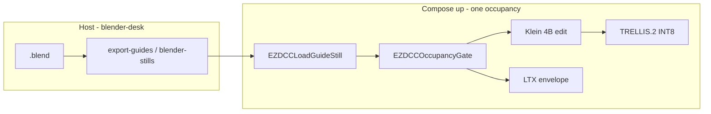

# Stay in Comfy after a Blender dump

**What's on this page**

- **Before you start** - no viewport embed, and the hard bans
- **Run the operator loop** - dump, gate, Klein, TRELLIS
- **Graphs under `_lab/dcc/`** - the three first-party loaders
- **Path D: dump on the laptop** - the default on one GB10
- **Related** - the sibling pages

**What this enables**

- **Loading** clay, depth, and canny from `guides/<slug>/<shot>/` without `--install-inputs`
- **Failing** closed when occupancy is still `blender-desk`
- **Handing** a Klein still to TRELLIS.2 INT8 under `output/assets/objects/_lab-mug/`
- **Staying** on `:8188` for the whole look-dev pass

**Who this is for:** studio users who already dumped a guide pack and want to stay in the ComfyUI canvas.

Use this page when the dump is done and you would rather keep working on the canvas than
shuffle files. The first-party `ez_dcc` loaders read the guide pack straight off the output
disk, and the occupancy gate stops you Queuing a Klein edit while Compose is still parked for
Blender.

---

## Before you start

There is **no** live Blender viewport embed. Blender stays on the host, and no node spawns it.

<Callout type="error" title="Hard bans">
  No Blender in Docker. No GeometryPack / Comfy_BlenderTools / ComfyBlockout / MixLab / IRCSS. No Pixal3D, nvdiffrast, Flux Dev, or 19B Union. No `asset-new`. TRELLIS stays opt-in `download-3d --tier trellis2`.
</Callout>



---

## Run the operator loop

```bash
./scripts/manage.sh occupancy enter blender-desk
./scripts/manage.sh export-guides --film go-see --shot 12 --blend /path/to/shot.blend --print ltx-iclora-depth
./scripts/manage.sh occupancy enter klein --yes
# :8188 -> dcc/guide-still
# EZDCCLoadGuideStill slug=go-see shot_id=12 layer=first
./scripts/manage.sh overlay-qc --film go-see --shot 12 --look PATH
./scripts/manage.sh occupancy enter trellis --yes
# dcc/still-to-mesh - inspect mesh in Load 3D / Preview 3D
```

Widgets default to `slug=go-see`, `shot_id=12`, `plate=mug`. Depth stays mist 0-1 (near=white, far=black). Do not invert.

`EZDCCOccupancyGate` reads `${COMFY_OUTPUT_DIR}/.occupancy.json`. It does not `POST /free`, start Compose, or spawn Blender. Missing file passes (mode `unknown`). `blender-desk` vs Klein / LTX / Wan / TRELLIS **fails** - park is for dumps. The rule the gate enforces: [Why one heavy job at a time](occupancy.md).

---

## Graphs under `_lab/dcc/`

| Graph | Occupancy | What it does |
| --- | --- | --- |
| **dcc/guide-still** | klein | Gate + `EZDCCLoadGuideStill(first)` -> Klein 4B edit. 1280x704. Seed 42. Prefix `ez_guide_hero` |
| **dcc/depth-from-loader** | ltx | Gate + still + `depth.mp4` path. Envelope only (Templates -> Union Control). MagCache off. Distilled-only. Prefix `ez_iclora_guide` |
| **dcc/still-to-mesh** | trellis | Gate + still pack `plate=mug` -> native TRELLIS.2 INT8. Output `assets/objects/_lab-mug/` under `output/` |

The original seven DCC graphs stay on `LoadImage` + `--install-inputs`. After a dump you can keep using those, or stay on `:8188` with the loaders.

---

## Path D: dump on the laptop

Laptop dump -> rsync `guides/` -> Spark Comfy. Spark does not run Blender. This is the
default on one GB10, because it keeps the GPU on Comfy.

```bash
rsync -a guides/go-see/12/ spark-0:/mnt/comfy-output/guides/go-see/12/
./scripts/manage.sh start
```

---

## Related

- **Previous lesson** - [Blender creator suite](blender-creator.md) - the two dump contracts
- **Next lesson** - [Dream-house tours](dream-house.md) - the ten-camera tour
- **Pack contract** - [DCC guide pack](../dcc-workflows.md)
- **The GPU rule** - [Why one heavy job at a time](occupancy.md)
- **Park it yourself** - [Occupancy desk](../occupancy.md)
