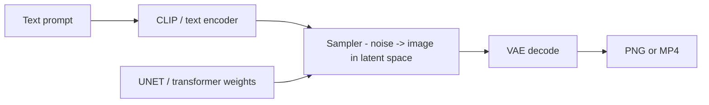
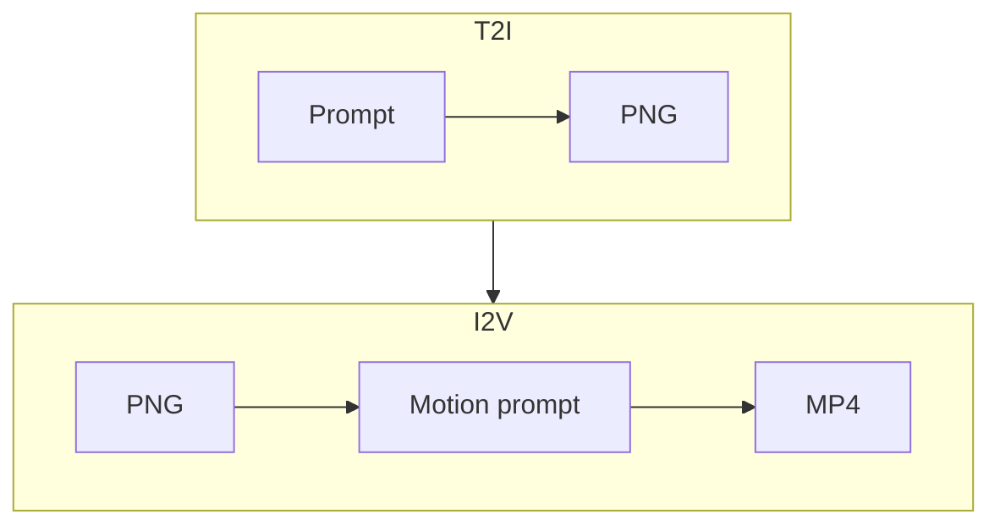

# Image and video generation

**What's on this page**

- **Three boxes** - text encoder, denoiser, VAE
- **Latents are where size lives** - width, height, and frame count
- **Distilled Klein** - CFG 1.0, 4 steps, and the Quality combo
- **Choose a modality** - T2I, I2V, T2V, A2V, and S2V in one table

**What this enables**

- **Reading** a lab graph without treating every node as magic
- **Avoiding** the two classic Spark-melters: 720p on LTX, and a 90 s latent
- **Setting** width, height, and frames on a widget and knowing what the sampler does with them
- **Prompting** an I2V run as motion instead of a second description

**Who this is for:** studio users who can Queue a still and want to know *why* the widgets look like that.

You do not need the math to use this studio, but you do need three ideas: a model turns
words into conditioning, a sampler walks noise toward a picture in **latent space**, and a
VAE decodes that latent to pixels (and to audio on LTX). Everything a widget asks you for -
width, height, frames, steps, CFG, seed - is a knob on one of those three boxes.

---

## Three boxes

Every lab still or clip is the same shape:

| Piece | Job in this studio |
| --- | --- |
| **CLIP** | Turns words into conditioning. Klein uses Qwen (`flux2`), Wan uses UMT5 (`wan`), LTX uses Gemma4-with-proj (`ltxv`) |
| **Denoiser** | Walks noise toward a sample for N **steps** at a **CFG** and **seed** |
| **VAE** | Decodes latents to pixels (and LTX audio). Each family has its own VAE - do not mix |

Wrong CLIP type on a Klein graph is a Queue error, not a "bad prompt."

---

## Latents are where size lives

The sampler does not paint a PNG directly. It denoises a **latent** tensor. Width, height,
and frame count are latent widgets.

| Goal | Lab default | Why |
| --- | --- | --- |
| Fast still | Klein draft **768x432**, 4 steps | Minutes, not a hero |
| I2V feeder / LTX | **1280x704** | LTX VAE is **div32**. 1280x720 is not (720/16=45) |
| ~5 s Wan / ~8 s LTX App | LTX Apps **193** frames (`1+8n`) @ 24 fps ~ **8.04 s**; film printers **121** ~ **5.04 s**; Wan shot **120** = **5.00 s** | Iterate in minutes |
| 90 s film | **18 x 5.00 s** + stitch | Not a 90 s denoise |

Typing 720 or 1080 on an LTX widget is auto-snapped (704 / 1056) by `ez_ltx_spatial`. Prefer
704 so you skip the extra crop. The same pack snaps illegal **120** length to **121**
(`1+8n`). Portrait shorts I2V is **768x1280**.

<Callout type="warning" title="Do not Queue a 30 / 60 / 90 s latent">
  Long latents melt GB10. Film graphs still use 121-frame (`1+8n`) LTX printers. See [Short films](../shorts.md).
</Callout>
---

## Distilled Klein

Distilled Klein is **not** "turn CFG up for quality." Quality is the **positive** prompt
(and resolution/steps on the hero graph), or the App **Quality** combo (Lab / Draft / High).
High on distilled Klein without Klein base keeps CFG 1.0 and only adds steps. FLUX-family
models do not use negatives well - put constraints in the positive ("unmarked facades, empty
of signage").

Wan and LTX pin their own steps on the canvas. Change them on purpose; do not copy an SD1.5
recipe.

---

## Choose a modality

| Code | Means | Start image? | Audio? | Default model |
| --- | --- | --- | --- | --- |
| **T2I** | Text -> still | No | - | Klein 4B |
| **I2V** | Still -> clip | **Yes - owns look** | Wan silent / LTX world audio | Wan 5B or LTX-2.5 |
| **T2V** | Text -> clip | No | Wan silent / LTX AV | Wan 5B or LTX-2.5 |
| **A2V** | Soundtrack -> picture | Often a freeze still | Input audio | **motion/av/audio-to-video-8s** (talking-head is I2V smoke) |
| **S2V** | Speech -> picture | Optional | Speech | Opt-in Wan 14B |

I2V prompt = **motion + one camera move**. Do not re-describe the coat and the city; the PNG
already did.

---

## Related

- **Next lesson** - [Klein, Wan, and LTX](pipeline.md) - what each encoder actually hears
- **Back one step** - [ComfyUI basics](comfyui.md) - the canvas these widgets live on
- **Write the prompt** - [Prompting](../prompting.md)
- **Run the loop** - [The still-to-motion-to-AV pipeline](../visual-generative-ai.md)
