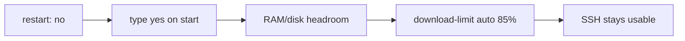
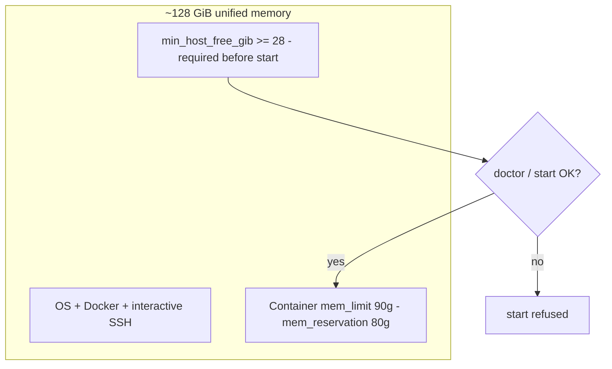
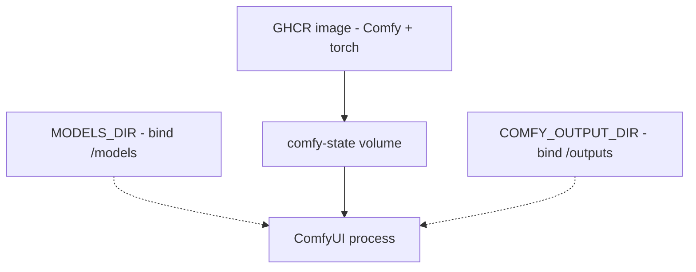
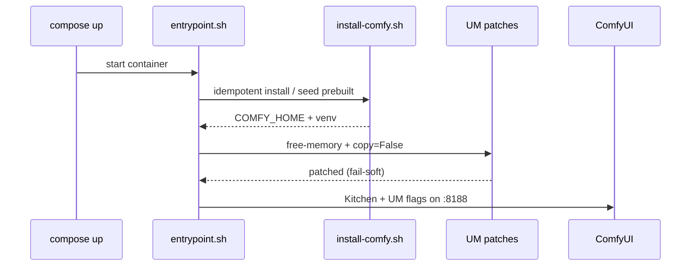

# Hardware, memory, and safety

**What's on this page**

- **The constraint is SSH, not the demo** - why every default looks paranoid
- **Unified memory on GB10** - the 90g limit, headroom preflight, and the lab flags
- **Three stores** - image, weights, and comfy-state, and what deletes each
- **One heavy GPU job** - pointer to the occupancy rule
- **What happens on start** - entrypoint, seed, and patches
- **Related** - architecture and the operator pages

**What this enables**

- **Operating** a remote Spark without locking yourself out
- **Knowing** what `cleanup`, `stop`, and `download-models` each delete or keep
- **Reading** `doctor` output and spotting the Kitchen fallback early
- **Explaining** the 90g limit and the headroom gate to the next person

**Who this is for:** operators, and studio users who just hit OOM or a slow Queue.

This page explains the numbers and the guards: why the container is capped at 90g, what has
to be free before `start` is allowed, which of your three stores a `cleanup` destroys, and
what the entrypoint does on first boot. Read it once before you are tempted to "optimize" a
flag.

<Callout type="warning" title="Do not weaken">
  `restart: "no"`, type **yes** on start, headroom preflight, and download-limit **clear-on-exit** are the SSH-safe defaults. Demos do not get a pass.
</Callout>
---

## The constraint is SSH, not the demo

DGX Spark nodes are often driven over the internet with no KVM. A 90g GPU job that
auto-starts on boot, or a full-rate Hugging Face pull, is how you lose the box.



Details: [Reboot safety](../reboot-safety.md) - [Download limit](../download-limit.md). Disk
full from leftover experiments: [Disk wizard](../disk-wizard.md) (`--plan` first).

---

## Unified memory on GB10

GB10 shares **~128 GiB** among OS, SSH, Docker, and Comfy. There is no separate giant VRAM
island.



Lab flags (do not "optimize" these away):

| Setting | Why |
| --- | --- |
| Default VRAM + offload flags | Unified memory. Omit `--highvram` / `--gpu-only`. ComfyUI dropped `--normalvram` |
| `patch_unified_memory_copy.py` | `copy=False` so UM does not double weights |
| `patch_get_free_memory.py` | Host free RAM instead of under-reporting `cudaMemGetInfo` |
| `--use-ck-attention` | Comfy Kitchen. XOR Sage - never both |
| `TORCH_COMPILE_DISABLE=1` | Triton compile off by default on sm_121 |
| Occupancy | One heavy GPU job - see the next section |

`doctor` must **not** print `attention: pytorch-fallback` on a running Spark (10-20x slow).
spark-timing is measured on a real Spark after Kitchen is live - CI does not invent seconds.

```bash
./scripts/manage.sh doctor
# Queue klein-still-draft, wan-i2v-5s, ltx-i2v-5s
./scripts/manage.sh spark-timing record --klein N --wan N --ltx N
```

---

## Three stores

| Store | What it is | Destroyed by |
| --- | --- | --- |
| **GHCR image** | ComfyUI + PyTorch (`us-safe-studio` / `-development`) | Re-pull / rebuild. **No weights** |
| **MODELS_DIR** | Klein / Wan / LTX / GGUF on the host (default `/mnt/models`) | You, or `reap-models`. **Not** `cleanup` |
| **comfy-state volume** | Comfy install, custom nodes, seeded workflows | `cleanup` (type `DELETE`) |

Outputs live in **COMFY_OUTPUT_DIR** (default `/mnt/comfy-output`). The container sees that
tree as `/outputs`. `cleanup` does not delete them.



---

## One heavy GPU job

GB10 is **one** GPU and this stack runs one heavy job at a time, so `manage.sh blender`,
`export-guides`, and the NVENC preview paths refuse to start while Compose still owns the
card. The rule, the verbs (`park` and `stop`), and the list of heavy jobs live on
[Why one heavy job at a time](occupancy.md).

---

## What happens on start



First start usually **seeds** from `/opt/comfy-prebuilt`. Without that image, cold pip is
**10-30+ minutes**. Ops scripts are bind-mounted - edit them on the host and restart; do not
rebuild for an entrypoint typo.

---

## Related

- **Next lesson** - [Architecture](architecture.md) - services, sidecars, and the Spark farm
- **The rule itself** - [Why one heavy job at a time](occupancy.md)
- **First run** - [Getting Started](../getting-started.md)
- **Command catalog** - [manage.sh reference](../manage-cli.md)
