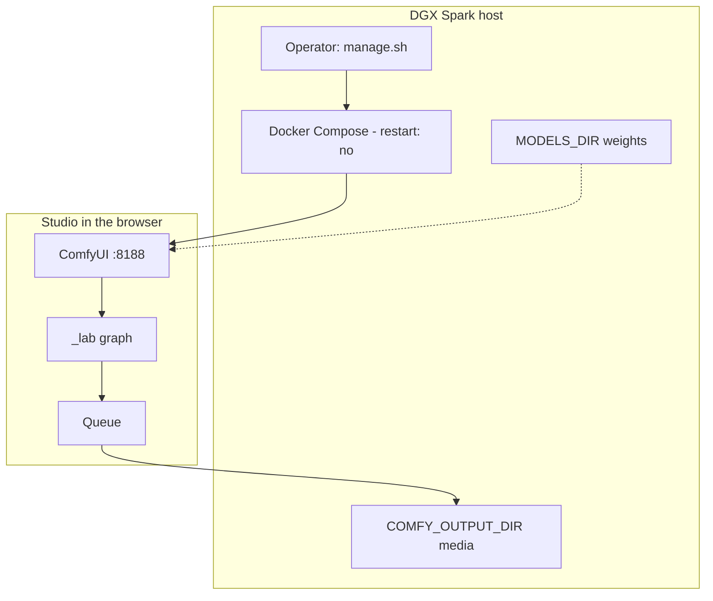
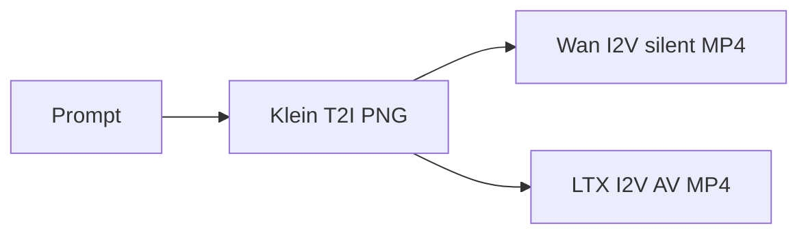

# How the studio works

**What's on this page**

- **What the studio is** - the one-sentence version, and what it is not
- **Pick your seat** - operator, studio user, licenses, glossary
- **Two jobs, one machine** - the host desk and the browser desk
- **What you make** - still, silent motion, audio-video
- **Read the Learn tab in order** - the course outline for this section
- **Related** - where to go when you leave Learn

**What this enables**

- **Choosing** the right tab (Learn, Get started, Studio, Operate, Reference) on the first visit
- **Naming** the pieces you will touch: manage.sh, ComfyUI, Klein, Wan, LTX
- **Separating** the operator job from the studio-user job on one box
- **Queueing** a first still without guessing what each widget means

**Who this is for:** someone new to the repo, ComfyUI, or DGX Spark.

Read this page first if you have never opened the studio. It gives you the vocabulary the
other Learn pages assume, the two roles you will play on one machine, and the order to read
the rest of the tab in. Ten minutes here saves a lot of clicking later.

---

## What the studio is

ez-comfy-stack is a **sample US-safe local studio**: ComfyUI in Docker on **one** NVIDIA
DGX Spark, with Apache Klein 4B stills, Apache Wan 2.2 silent motion, and LTX-2.5 joint AV.

It is **not** nvidia-dgx-spark-lab (no K3s, no dashboard, no multi-node NCCL). How the
pieces fit: [Architecture](architecture.md). When to graduate:
[This stack or nvidia-dgx-spark-lab](../start/when-to-use-vs-spark-lab.md).

---

## Pick your seat

<Cards>
  <Card title="Operator">
    ---

    SSH to the Spark. Run `./scripts/manage.sh` for setup, doctor, downloads, start (type **yes**), and stop.

    [Getting Started](../getting-started.md)
  </Card>
  <Card title="Studio user">
    ---

    Browser at port **8188**. Load a `_lab` graph, change widgets, Queue, pick PNG/MP4 from `COMFY_OUTPUT_DIR`.

    [ComfyUI basics](comfyui.md)
  </Card>
  <Card title="US-safe defaults">
    ---

    Local weights only. Klein + Wan are Apache; LTX is Community License (gated, $10M cap). MiniMax H3 is banned.

    [Model licenses](../licenses.md)
  </Card>
  <Card title="Glossary">
    ---

    Dotted terms open a definition dialog. This Learn section teaches the ideas behind those words.

    [Glossary](../glossary.md)
  </Card>
</Cards>

---

## Two jobs, one machine

You can be both people. First-time path is still operator-shaped (clone, doctor, download,
start), then you become a studio user for the first still.

---

## What you make

Text -> **still** (Klein) -> **silent ~5 s** (Wan) -> **AV ~5 s** (LTX). Iterate in minutes.
A 90 s YouTube short is **18 x 5 s** prints stitched, not one 90 s denoise.

Learn the models: [Klein, Wan, and LTX](pipeline.md). Learn the math-lite version of latents
and steps: [Image and video generation](generation.md). Learn why SSH-safe defaults exist:
[Hardware, memory, and safety](hardware.md).

---

## Read the Learn tab in order

This tab is a course. Read top to bottom; skip a lesson only if you already know it. The
sidebar shows the same order, in three groups plus the glossary.

**The studio at a glance**

1. This page (you are here) - roles and the still, motion, and AV loop
2. [ComfyUI basics](comfyui.md) - graph, App Mode, Queue
3. [Image and video generation](generation.md) - latents, steps, I2V

**Models, hardware, and safety**

4. [Klein, Wan, and LTX](pipeline.md) - why these three models
5. [Why one heavy job at a time](occupancy.md) - occupancy as an idea
6. [Hardware, memory, and safety](hardware.md) - why SSH-safe defaults exist
7. [Architecture](architecture.md) - Compose, three stores

**Look-dev and 3D concepts**

8. [Clay blockout to finished clip](clay-to-finish.md) - camera first, AI finish second
9. [Blender creator suite](blender-creator.md) - host dumps, then Comfy plates and prints
10. [Stay in Comfy after a Blender dump](comfy-first-blender.md) - the `:8188` loop
11. [Dream-house tours](dream-house.md) - ten stills of one place

**Glossary**

12. [Glossary](../glossary.md) - dictionary, not the course

---

## Related

Then leave Learn: [Getting Started](../getting-started.md) for the first still,
[The still-to-motion-to-AV pipeline](../visual-generative-ai.md) for the daily playbook,
[Workflow catalog](../studio-workflows.md) for filenames.

- **Next lesson** - [ComfyUI basics](comfyui.md)
- **Something broke** - [Troubleshooting](../troubleshooting.md)
- **Before a reboot** - [Reboot safety](../reboot-safety.md)
