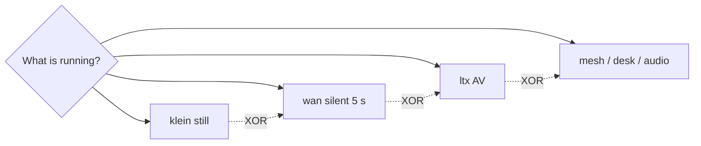

# Why one heavy job at a time

**What's on this page**

- **What occupancy means here** - the rule, and what the App chip tells you
- **What counts as a heavy job** - the eight occupants that cannot share the GPU
- **Park, stop, reboot** - the three verbs and what each one frees
- **Modes, and where to look them up** - CLI modes vs the graph's occupancy label
- **Related** - the desk and the matrix

**What this enables**

- **Choosing** one job before you Queue, instead of stacking models until the host swaps
- **Knowing** why the App chip says klein / wan / ltx
- **Picking** park or stop before a Blender dump, an encode, or the 35B desk
- **Keeping** SSH alive on a headless Spark

**Who this is for:** learners after [Klein, Wan, and LTX](pipeline.md). Operators:
[Occupancy desk](../occupancy.md). Lookup: [Occupancy matrix](../operate/occupancy-matrix.md).

Before you Queue anything beyond a still draft, decide who owns the GPU. This page is the
concept; the operator desk and the matrix are the buttons and the table. Read it once and
the occupancy chip, the `occupancy enter` verbs, and the "compose is up" errors all stop
being mysteries.

---

## What occupancy means here

The Spark has a lot of unified memory, but this stack still treats the GPU as **one** heavy
occupant. A Klein still, a Wan 5 s clip, an LTX AV shot, a TRELLIS mesh, and the optional 35B
writing desk each want the same RAM. Running two of them is how SSH dies.

Occupancy is the name for that rule. The App chip on a lab graph is not decoration - it is
the job you just reserved.

You do **not** need the matrix to Queue `stills/still-draft`. You do need it before you park
Comfy for Blender or start the 35B sidecar.

---

## What counts as a heavy job

Any of these owns the GPU on its own:

| Heavy job | Occupancy |
| --- | --- |
| Klein still (T2I or edit) | `klein` |
| Wan silent clip | `wan` |
| LTX audio-video clip | `ltx` |
| TRELLIS.2 mesh | `trellis` |
| Optional 35B writing desk (`llama-server` on the host) | `llm-desk` |
| Host Blender Workbench dump | `blender-desk` |
| ACE-Step music or podcast | audio pack, separate from the visual session |
| SuperSplat, NVENC preview, NLE | host, and these need Compose **down**, not parked |

Two consequences worth memorising:

- `export-guides`, `blender-stills`, `house-views`, and `manage.sh blender` **die (exit 2)**
  while Compose is up and not parked.
- `film-proxies` and NVENC preview **die if Compose is up at all** - parking is not enough.

Host file and ffmpeg work is exempt: `overlay-qc`, `film-animatic`, `stem-mix`,
`house-views --install-inputs`, and `house-views --seed-inputs` may run while Comfy is up.

---

## Park, stop, reboot

| Action | What it does |
| --- | --- |
| **Queue another App** | Unload the previous occupant first if the chip changed |
| **Park** (`occupancy enter ...`) | `POST /free` unloads weights; the container can stay up |
| **`occupancy enter blender-desk`** | Compose may stay **up**; empty queue; `POST /free` unload; Workbench dumps allowed |
| **Stop** | Container down, volumes kept. Type **yes** on the next `start`. Use for NVENC, SuperSplat, or a wedged UI |
| **`occupancy enter idle`** | Stop sidecars **and** Compose |
| **Reboot the Spark** | Always `stop` first. Compose `restart: "no"` will not bring Comfy back |

`occupancy enter` **does not** start Compose and does **not** turn the box into two GPU jobs.
Heavy modes tell you to run `./scripts/manage.sh start` (type **yes**) when the container is
down.

This does **not** weaken `restart: "no"`, headroom preflight, or download-limit clear-on-exit.

---

## Modes, and where to look them up

CLI modes are `idle`, `blender-desk`, `llm-desk`, `klein`, `trellis`, `wan`, and `ltx`. The
occupancy label printed on a graph (`none` / `llm` / `film` / `audio` / ...) is an App Mode
hint, **not** a CLI mode.

| Need | Page |
| --- | --- |
| Buttons for today (park Comfy, enter a desk, restore a visual job) | [Occupancy desk](../occupancy.md) |
| Mode x legal GPU jobs, in table form | [Occupancy matrix](../operate/occupancy-matrix.md) |
| Why the memory limit and headroom exist | [Hardware, memory, and safety](hardware.md) |

---

## Related

<Cards>
  <Card title="Hardware and safety">
    ---

    The memory maths behind the one-job rule.

    [Hardware, memory, and safety](hardware.md)
  </Card>
  <Card title="Architecture">
    ---

    What `start`, `stop`, and `cleanup` touch on the way.

    [Architecture](architecture.md)
  </Card>
  <Card title="Occupancy desk">
    ---

    Park Comfy, enter a desk, restore a visual job.

    [Occupancy desk](../occupancy.md)
  </Card>
  <Card title="Occupancy matrix">
    ---

    Mode against legal GPU jobs, in table form.

    [Occupancy matrix](../operate/occupancy-matrix.md)
  </Card>
</Cards>
