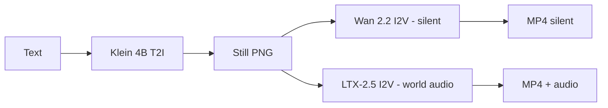
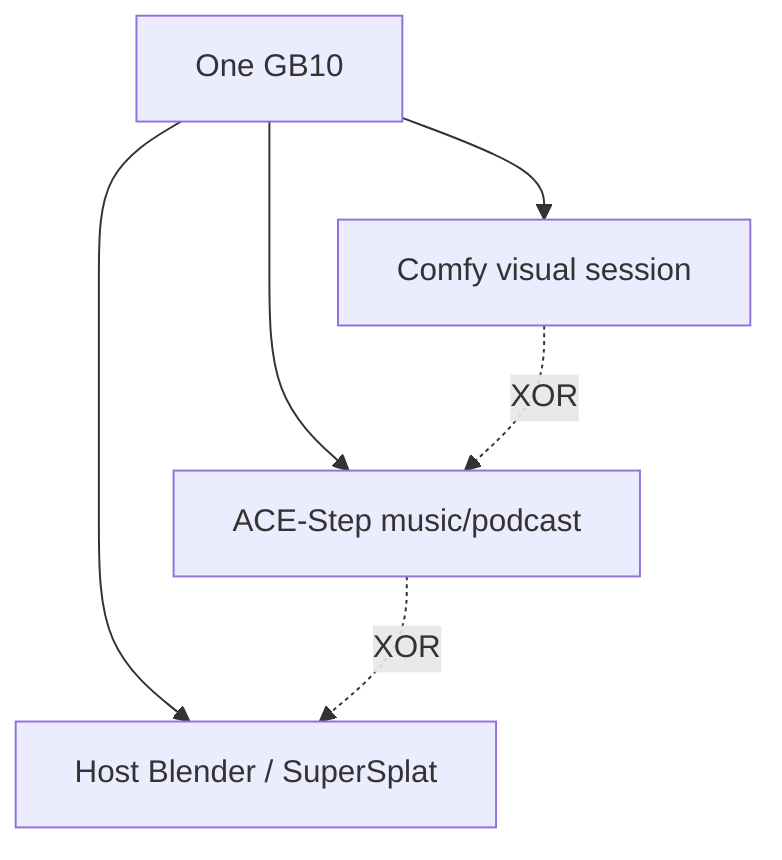

# Klein, Wan, and LTX

**What's on this page**

- **Three jobs, three licenses** - what each model owns and what it costs you
- **The handoff** - still PNG to Wan, then the same frame to LTX
- **What you type vs what they hear** - one tab per model
- **Why not one model for everything** - the trade you are making
- **One model family at a time** - the occupancy note for this page

**What this enables**

- **Picking** the next graph after a still without guessing
- **Prompting** each model in its native shape
- **Choosing** between the Apache path and the gated LTX path before you download
- **Queueing** a commercial-safe clip without stacking families on the GPU

**Who this is for:** studio users who have Queued `stills/still-draft` once.

Three models do three jobs here, and each one reads a prompt differently. This page gives
you the role split, the licenses behind it, and the prompt shape that gets a usable result
from each family on the first Queue.

---

## Three jobs, three licenses

| Model | Job | Encoder | License |
| --- | --- | --- | --- |
| **Klein 4B** distilled FP8 | Still (T2I, optional edit) | Qwen3-4B - `flux2` | Apache 2.0 |
| **Wan 2.2** TI2V-5B | Silent T2V / I2V ~5 s | UMT5-XXL - `wan` | Apache 2.0 - **no native audio** |
| **LTX-2.5** distilled INT8-convrot | Joint AV ~8 s Apps (5 s film printers) | Gemma4-with-proj - `ltxv` | Community License, **gated**, $10M company cap |

Klein 9B and FLUX.2-dev are opt-in FLUX Non-Commercial packs, not defaults. MiniMax H3 is
banned (US Excluded Territory). Canonical table: [Model licenses](../licenses.md).

---

## The handoff

Queue a Klein still -> set Wan **LoadImage** to that PNG -> optional LTX I2V from the **same**
first frame at **1280x704** (portrait **768x1280**).

**Free Commercial Use (\<$10M):** Klein 4B at that clip size (Draft to pick a seed, then the
commercial quality for the hero) -> optional SeedVR2 polish on the PNG (not 4K) -> LTX-2.5
I2V, motion + sound only. Unload Klein before LTX. Quality combo never selects Klein 9B or
FLUX.2-dev on this path. Wan is the Apache silent rehearsal, not this LTX cap path.

---

## What you type vs what they hear

<Tabs groupId="klein-still-wan-i2v-wan-t2v-ltx-av" items={["Klein (still)", "Wan I2V", "Wan T2V", "LTX AV"]} persist>
  <Tab value="Klein (still)">
    Sentences. Subject -> place -> light -> camera. Under ~150 words. Positive opposites, not "no logos". Distilled = CFG 1.0 / 4 steps, so the Positive widget *is* the quality knob.
  </Tab>
  <Tab value="Wan I2V">
    The PNG owns look. Prompt **motion + one camera verb** (`dolly in`, `pan`, `tracking`, `fixed camera`). Silent - do not prompt a score, foley, or dialogue.
  </Tab>
  <Tab value="Wan T2V">
    Entity + scene + motion + aesthetic + one camera move, about 80-120 words. Still no audio.
  </Tab>
  <Tab value="LTX AV">
    One flowing **present-tense** paragraph, 4-8 sentences, **sound interleaved** (wind beside the coat, not a trailer at the end). Dialogue in `"quotes"` only if you asked for speech. Shorts: world SFX, no score.
  </Tab>
</Tabs>
Seeded lab graphs already ship model-native text. Leave **Enhance** off unless you replace
that text with something short. Recipes: [Prompting](../prompting.md).

---

## Why not one model for everything

- **Wan** is the legally cleanest motion default (Apache) and the cheap 5 s rehearsal. It
  cannot mux world audio.
- **LTX** is the AV hero and is **not** Apache. You accept a gated license and a revenue cap
  for that audio.
- **Klein** is the identity lock. A 90s film is Klein identity + 18 LTX prints, not a 90s Wan
  denoise.

Optional fallbacks (Z-Image, Wan A14B, LTX-2.3) live on [Models and cache](../models-and-cache.md).
They are not the first download.

---

## One model family at a time

Do **not** load Klein + Wan + LTX + ACE-Step in one session. Cover art is a separate Klein
graph. Podcast and rap packs are opt-in and share the ACE-Step AIO file. The rule behind that
- one heavy GPU job, park or stop before you switch families - lives on
[Why one heavy job at a time](occupancy.md).

---

## Related

- **Next lesson** - [Why one heavy job at a time](occupancy.md) - park, stop, and the App chip
- **Back one step** - [Image and video generation](generation.md) - latents, steps, CFG
- **Run the loop** - [The still-to-motion-to-AV pipeline](../visual-generative-ai.md)
- **Filenames** - [Workflow catalog](../studio-workflows.md)
