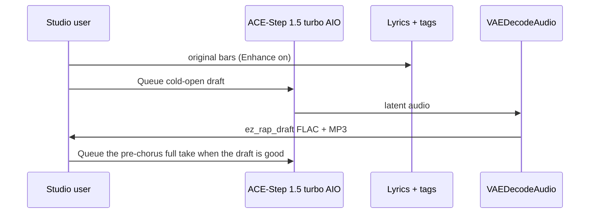

# Local music

**What's on this page**

- **Which lane to pick** - a rap draft, an album body, an EDM set, or the release gate
- **Occupancy warning:** do not load ACE-Step with Klein / Wan / LTX
- **First Queue** is **audio/music/rap-draft**, then the full track or an album take
- **`download-music --tier turbo`** (same ACE-Step AIO as podcast acestep)
- **Sequential Queue** and album art in a later Klein session
- **Child pages** for the RAP-FIRST albums, the Drive-through EDM albums, and the pre-release checklist
- **Audio Rack** (`inspire/audio-rack`) splices professional tags/lyrics on occupancy **llm** - copy into rap-draft; do not load ACE-Step on the rack canvas

**What this enables**

- **A cold-open boom-bap draft** on one NVIDIA DGX Spark without cloud music APIs
- **One hundred thirty-five original Nill Bye takes** (64-210 s, varied form) without cloud music APIs
- **One hundred one original Drive-through EDM takes** (180-480 s, multi-pass epic arcs with repeating layered build-up/drop cycles, 165-176 BPM) without cloud music APIs
- **Reusing** the podcast ACE-Step AIO dest so the 10 GB file is not pulled twice
- **Keeping** the visual studio bootable when the music pack is missing
- **Muxing** a cover still + FLAC into a YouTube MP4 without changing the rap graphs

**Who this is for:** studio users after `download-music --tier turbo`.

**Question this page answers:** which music lane do I want, and what do I Queue first? Pick one lane in [Which lane to pick](#which-lane-to-pick), then open that page. The two lane pages are sample catalogs you browse; the disclosure page is the gate before you release anything.

<Callout type="warning" title="Not legal advice">
  Platform rules and copyright change. Read the current DistroKid, Spotify, YouTube, FTC, and USCO pages before you monetize. Tags vs lyrics, Hard no, QC, and platform disclosure: [Music disclosure and QC](create/music-disclosure.md).
</Callout>

<Callout type="error" title="Occupancy">
  Do **not** load Klein + Wan + LTX + ACE-Step in one session. The Spark runs **one heavy GPU job** at a time - park or stop the other one first ([Occupancy rule](studio-sidecars.md#occupancy-rule)). The AIO is ~10 GB VRAM-adjacent work, so do **not** co-resident it with LTX / Wan / Klein. Cover art is a **later** Klein session. Start still requires typing `yes`. Compose `restart: "no"` is unchanged.
</Callout>
---

## Which lane to pick

| Lane | Pick it when | What you get | Deep page |
| --- | --- | --- | --- |
| **RAP-FIRST** draft + full track | You want one original rap take to iterate on | Cold-open `ez_rap_draft` FLAC + MP3, then a pre-chorus full track | [RAP-FIRST rap lane](create/music-rap.mdx#graphs) |
| **Nill Bye albums** | You want a body of original songs to select from | Nine albums, one hundred thirty-five takes, 64-210 s, varied form | [RAP-FIRST rap lane](create/music-rap.mdx) |
| **Drive-through EDM** | You want long instrumental bass-set arcs, not rap over a club bed | Six albums, one hundred one takes, 180-480 s, 165-176 BPM; each take is 3-5 ACE-Step passes joined on the bar grid by **Beat-join passes**, so the build-up and drop repeat three to five times with fresh beds, leads, and drop tiers each time | [Drive-through EDM lane](create/music-edm.mdx) |
| **Release gate** | A take is picked and you are about to publish it | DistroKid / Spotify / YouTube / USCO disclosure, tags vs lyrics, Hard no, QC | [Music disclosure and QC](create/music-disclosure.md) |

The three pages are one ladder: **pick a lane here -> browse the takes there -> clear the checklist before release**.



Catalog filenames: [Audio graphs](create/workflows-audio.md).

---

## First Queue

Graph: **audio/music/rap-draft** (`extra.lab_profile` `us-safe-music`). Same role as **klein-still-draft**. App **Duration (seconds)** defaults to **32**. Prefix `ez_rap_draft`. Full stage table: [RAP-FIRST](create/music-rap.mdx#graphs).

Then load **audio/music/rap-full** (pre-chorus form), **or** a numbered take under `_lab/audio/albums/nill-bye/<album>/`, **or** `_lab/audio/albums/drive-through/<album>/`.

---

## Download

Music weights are **opt-in**. `./scripts/manage.sh download-models` does **not** pull them. `doctor` prints turbo JSON and still exits 0 when the pack is absent.

```bash
./scripts/manage.sh download-music --tier turbo     # ace_step_1.5_turbo_aio.safetensors (~10 GB)
./scripts/manage.sh download-music --tier xl        # optional XL split only
# same --limit auto|N|off wrap as download-models (always clears on exit)
```

Turbo uses the **same snapshot** as `download-podcast --tier acestep`:

```text
${MODELS_DIR}/Comfy-Org__ace_step_1.5_ComfyUI_files_acestep/checkpoints/ace_step_1.5_turbo_aio.safetensors
${MODELS_DIR}/comfy/checkpoints/ace_step_1.5_turbo_aio.safetensors   # relative symlink
```

If you already ran `download-podcast --tier acestep`, `download-music --tier turbo` is a cache hit + relink. Do not download the 10 GB AIO twice.

Relative symlinks only (host `/mnt/models` vs container `/models`).

---

## Sequential Queue

1. `./scripts/manage.sh download-music --tier turbo`
2. `./scripts/manage.sh start` - type **yes**
3. Load **audio/music/rap-draft**. Enhance on. Queue. Files under `${COMFY_OUTPUT_DIR}` as `ez_rap_draft_*.flac` / `ez_rap_draft_*.mp3`
4. Then load **audio/music/rap-full** (pre-chorus form), **or** a numbered take under `_lab/audio/albums/nill-bye/<album>/`, **or** `_lab/audio/albums/drive-through/<album>/`. Full album: `./scripts/manage.sh album-render --album nill-bye/peer-review --art skip|upload|generate [--quality TIER]`
5. Album art: App **Album art** skip (default) / upload / generate, or `album-render --art skip|upload|generate`. Cover LoadImage is **bypassed** (and unwired) so App Queue does not require a file. Upload: graph view, **Ctrl+B** Cover image, then wire IMAGE to Album metadata. Generate queues `cover.json` (klein occupancy) then POST `/free` then ACE tracks. The Quality table overlays the cover and every track: pass `--quality TIER` (or `EZ_QUALITY=TIER`) to pick the cover's Klein profile, otherwise the tier the graph records is used ([ComfyUI Apps](studio-apps.md#graph-vs-app)). Do not co-resident Klein + ACE. Generic stills: **stills/thumbnail** or **stills/podcast-cover** in a later session.
6. Optional YouTube still-image video (host ffmpeg; graphs still save FLAC + MP3):

```bash
./scripts/manage.sh audio-still-video \
  --audio "${COMFY_OUTPUT_DIR}/ez_rap_full_00001_.flac" \
  --image "${COMFY_OUTPUT_DIR}/ez_thumbnail_00001_.png"
# -> ${COMFY_OUTPUT_DIR}/ez_rap_full_00001_.mp4
# Square covers letterbox onto 1920x1080. Shorts: --size 1080x1920
```

Queue with the same rails as every other lane: type **yes** at start, Compose `restart: "no"` unchanged, and one heavy GPU job at a time ([Occupancy rule](studio-sidecars.md#occupancy-rule)).

---

## Related

- [RAP-FIRST rap lane](create/music-rap.mdx) - draft, full track, and the nine Nill Bye albums
- [Drive-through EDM lane](create/music-edm.mdx) - the six Drive-through bass-set albums
- [Music disclosure and QC](create/music-disclosure.md) - what to disclose and edit before release
- [Local podcast](podcast.md) - Kokoro voices and instrumental beds, the other audio lane
