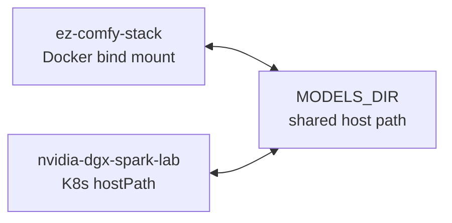
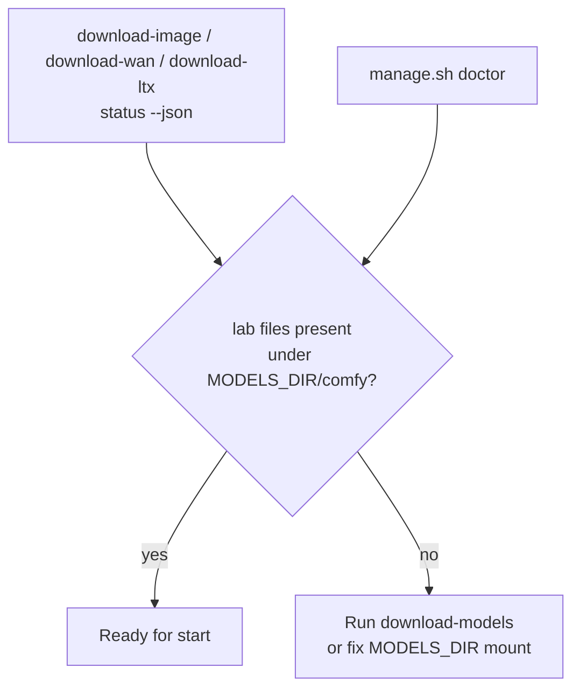

# Sharing MODELS_DIR

**What's on this page**

- **When you need this** - two stacks, or several Sparks, over one weights tree
- **What to do** - one `${MODELS_DIR}`, NFS or rsync, one cache owner
- **How to verify** - `doctor`, `status --json`, and the lab basename check
- **What breaks otherwise** - broken links, non-writable trees, and a second writer

**What this enables**

- **Downloading weights once** and reusing them across stacks
- **Checking readiness** without network access
- **Keeping** the share to NFS and rsync - this sample stack still has no in-tree NCCL

**Who this is for:** operators who also run nvidia-dgx-spark-lab, or run more than one Spark.
The tree itself, its relative `comfy/` symlinks, and the headroom floor are owned by
[Models and cache](../models-and-cache.md). This sample stack does not pull in K3s or
multi-node NCCL; graduate to
[This stack or nvidia-dgx-spark-lab](../start/when-to-use-vs-spark-lab.md).

---

## When you need this

One `${MODELS_DIR}` serves this Docker stack and nvidia-dgx-spark-lab's K8s hostPath, or
several independent Sparks. The relative `comfy/` symlinks are what make that possible: they
resolve both on the host (`${MODELS_DIR}=/mnt/models`) and inside the container (bind-mounted
at `/models`). Absolute `/mnt/models/...` links look fine on the host and break Comfy with
"exists but doesn't link anywhere".



Independent Sparks share `MODELS_DIR`; that is NFS or rsync, **not** NCCL. For a three-node
farm, pick NFS over the fabric subnet or run `sync-models`: [Spark farm](../spark-farm.md).

---

## Share one tree

1. Set the same path everywhere.

   ```bash
   # .env on every stack that shares the cache
   MODELS_DIR=/mnt/models
   ```

2. Let one host be the cache owner and run the pull there.

   ```bash
   ./scripts/manage.sh download-models
   ```

   Every `hf` pull is throttled by the download-limit wrap, which **always clears on exit**.
   The throttle is owned by [Download limit](../download-limit.md).

   ```mermaid
   sequenceDiagram
     actor Op as Operator
     participant M as manage.sh
     participant W as download-limit wrap
     participant I as download-image.sh
     participant Wa as download-wan.sh
     participant L as download-ltx.sh
     participant HF as Hugging Face
     participant Disk as MODELS_DIR

     Op->>M: download-models
     M->>W: --limit auto (default)
     W->>I: run --tier fast
     I->>HF: pull Klein 4B + TE + VAE
     HF-->>Disk: still weights + symlinks
     W->>Wa: run --tier 5b
     Wa->>HF: pull Wan 5B
     HF-->>Disk: wan weights + symlinks
     W->>L: run --tier 2.5
     L->>HF: pull LTX-2.5
     HF-->>Disk: ltx weights + symlinks
     W-->>M: clear limit on EXIT/INT/TERM
   ```

3. Mount or replicate for the other consumers: NFS from the owner (preferred), or
   `./scripts/utilities/spark-farm.sh sync-models` to rsync `MODELS_DIR/comfy` over
   `SPARK_FABRIC_IPS` only.

4. Do not prefix `download-models` with `sudo` - download-limit uses sudo internally and
   `hf` must stay on the login user's PATH.

**Check it worked:** the second stack starts with no pull of its own, and
`./scripts/manage.sh doctor` is clean.

---

## Verify the tree



```bash
./scripts/manage.sh doctor
./scripts/manage.sh models-status
./scripts/utilities/download-image.sh status --tier fast --json
./scripts/utilities/download-wan.sh status --tier 5b --json
./scripts/utilities/download-ltx.sh status --tier 2.5 --json
```

**Check it worked:** `doctor` reports `MODELS_DIR` writable by your user, and `models-status`
logs `lab models: all expected files present`. `status --json` needs no network.

---

## What breaks otherwise

| Symptom | Cause | Fix |
| --- | --- | --- |
| Comfy says a weight "exists but doesn't link anywhere" | Absolute `/mnt/models/...` file links, valid on the host only | Re-run `download-models` so it rewrites **relative** links, then restart Comfy |
| `doctor` fails on `MODELS_DIR` | The shared mount is not writable by your user | `./scripts/manage.sh setup` sudo-heals the layout dirs; a root-owned nested `comfy/` is a warning |
| The second stack re-downloads tens of GB | The two stacks point at different paths | Set the same `MODELS_DIR` in each `.env` and make one host the cache owner |
| A shared tree gains a stray root-owned file | Someone ran the pull with `sudo` | Run pulls as the login user; `hf` also has to stay on that PATH |
| Two writers race during a sync | `sync-models` ran against a tree that was also downloading | Pull on the owner, sync to the replicas |

A missing basename is a cache problem, not a graph bug:
[Models and workflows](troubleshooting-models-workflows.md).

---

## Next

1. [Models and cache](../models-and-cache.md) - the tier tree, links, and reap
2. [Model packs by family](models-packs.md) - the basenames each family owes you
3. [Download tiers](../download-tiers.md) - what to pull on the cache owner
4. [Spark farm](../spark-farm.md) - NFS and `sync-models` across Sparks
5. [Disk wizard](../disk-wizard.md) - reclaim host leftovers around a shared cache
