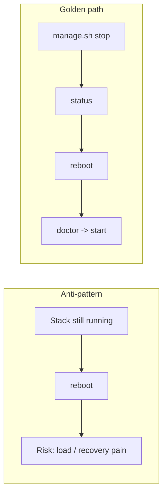
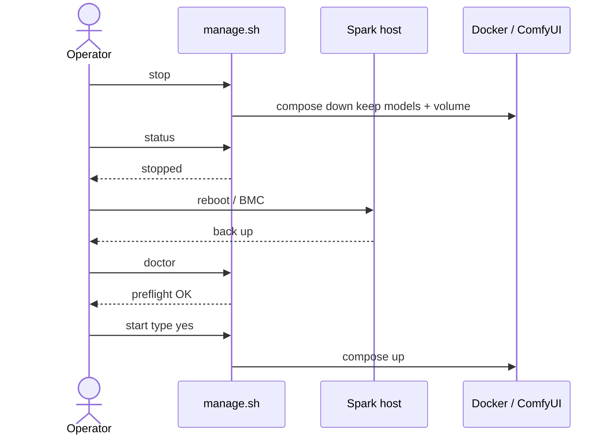
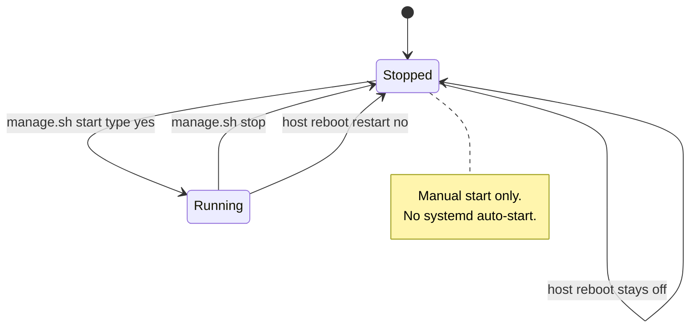
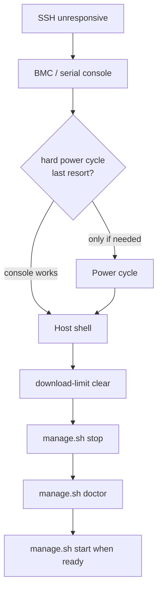

# Reboot safety

**What's on this page**

- **Golden rule** - stop first, always
- **Sequence** - stop, status, reboot, doctor, start
- **Why containers do not return** - `restart: "no"` and no auto-start unit
- **Recovery** - BMC, serial console, and a last-resort power cycle

**What this enables**

- **Rebooting** a Spark without losing SSH recoverability
- **Corrupting nothing** - no GPU load and no live pull across the reboot
- **Coming back** on a known-good path instead of guessing after a hard power cycle

**Who this is for:** anyone who has to reboot a Spark they reach over SSH. This is a human
problem (a remote box with no console), not a Docker quirk.

---

## Follow the sequence

<Callout type="error" title="Never reboot with the heavy ComfyUI stack still running">
  Always `stop` first. Compose uses `restart: "no"` so the stack will **not** come back by itself - that is intentional, but a live GPU load during reboot still risks painful recovery. Independent Spark farm containers still use `restart: "no"`; `spark-farm.sh` never starts compose on a remote node.
</Callout>

1. From your workstation / SSH session:

   ```bash
   ./scripts/manage.sh stop
   ./scripts/manage.sh status
   ```

   **Check it worked:** status shows Comfy is not running.

2. Reboot the node (`sudo reboot` or out-of-band BMC).

3. After boot, verify Docker and GPU:

   ```bash
   ./scripts/manage.sh doctor
   ```

   **Check it worked:** doctor prints `Doctor OK`.

4. Only then start again:

   ```bash
   ./scripts/manage.sh start
   # type: yes
   ```

   `start` returns after `compose up -d`. Closing the SSH session does **not** stop the stack.
   `stop` is still required before the next reboot. Independent Spark farm containers still use
   `restart: "no"`; start each node locally with confirm.





---

## Understand why containers do not return

Compose uses `restart: "no"`. There is no systemd unit that auto-starts this demo. That is
intentional.



<Callout type="info" title="Safety impact">
  Manual start + headroom preflight + heavy confirmation keep remote SSH recoverable. Do not add auto-start units for this demo stack.
</Callout>

---

## Recover when SSH is already unresponsive

1. Use **BMC / serial console**
2. **Hard power cycle** only as last resort
3. After recovery:

   ```bash
   ./scripts/manage.sh download-limit clear
   ./scripts/manage.sh stop
   ./scripts/manage.sh doctor
   ```

   **Check it worked:** `download-limit status` reports no active limit, status shows the
   stack down, and doctor prints `Doctor OK`. Then start when you are ready.



---

## Next

1. [Daily loop](operate/daily.md) - the loop you restart into after the reboot
2. [Download limit](download-limit.md) - why `clear` is the first recovery command
3. [Spark farm](spark-farm.md) - per-node confirm on every Spark
4. [Host and Docker](operate/troubleshooting-host-docker.md) - Docker or GPU fails the check
5. [Troubleshooting](troubleshooting.md) - anything else that did not come back
