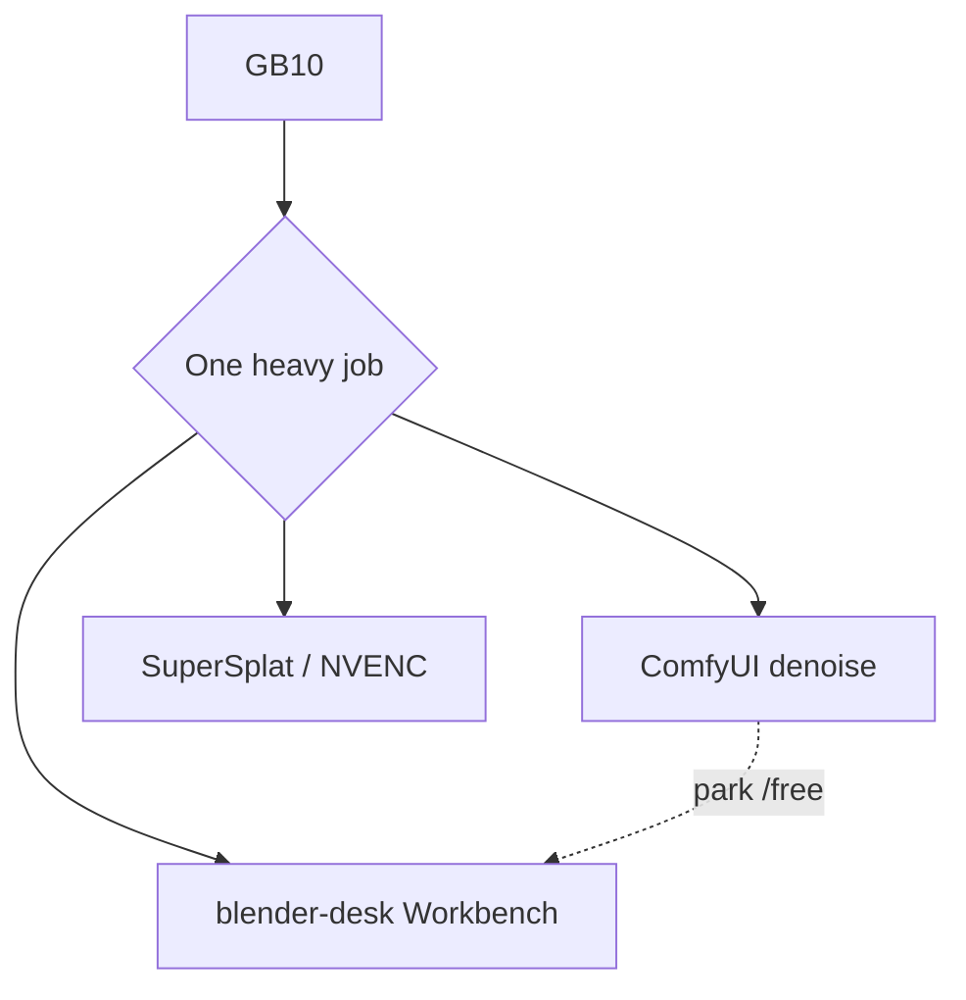

# Studio sidecars

**What's on this page**

- What a sidecar is (host process, not Compose)
- Occupancy: one heavy GPU job
- TRELLIS.2 native + DA3-BASE opt-in packs
- Pointers to Blender, SuperSplat, and the host NLE (Vlo in the browser, or Kdenlive / Shotcut on OTIO files)

**What this enables**

- Optional 3D stills and depth without putting DCC or splat viewers in the Docker image
- Timeline edits in a host browser (Vlo) or a host NLE - both outside the Comfy image
- Unchanged `restart: "no"`, `mem_limit: 90g`, and headroom preflight

<Callout type="warning" title="Occupancy">
  GB10 is one heavy GPU job. Park Comfy (`occupancy enter blender-desk`) for Workbench dumps. Park Comfy (`occupancy enter llm-desk`) for the host 35B llama-server. Stop Blender and the sidecar before TRELLIS / LTX / Wan. SuperSplat and NVENC still want Compose **down**. Sidecars are **not** `docker compose` services. Bind the LLM sidecar on `127.0.0.1` only. [Occupancy desk](occupancy.md).
</Callout>



---

## Host, not Dockerfile

| Sidecar | Where it runs | License | In image? |
| --- | --- | --- | --- |
| Blender | Host binary (`PATH` / `BLENDER_BIN` / `blender-install`) | Blender's own | **No** - [Blender GB10 sidecar](blender-gb10-sidecar.md) |
| SuperSplat | Host static viewer | MIT | **No** - [Splat sidecar](splat-sidecar.md) |
| TRELLIS.2 native | Comfy after `download-3d` | MIT | Weights on `MODELS_DIR` only. No nvdiffrast |
| DA3-BASE | Comfy after `download-3d` | Apache 2.0 | Weights on `MODELS_DIR` only. DA3-LARGE refused |
| llama-server 35B | Host `llama-server` on `127.0.0.1:30000` | Apache 2.0 GGUF | **No** - occupancy `llm-desk`. Never a Compose service |
| Vlo | Host browser app (Chromium) + its own Node/Python backend on `127.0.0.1:6332` | AGPL-3.0 | **No** - [Vlo video editor](vlo.md) |

Never `pip install nvdiffrast` / `nvdiffrec`. Never vendor Inria 3DGS or Pixal3D as a default.

Generated meshes, previews, and scene instances are **outputs** in the [Asset Bible](asset-bible.md) under `COMFY_OUTPUT_DIR/assets/` - never in `MODELS_DIR` or `guides/`.

```bash
./scripts/manage.sh blender-install              # once; never in Dockerfile
./scripts/manage.sh occupancy enter blender-desk
./scripts/manage.sh download-3d --tier trellis2   # or da3-base | all
./scripts/manage.sh blender                      # Workbench; dies if Comfy is heavy
./scripts/manage.sh export-guides --film go-see --shot 12   # same occupancy
./scripts/manage.sh blender-stills --film go-see --plate mug --size 1024x1024
./scripts/manage.sh house-views --slug lab-penthouse        # Instagram 4:5 clay; same occupancy
./scripts/manage.sh occupancy enter trellis --yes
```

Guide packs: [DCC guide pack](dcc-workflows.md). Clay is Workbench; beauty is Path A. Never 1280x720.

`custom_nodes/ez_dcc` is a **Comfy pack on `:8188`**, not a sidecar. It loads dumped packs and gates occupancy in-canvas. It does not run Blender. Playbook: [Stay in Comfy after a Blender dump](learn/comfy-first-blender.md).

VACE join (Wan 2.1 1.3B Apache, 17 frames = `1+8n`) is a Comfy graph, not a sidecar:

```bash
./scripts/utilities/download-wan.sh run --tier vace
# load workflows/_lab/motion/silent/vace-join.json - MagCache off
```

## Host NLE (Kdenlive / Shotcut)

OTIO from `./scripts/manage.sh film-export-otio go-see` is stdlib JSON under `films/<slug>/publish/`. Import on the Spark host or a laptop - never in the Docker image.

On DGX Spark (Ubuntu aarch64):

```bash
sudo apt-get update
sudo apt-get install -y kdenlive shotcut
# or: flatpak install flathub org.kde.kdenlive
```

Then open the `.otio` in Kdenlive/Shotcut. Occupancy: stop Comfy first if the NLE will use the GPU.

### Recommended in-browser editor: Vlo

For a live editor instead of a file handoff, use **Vlo** (`PxTicks/vlo`, AGPL-3.0): a host browser app that drives this stack's ComfyUI over its bridge, so the timeline is local and every generation is one Queue on the Spark. Install and run it on the host - it is not a Compose service and not a ComfyUI custom node. Kdenlive / Shotcut stay the OTIO file path above.

```bash
git clone https://github.com/PxTicks/vlo && cd vlo && ./install.sh && ./run.sh
# editor on http://127.0.0.1:6332; set the ComfyUI URL in App settings -> Runtime settings
```

Page: [Vlo video editor](vlo.md). Chromium-based browser only (File System Access API + WebCodecs).

See [Model licenses](licenses.md) and [Models & Cache](models-and-cache.md).
