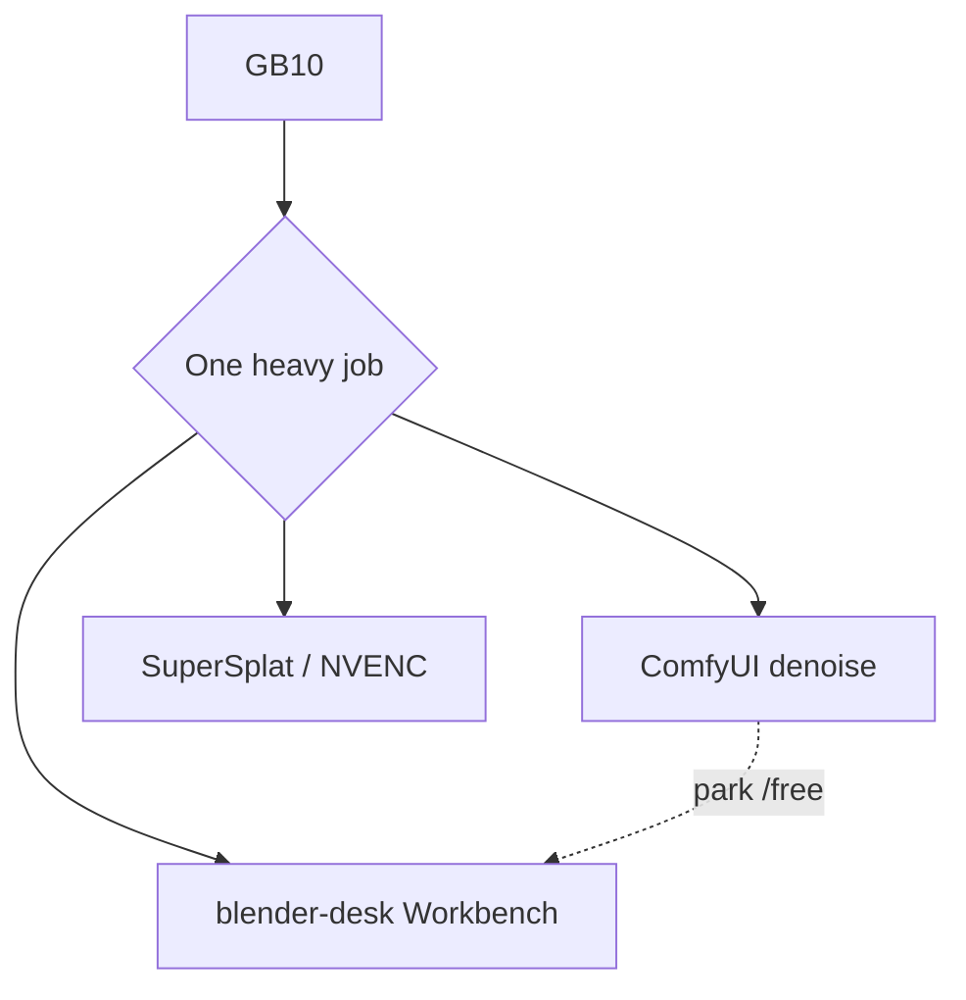

# Host sidecars overview

**What's on this page**

- **Which sidecar to pick** - Blender, SuperSplat, TRELLIS.2, DA3-BASE, the host LLM, Vlo, Kdenlive / Shotcut
- **Occupancy rule** - one heavy GPU job at a time; the two verbs are park and stop
- **Host, not Dockerfile** - where each sidecar runs and what ships in the image
- **Host NLE** - Vlo in the browser, or Kdenlive / Shotcut on OTIO files
- **Not sidecars** - `ez_dcc`, the VACE join, and where generated meshes land

**What this enables**

- **Optional 3D stills and depth** without putting DCC or splat viewers in the Docker image
- **Timeline edits in a host browser** (Vlo) or a host NLE - both outside the Comfy image
- **Keeping** `restart: "no"`, `mem_limit: 90g`, and the headroom preflight unchanged
- **Deciding in one table** whether a tool wants Comfy parked, stopped, or neither

**Question this page answers:** which host tool do I want, and what has to give up the GPU first? This is the index for the 3D, Blender, and host-tools pages; each of those pages links back here.

---

## Which sidecar to pick

| Sidecar | Use it for | Where it runs | GPU: what Comfy must do first | Page |
| --- | --- | --- | --- | --- |
| **Blender** | Clay blockout, guide-pack dumps, creator plates, greybox sets | Host binary (`PATH` / `BLENDER_BIN` / `blender-install`) | **Park** Comfy (`occupancy enter blender-desk`); dumps exit 2 if it is still heavy | [Blender GB10 sidecar](blender-gb10-sidecar.md) |
| **SuperSplat** | Inspect a Gaussian splat on disk | Host static viewer | **Stop** Comfy (compose down) - the encoder is a GPU job too | [Splat sidecar](splat-sidecar.md) |
| **TRELLIS.2 native** | Still -> mesh, previews | Comfy after `download-3d` | **Stop** Blender and any sidecar before TRELLIS / LTX / Wan | this page |
| **DA3-BASE** | Depth from a still | Comfy after `download-3d` | Same as TRELLIS.2 | this page |
| **llama-server 35B** | Host LLM for script and tag work | Host `llama-server` on `127.0.0.1:30000` | **Park** Comfy (`occupancy enter llm-desk`); never a Compose service | [MCP and SSH tunnels](operate/mcp.md) |
| **Vlo** | Timeline edit that Queues into this stack | Host browser app + its own Node/Python backend on `127.0.0.1:6332` | **Stop** Comfy before a GPU encode; never let Vlo launch a second ComfyUI | [Vlo video editor](vlo.md) |
| **Kdenlive / Shotcut** | Offline edit of an exported OTIO | Host apt / Flatpak | **Stop** Comfy first if the NLE will use the GPU | this page |

---

## Occupancy rule

This page owns the full wording of the occupancy rule; the other pages link here instead of restating it.

<Callout type="error" title="Occupancy">
  GB10 is one heavy GPU job. Park Comfy (`occupancy enter blender-desk`) for Workbench dumps. Park Comfy (`occupancy enter llm-desk`) for the host 35B llama-server. Stop Blender and the sidecar before TRELLIS / LTX / Wan. SuperSplat and NVENC still want Compose **down**. Sidecars are **not** `docker compose` services. Bind the LLM sidecar on `127.0.0.1` only. [Occupancy desk](occupancy.md).
</Callout>

The rule is **one heavy GPU job at a time** on the single GB10. There are exactly two verbs, and they are not interchangeable:

- **park** - hand the GPU to a desk with `./scripts/manage.sh occupancy enter <desk>`. Comfy stays up and unloaded, so you can come straight back. Use it for the Blender Workbench dumps and the host 35B llama-server.
- **stop** - take the stack down with `./scripts/manage.sh stop` (compose down). Use it before TRELLIS / LTX / Wan work, for SuperSplat, and for any NVENC encode.



```bash
./scripts/manage.sh occupancy enter blender-desk   # park Comfy for a host GPU job
./scripts/manage.sh occupancy idle                 # hand the GPU back to Comfy
./scripts/manage.sh stop                            # compose down for splat / NVENC
```

Never `pip install nvdiffrast` / `nvdiffrec`. Never vendor Inria 3DGS or Pixal3D as a default.

---

## Host, not Dockerfile

| Sidecar | Where it runs | License | In image? |
| --- | --- | --- | --- |
| Blender | Host binary (`PATH` / `BLENDER_BIN` / `blender-install`) | Blender's own | **No** - [Blender GB10 sidecar](blender-gb10-sidecar.md) |
| SuperSplat | Host static viewer | MIT | **No** - [Splat sidecar](splat-sidecar.md) |
| TRELLIS.2 native | Comfy after `download-3d` | MIT | Weights on `MODELS_DIR` only. No nvdiffrast |
| DA3-BASE | Comfy after `download-3d` | Apache 2.0 | Weights on `MODELS_DIR` only. DA3-LARGE refused |
| llama-server 35B | Host `llama-server` on `127.0.0.1:30000` | Apache 2.0 GGUF | **No** - occupancy `llm-desk`. Never a Compose service |
| Vlo | Host browser app (Chromium) + its own Node/Python backend on `127.0.0.1:6332` | AGPL-3.0 | **No** - [Vlo video editor](vlo.md) |

Sidecars are host processes you install and run yourself. None of them is a `docker compose` service, none is cloned into the Comfy image, and none is built by `docker/Dockerfile`.

```bash
./scripts/manage.sh blender-install              # once; never in Dockerfile
./scripts/manage.sh occupancy enter blender-desk
./scripts/manage.sh download-3d --tier trellis2   # or da3-base | all
./scripts/manage.sh blender                      # Workbench; dies if Comfy is heavy
./scripts/manage.sh export-guides --film go-see --shot 12   # same occupancy
./scripts/manage.sh blender-stills --film go-see --plate mug --size 1024x1024
./scripts/manage.sh house-views --slug lab-penthouse        # Instagram 4:5 clay; same occupancy
./scripts/manage.sh occupancy enter trellis --yes
```

---

## Host NLE (Kdenlive / Shotcut)

OTIO from `./scripts/manage.sh film-export-otio go-see` is stdlib JSON under `films/<slug>/publish/`. Import on the Spark host or a laptop - never in the Docker image.

On DGX Spark (Ubuntu aarch64):

```bash
sudo apt-get update
sudo apt-get install -y kdenlive shotcut
# or: flatpak install flathub org.kde.kdenlive
```

Then open the `.otio` in Kdenlive/Shotcut. Occupancy: stop Comfy first if the NLE will use the GPU.

### Recommended in-browser editor: Vlo

For a live editor instead of a file handoff, use **Vlo** (`PxTicks/vlo`, AGPL-3.0): a host browser app that drives this stack's ComfyUI over its bridge, so the timeline is local and every generation is one Queue on the Spark. Install and run it on the host - it is not a Compose service and not a ComfyUI custom node. Kdenlive / Shotcut stay the OTIO file path above.

```bash
git clone https://github.com/PxTicks/vlo && cd vlo && ./install.sh && ./run.sh
# editor on http://127.0.0.1:6332; set the ComfyUI URL in App settings -> Runtime settings
```

Page: [Vlo video editor](vlo.md). Chromium-based browser only (File System Access API + WebCodecs).

---

## Not sidecars

- **`custom_nodes/ez_dcc`** is a **Comfy pack on `:8188`**, not a sidecar. It loads dumped packs and gates occupancy in-canvas. It does not run Blender. Playbook: [Stay in Comfy after a Blender dump](learn/comfy-first-blender.md).
- **The VACE join** (Wan 2.1 1.3B Apache, 17 frames = `1+8n`) is a Comfy graph, not a sidecar:

```bash
./scripts/utilities/download-wan.sh run --tier vace
# load workflows/_lab/motion/silent/vace-join.json - MagCache off
```

- **Guide packs** are dumps a host tool writes for Comfy to read: [DCC guide pack](dcc-workflows.md). Clay is Workbench; beauty is Path A. Never 1280x720.
- **Generated meshes, previews, and scene instances** are **outputs** in the [Asset Bible](asset-bible.md) under `COMFY_OUTPUT_DIR/assets/` - never in `MODELS_DIR` or `guides/`.

---

## Related

- [DCC guide pack](dcc-workflows.md) - block in Blender, print a depth-guided 5.00s hero
- [Blender GB10 sidecar](blender-gb10-sidecar.md) - install, park, and dump from the host
- [Asset Bible](asset-bible.md) - where generated meshes and scene instances live
- [Splat sidecar](splat-sidecar.md) - the host splat viewer
- [Vlo video editor](vlo.md) - the AGPL browser NLE on the ComfyUI bridge

See [Model licenses](licenses.md) and [Models and cache](models-and-cache.md).
