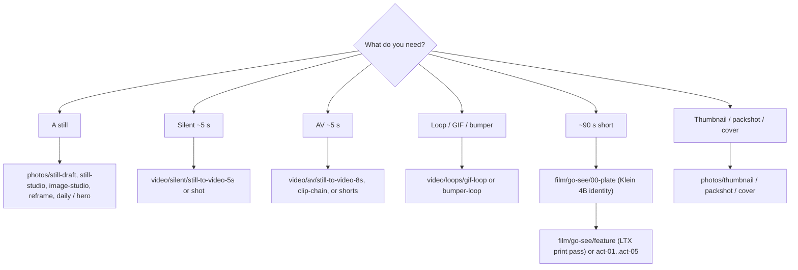

# Workflow catalog

This page answers one of the four start-creating questions: **which graph to load
for this job**. It maps a need to a lane and a filename. The end-to-end
idea and the iteration loop live on [The still-to-motion-to-AV pipeline](visual-generative-ai.md),
the widget surfaces, lanes, and handoffs live on [ComfyUI Apps](studio-apps.md),
and how to word the prompt lives on [Prompting](prompting.md).

**What's on this page**

- **Choose a graph** - the need-to-lane decision, then the filename
- **Catalogs by job family** - the six graph catalogs, one table family each
- **Where the graphs live** - the `_lab/<lane>/` tree after `start`, plus `_user/`
- **Labs (Lane A)** - the no-UNET desks
- **Shared lab-graph rules** - outputs, seeds, occupancy, sizes, and Queue rules
- **Notes on every lab graph** - the on-canvas Note, MP4 output, the reference pair, optional A14B

**What this enables**

- **Picking a filename** instead of starting from a blank canvas
- **Reading one table** per family: photos, video, social, business, film, audio
- **Skipping repetition** - the rules every catalog repeats are written once here
- **Keeping** the [playbook](visual-generative-ai.md) a how-to, not a spreadsheet

**Who this is for:** studio users after the first still-draft Queue. Node-by-node widgets: [Workflow details](create/workflows-index.md). Encyclopedia: [Workflow node parameters](reference/workflow-nodes.md).

After `download-models` + `start`, load from Comfy's **Workflows** sidebar under **`_lab/<lane>/`** (seeded from host `workflows/_lab/`). Filenames are short stems in lane folders (`photos/still-draft.json`); the unique id is `extra.lab_rel`. Every shipped graph is Nodes 2.0 native (`extra.workflowRendererVersion` = `Vue-corrected`). App Mode graphs also appear under Comfy's **Apps** sidebar (`*.app.json` on disk under the same lane folder; same stem). Do **not** edit raw JSON - change widgets on the canvas. Toggle Nodes 2.0 from the Comfy logo menu if you need classic LiteGraph; the JSON still loads.

---

## Choose a graph

Name the deliverable first, then open that lane's catalog. The decision below
is the same one the sidebar folders make for you. There are nine lanes; the
title and the one-liner are what the sidebar and the App surfaces print.

| Lane | Title | Make this when you are making |
| --- | --- | --- |
| `photos/` | Photos | Single images: drafts, edits, product shots, and channel art. |
| `video/` | Video | Short clips, silent or with audio, from a still you already like. |
| `social/` | Social | Platform-shaped posts for a channel or shop, sized per surface. |
| `business/` | Business | Client work by vertical, from listing photos to ad packs. |
| `film/` | Film | Narrative shorts, act by act, plus the cut tools that finish them. |
| `audio/` | Audio | Music, podcasts, dubbing, and whole albums. |
| `3d/` | 3D | Meshes and turntables built from a still you already like. |
| `guides/` | Control guides | Depth, canny, and clay passes that steer a generation. |
| `labs/` | Labs | Writers' room tools, and opt-in model families you add on purpose. |



- **A still, a plate, or a cover** - [Stills graphs](create/workflows-stills.md) (`photos/`)
- **A silent ~5 s clip or an AV ~8 s take** - [Motion graphs](create/workflows-motion.md) (`video/`)
- **A named platform job** - [Creator pack](create/workflows-creator.md) (`social/`)
- **A client or agency SKU** - [Services pack](create/workflows-services.md) (`business/`)
- **A 90s film or a clay print** - [Film graphs](create/workflows-film.md) (`film/`, `guides/`)
- **A podcast, dub, rap, or EDM take** - [Audio graphs](create/workflows-audio.md) (`audio/`)
- **A mesh or turntable from a still** - [Blender + ComfyUI](dcc-workflows.md) (`3d/`)
- **A depth, canny, or clay pass to steer a run** - [Control guides](dcc-workflows.md) (`guides/`)
- **A prompt, rack, beat sheet, or an opt-in model** - [Labs](#labs-lane-a) (`labs/`)

---

## Catalogs by job family

App Mode (frontend **1.41.13+**) is a widget surface on the same lab JSON. Surfaces, occupancy, and handoff: [ComfyUI Apps](studio-apps.md).

<Cards>
  <Card title="Stills (Klein 4B)">
    ---

    Draft / hero / daily stills, identity, character, creator plates, Apps Lane A Klein.

    [Stills graphs](create/workflows-stills.md)
  </Card>
  <Card title="Motion and AV">
    ---

    Wan 2.2 silent ~5 s, LTX-2.5 AV, GIF / bumper / sticker, creator motion plates. LTX size is div32.

    [Motion graphs](create/workflows-motion.md)
  </Card>
  <Card title="90s film and DCC">
    ---

    Plate + print-pass 90s shorts, five-act 7.5 min films, plus clay -> print, IC-LoRA envelopes, and in-canvas guide loaders.

    [Film graphs](create/workflows-film.md)
  </Card>
  <Card title="Creator pack">
    ---

    One hundred extra platform Apps: YouTube, Instagram, TikTok, X, LinkedIn, Pinterest, Twitch, Spotify, merch, production plates.

    [Creator pack](create/workflows-creator.md)
  </Card>
  <Card title="Services pack">
    ---

    Two hundred agency SKUs: ecommerce, paid-social, local business, courses, podcasts, listings, fashion, B2B, events, fitness/travel.

    [Services pack](create/workflows-services.md)
  </Card>
  <Card title="Audio">
    ---

    Podcast, dub, RAP-FIRST, Drive-through EDM. Occupancy **audio**. Do not co-resident with Klein / Wan / LTX.

    [Audio graphs](create/workflows-audio.md)
  </Card>
</Cards>

Playbooks: [The still-to-motion-to-AV pipeline](visual-generative-ai.md), [Short films](shorts.md), [Local podcast](podcast.md), [Local dub](dub.md), [Local music](music.md). Outputs land under `${COMFY_OUTPUT_DIR}`.

<Tabs groupId="license" items={["License"]} persist>
  <Tab value="License">
    MiniMax H3 is **banned** (US Excluded Territory). Klein 9B and FLUX.2-dev are opt-in FLUX Non-Commercial packs, not lab UNET pins. See [Model licenses](licenses.md).
  </Tab>
</Tabs>

---

## Where the graphs live

Save your own graphs in **`_user/`**. Live `_lab/` is the git catalog (overwritten on start). An explicit Save that landed in `_lab/` is **rescued** into `_user/` (new files) or `_user/_rescued/` (in-place lab Saves). Catalog restamps on `start` do **not** clone shipped `_lab` graphs into `_user/`.

Sidebar tree after start:

Nine lanes, in browse order. The title in quotes is what an operator reads;
each lane answers a different "what am I making" question.

```text
user/default/workflows/
  _lab/
    photos/    "Photos" - draft, hero, studio, identity, character, plates, dream-house, reframe
    video/     "Video" - short clips, silent or with audio, from a still you already like
      silent/  Wan I2V / T2V, first-last, vace, shot, parallax / orbit / push-in
      loops/   gif, bumper, sticker
      av/      LTX I2V / T2V, clip-chain, hook, b-roll, dialogue, A2V, talking-head
    social/    "Social" - platform-shaped posts for a channel or shop, sized per surface
      stills/  YouTube / IG / Twitch / merch plates
      silent/  Wan loops and I2V jobs
      av/      LTX AV jobs
    business/  "Business" - agency SKUs by vertical (ecommerce, ads, local, education, podcasts, listings, fashion, B2B, events, travel)
    film/      "Film" - per title a plate app + a print app: go-see / still-here / switchyard plate, feature (90s); tide-table / night-oven / glasshouse / last-lane / breakwater plate, act-01...05; generate-cutaway
    audio/     "Audio" - podcast, dub, music/rap-draft, music/rap-full, stem-mix
      albums/nill-bye/<album>/     nine Nill Bye albums (numbered tracks + cover + album)
      albums/drive-through/<album>/  six Drive-through albums
    3d/        "3D" - still-to-mesh, trellis2
    guides/    "Control guides" - clay -> print, plates, canny, depth/canny control, first-last from guide
    labs/      "Labs" - writers' room tools, and opt-in model families you add on purpose
      assist/  prompt-forge, cinema-rack, audio-rack, research-chat, app-forge, beat-sheet
      opt-in/  still-to-video-a14b, longcat-video, still-flux3-fast, still-flux3-quality
  _user/       your graphs (never overwritten; `_rescued/` holds explicit in-place lab Saves, not catalog updates)
```

Reusable printer blocks live in the node library after start (`custom_nodes/ez_studio_blocks/subgraphs/`): **klein-t2i-backbone**, **wan-i2v-5s**, **ltx-av-8s**, **ltx-film-shot**. Drop them from the subgraph menu instead of copy-pasting chains.

---

## Labs (Lane A)

No UNET still. Occupancy **llm** or **none**. Full Apps Lane A Klein stills: [Stills graphs](create/workflows-stills.md).

| Workflow | What it does |
| --- | --- |
| **[labs/assist/prompt-forge](generated/workflows/labs/assist/prompt-forge.md)** | No UNET. Shared Prompt + Context, then Klein / Wan / LTX / Z-Image / LongCat / DreamX enhance preview (occupancy **llm**) |
| **[labs/assist/cinema-rack](generated/workflows/labs/assist/cinema-rack.md)** | No UNET. Splice cinematography axes into Klein / Wan / LTX (occupancy **llm**). [Cinema Rack](create/cinema-rack.md) |
| **[labs/assist/audio-rack](generated/workflows/labs/assist/audio-rack.md)** | No UNET. Splice audio/music axes into ACE-Step tags / lyrics (occupancy **llm**). [Audio Rack](create/audio-rack.md) |
| **[labs/assist/research-chat](generated/workflows/labs/assist/research-chat.md)** | Creative-process chat + web search + research subagents (occupancy **llm**). Handoff Prompt Forge |
| **[labs/assist/app-forge](generated/workflows/labs/assist/app-forge.md)** | No UNET. Clone a lab graph into live `_user/` (occupancy **llm**). [App Forge](create/app-forge.md) |
| **[labs/assist/beat-sheet](generated/workflows/labs/assist/beat-sheet.md)** | Script desk. Logline + audio policy + 18 cards. `shot-sheet` writes `films/<slug>/shots.yaml` (occupancy **none**) |

---

## Shared lab-graph rules

Every catalog page follows these rules. They are written once here and the
catalogs link back, so a rule change lands in one place.

- **Outputs** - every graph writes under `${COMFY_OUTPUT_DIR}` on the host
  (container `/outputs`). `cleanup` does not delete that folder.
- **Seeds** - the App **Seed** widget is the seed control. Keep the same seed
  from a draft graph to its hero graph so the two prints compare, and leave
  shipped album-track seeds as they are so a re-Queue reproduces. Widgets:
  [ComfyUI Apps](studio-apps.md#graph-vs-app).
- **Occupancy** - one heavy GB10 job at a time. The two verbs are **park** and
  **stop**; park the previous family before you Queue the next. Table:
  [ComfyUI Apps](studio-apps.md#occupancy). Keep the headroom preflight green
  before `start`.
- **Sizes** - a **Size** column in a catalog table is the widget default.
  **Format / platform** retargets the same graph; match the platform aspect and
  scale in an editor when a host wants more pixels. Klein stills may use
  1280x720; LTX feeders stay **1280x704** (div32).
- **Queue** - change widgets on the canvas, never the JSON. One Queue is one
  job; a long latent is a defect, not a longer take.
- **Printers, not new models** - the creator and services catalogs clone the
  shipped Klein 4B / Wan 2.2 / LTX-2.5 printers. They add no models, and the
  plates ship empty of lettering so you composite titles later.
- **Safety impact** - none. `restart: "no"`, the heavy confirm on start, the
  headroom preflight, and the download-limit clear-on-exit are unchanged.

---

## Notes that apply to every lab graph

Every seeded lab graph includes an on-canvas **Note** (purpose, models, sampler, prompting tips, run steps). Video graphs emit MP4 via VHS with **`save_output: true`**; after Queue, open **Save video (MP4) - open node for preview**. LTX graphs decode audio (`LTXVAudioVAEDecode`) into the MP4. **[video/loops/gif-loop](generated/workflows/video/loops/gif-loop.md)** emits `image/gif`.

Every Klein T2I graph also carries the optional reference pair: **Optional reference stills** (`EZOptionalImage`) plus **Klein canvas (optional ref)** (`EZKleinRefCanvas`). Both ship inert - the picker node saves `[""]`, so a fresh Queue is text-to-image. Pick up to three stills (drag-and-drop, upload, or a name from `input/`) and they reach Klein / Flux.2 as real reference latents, along with any wired IMAGE batch; the node's **Use reference stills** / **References off** mute stops them without clearing your picks, and **max_refs** on the canvas node caps how many attach (1-4, default 3). Widgets: [ComfyUI Apps](studio-apps.md#reference-stills-optional). Nodes: [Custom nodes](reference/custom-nodes.md#ez_image).

Optional Wan A14B is a Queue graph (`workflows/_lab/labs/opt-in/still-to-video-a14b.json`): **both** high-noise and low-noise FP8 UNETs on the canvas. Queue uses the high-noise expert at 8 Lightning-style steps (MagCache **off**) so the graph loads. Dual-expert KSampler split is the full I2V recipe after both weights exist (Comfy Templates / operator). Download `download-wan.sh run --tier a14b` and unload 5B first.

---

## Related

Pick a filename here, then:

1. Run the loop: [The still-to-motion-to-AV pipeline](visual-generative-ai.md)
2. Load it from the App surface: [ComfyUI Apps](studio-apps.md)
3. Write the prompt: [Prompting](prompting.md)
4. Splice a look or a mix: [Cinema Rack](create/cinema-rack.md), [Audio Rack](create/audio-rack.md)
5. Clone a graph into your own App: [App Forge](create/app-forge.md)
