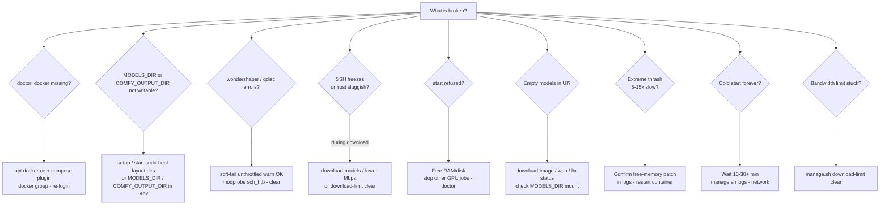
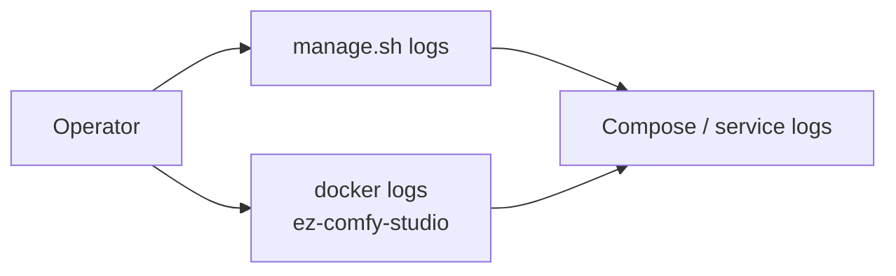
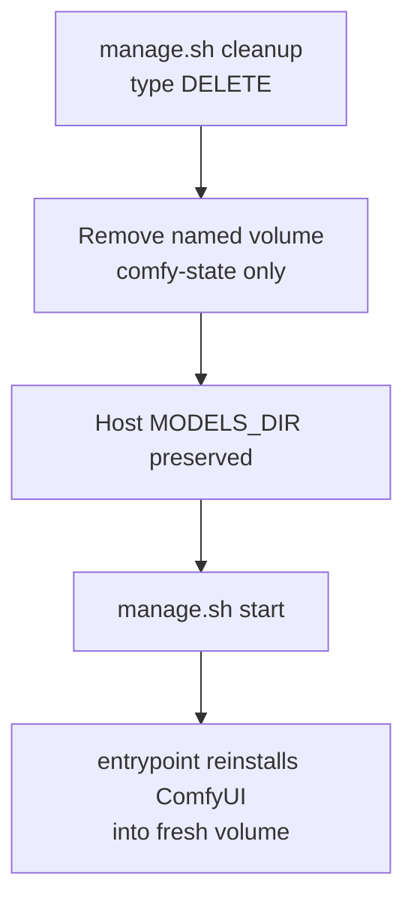

# Troubleshooting overview

**What's on this page**

- **Doctor first** - `./scripts/manage.sh doctor` before you hunt rows
- **Find the right page** - symptom router into the six topic pages
- **Symptom decision tree** - the common failures in one diagram
- **Bazel ingress** - missing linters, runfiles, and file-ownership failures
- **Vlo (host video editor)** - Vlo cannot reach ComfyUI, and the Chromium-only rule
- **Stills (Cubic block world)** - a block study with the people missing
- **Reference stills (optional refs)** - a picked still that does not apply, and `max_refs`
- **Prompt goal** - a deliverable the Enhancer ignored
- **Quality combo** - a tier that drops to `custom` and the CLI `--quality` seam
- **Dub (clone-translate)** - the rows live on the canvas page
- **Report buttons (ez_feedback)** and **Outputs sidebar (ez_outputs)**
- **update-stack (redeploy refusals)** - exit 3 guardrails and exit 5 repo root
- **Logs** and **Reset Comfy install (keeps models)**

**What this enables**

- **Reaching** the right page in one step from an error string or a failure mode
- **Recovering** from OOM, stuck bandwidth limits, empty models, and long cold starts
- **Jumping** to the matching table instead of scrolling a dump

<Callout type="info" title="Try this first">
  ```bash
  ./scripts/manage.sh doctor
  ```

  Many rows on the topic pages are hard failures `doctor` already reports. Prefer `./scripts/manage.sh setup` when Docker or `${MODELS_DIR}` is missing.
</Callout>

Open this page when something failed and you do not yet know which page owns it. Pick your symptom
in the router below, or read the decision tree. Every topic page is also a collapsible
**Troubleshooting** folder in the Operate tab.

## Find the right page

Find the row that matches what you see. The link takes you straight to the page that owns those
symptoms. Each row names what that page covers, so one hop is enough.

| What you see | Open this page |
| --- | --- |
| `start` is refused, the container dies right after the build, logs still show torch downloading, a `docker pull ghcr.io/...` is denied, or generations run 5-15x slow | [Start and runtime](operate/troubleshooting-start-runtime.md) - headroom refuse, immediate exits, cold start, GHCR / layer cache, Kitchen attention fallback, Nunchaku and VideoHelperSuite boot spam |
| Queue will not start, a preview stays blank, the graph load aborts, Nodes 2.0 sizes look tiny, a dub mix comes back wrong, the occupancy gate refuses, or the :8190 board is empty | [Canvas and studio UI](operate/troubleshooting-canvas.md) - Queue/history/previews, Nodes 2.0 layout, graph load aborts, Enhance and sample recipes, LTX/Wan guides, local dub, occupancy XOR, studio-ui `:8190` (not App Mode), Missing Inputs pickers |
| Empty models in the UI, a CLIP/VAE file that links nowhere, a node that will not import, a Queue dies on a CLIP/latent/Triton error, a film that will not stitch, or an audio graph that will not print | [Models and workflows](operate/troubleshooting-models-workflows.md) - missing weights and relative links, refused tiers, `IMPORT FAILED`, CLIP/latent/Triton queue errors, App widgets, lab pins, 90s concat, dream-house, ACE-Step and podcast loudness |
| `qdisc kind is unknown`, a bandwidth limit stuck after a kill, `Still waiting to acquire lock`, a resume pinned at `0 MiB/s`, or a gated LTX download | [Downloads and bandwidth](operate/troubleshooting-downloads.md) - wondershaper/qdisc soft-fail, stuck limits, HF locks and hung resume, the `hf` CLI, gated LTX (`HF_TOKEN` is not the license click) |
| `docker missing` in doctor, a nested `Permission denied` under `${MODELS_DIR}` or `${COMFY_OUTPUT_DIR}`, an `nvcr.io` pull refused, or farm SSH over the wrong NIC | [Host and Docker](operate/troubleshooting-host-docker.md) - Docker missing / group / daemon, `MODELS_DIR` and `COMFY_OUTPUT_DIR` permission, NGC oauth, Spark farm SSH (`SPARK_HOSTS` / `SPARK_FABRIC_IPS`) |
| Copy-paste still shows `${SPARK_HOST}` / `${MODELS_DIR}` chips, a wide table lost its horizontal bar, the pinned header stays after the table has scrolled past, or the docs search returns no results | [Docs site widgets](operate/troubleshooting-docs-site.md) - session chips, table chrome, docs search base path, docs CI heap OOM |
| The animatic or the film board still shows missing clay after `blender-guide --film go-see` | [DCC guide pack](dcc-workflows.md) - guide packs live at `guides/go-see/...` |

Rows that are not a topic page live here on this page: the Bazel ingress layer, Vlo, the Cubic block
world, reference stills, **Goal**, the **Quality** combo, `update-stack`, the report buttons, and the
Outputs sidebar. Each has its own section below.

---

## Symptom decision tree



---

## Bazel ingress

`bazelisk` is the ingress for every test, lint, build, and docs action
([Building with Bazel](contribute/building-with-bazel.md)). These are the failures unique to that
layer, before any stack or model is involved.

| Symptom | Cause | Fix |
| --- | --- | --- |
| `bazelisk test //:lint` fails with `shellcheck missing - required in CI/strict mode (apt install shellcheck or brew install shellcheck)` (or `shfmt`, `buildifier`, `pyright`, `mypy`) | Every gate in `lints/BUILD.bazel` sets `REQUIRE_LINT_TOOLS=1`, so a linter that is off `PATH` is fatal instead of printing `missing - skipping` and passing green. The host simply never installed that tool | `bazelisk run //:setup-host`, or `bash scripts/setup-host.sh` on a host with no `bazelisk` yet. Confirm with `bazelisk run //:setup-host -- --check`. Guide: [Set up a contributor host](contribute/host-setup.mdx) |
| `bazelisk test //:lint` is **green** and you suspect it checked nothing | Outside the `//:lint` gates, `scripts/lib/check_tool.sh` is still resilient by design and exits 0 on a missing tool. A run that never went through `//:lint` can skip silently | Run `bazelisk test //:lint --test_tag_filters=manual` and check it names each tool. If a tool is missing, the strict-mode line above tells you what to install |
| `exec_shell: cannot locate scripts/manage.sh (RUNFILES_DIR=...)` and exit 1 | The generated launcher from `tools/exec_shell.bzl` searched `RUNFILES_DIR`, `TEST_SRCDIR`, and `<argv0>.runfiles` and found none of them. That happens when the runfiles tree was not materialised - invoking the launcher copy in `bazel-bin/` directly, or a stale output tree after a Bazel or `.bazelversion` change | Invoke it through Bazel (`bazelisk run //:manage -- doctor`), never the file under `bazel-bin/`. If it persists, `bazelisk clean --expunge` and re-run |
| `scripts/lib/paths.sh: No such file or directory`, or a `bazelisk run //:manage -- <verb>` that dies before printing anything | `manage.sh` sources `lib/paths.sh` by `dirname "$0"`. Under a plain `sh_binary` the executable sits alone in `bazel-bin/` while its `data` is in `<target>.runfiles/`, so the sibling is missing. `//scripts:manage` is an `exec_shell` target precisely so script and `data` land in runfiles side by side | Run via `bazelisk run //:manage -- <verb>` so the launcher resolves the runfiles copy. Do not `bash` the `bazel-bin/` copy. `bazelisk clean --expunge` clears a runfiles tree left stale by a Bazel upgrade |
| `run-utility: utility name must be a bare name under scripts/utilities/` | `//scripts:run-utility` takes a bare utility name, not a path. A `scripts/utilities/` prefix, a `/` in the name, or a `.sh` suffix is rejected so the target cannot be pointed outside that directory | Drop the path and the suffix: `bazelisk run //scripts:run-utility -- download-limit status`, not `-- scripts/utilities/download-limit.sh status` |
| `bazelisk test //tests:owned_files_check` fails naming a file | A first-party source file is not claimed by any target's `srcs` / `data` / `filegroup`, so it would silently stop being built and linted | Add the file to the owning package's `BUILD.bazel` (or the filegroup that covers it). The guard is in `//:test-fast`, so it also fails the default gate |

---

## Vlo (host video editor)

Vlo (`PxTicks/vlo`, AGPL-3.0) is a host browser app that queues into this stack's ComfyUI over its bridge. Install and settings: [Vlo video editor](vlo.md).

| Symptom | Cause | Fix |
| --- | --- | --- |
| Vlo cannot reach ComfyUI - every generation fails to connect or the app shows ComfyUI offline | Compose is not up, or ComfyUI is published on a port other than the `http://127.0.0.1:8188` Vlo assumes by default | `./scripts/manage.sh start` (type **yes**) and confirm the UI itself loads at `http://127.0.0.1:${COMFY_PORT}` before blaming Vlo. Then set **App settings -> Runtime settings** to `http://127.0.0.1:${COMFY_PORT}` - the shipped default **8188** is only right when `COMFY_PORT=8188`. `backend/.env` `COMFYUI_URL` holds the same value; the in-app setting wins once you change it. Remote Spark: forward the port (`ssh -L "${COMFY_PORT}:127.0.0.1:${COMFY_PORT}" ...`) |
| Vlo's **Launch ComfyUI** starts a second ComfyUI, or start is refused on headroom | That button drives a folder install Vlo created itself. This stack owns the container lifecycle, so a second ComfyUI means two heavy GPU jobs | Start ComfyUI with `./scripts/manage.sh start` only. On first launch skip **Install ComfyUI** and just set the URL in **App settings -> Runtime settings**. Skip Vlo's model downloader for the same reason - weights stay on `./scripts/manage.sh download-models` |
| Vlo will not open, or the timeline will not play/render, in Firefox or Safari | The editor needs the File System Access API and WebCodecs (its media renderer wraps mediabunny), which those browsers do not give it | Use a Chromium-based browser: Chrome or Edge (Opera may work). See [Vlo video editor](vlo.md) |

---

## Stills (Cubic block world)

| Symptom | Cause | Fix |
| --- | --- | --- |
| **stills/background-swap** Cubic block world output has no people at all | The optional BSD-3 DeepLabV3 person mask could not load (weights missing, torch/torchvision missing, or `EZ_PERSON_MASK=off`), so the swap failed closed to the photo-anchored people-kept rebuild instead of erasing and pasting. Check the Enhance status: `photo-anchored block world (person mask unavailable)` means that mode ran | `./scripts/manage.sh doctor` or canvas **Check models** shows a `person-mask` row. Stage the checkpoint with the printed curl command into `$MODELS_DIR/comfy/ez-person/` (the first cubic Queue also auto-downloads it), then re-Queue with **Cubic block world** selected - the Enhance status should read `precise background instruction` and the paste reinserts the people. Set `EZ_PERSON_MASK=off` deliberately only if you want the people-kept rebuild. |

---

## Reference stills (optional refs)

**Example / reference (optional)** (**Optional reference stills**, `EZOptionalImage`) is empty by default and every failure path is fail-soft: a bad pick, a missing file, or a muted node never raises and never blocks Queue. Read the node status text and the **count** / **has_image** outputs before blaming the sampler. Widget guide: [ComfyUI Apps](studio-apps.md#reference-stills-optional).

| Symptom | Cause | Fix |
| --- | --- | --- |
| You picked a still and the output looks like plain text-to-image | The **Use reference stills** mute is off (**References off**). The node returns `count 0` / `has_image false` and reports `references off`, so **Klein canvas (optional ref)** passes the empty Flux2 latent through | Turn the mute back on (**Use references**) - or just pick a still again, which turns it back on. The mute never clears what you picked. Confirm the card status line lists stills rather than `Reference stills muted` before you Queue |
| You cleared a picker to A/B a run and lost the pick | Clearing a picker drops the file; only the mute is non-destructive | Use the mute for A/B (off, Queue, on, Queue). To restore a cleared slot, pick the file again or re-upload it |
| A picked file behaves as if you never picked it, with no error anywhere | The load fails soft and yields nothing: the file is gone from Comfy `input/` (cleaned, renamed, moved), it is not a readable image, or the wired IMAGE is an empty batch. Zero stills is a legal text-to-image Queue | Re-pick a file that exists, use **Upload media**, or send one from the Outputs sidebar (**Use as start image** copies it into `input/`). Trust the status line and `count`, not the picker text |
| More stills reach the model than the slots you filled | A wired IMAGE batch counts by its leading batch dim and each non-empty picker counts, so `count` can sit well above the number of slots you touched. The Klein canvas node then attaches up to `max_refs` frames | Set **max_refs** on **Klein canvas (optional ref)** (1-4, default 3) to how many you want - `1` is the old single-reference behavior. Unwire the batch or remove the extra picks you did not mean to send |
| Fewer stills attach than slots you filled | The same file picked twice is one still (duplicates skip by normalized filename), and anything past **max_refs** is cut | Pick distinct files, or raise **max_refs** (max 4) |
| A graph you saved before this change shows one picker and no mute | Saved `widgets_values` carry only the old single picker (`[""]`). The mute and the two extra pickers come from the node definition, so they land at their defaults once the updated `ez_image` pack is loaded | `./scripts/manage.sh restart`, then hard-refresh the Comfy tab (the entrypoint copies `custom_nodes/` on start). If the node still shows one widget, add a fresh **Optional reference stills** node. Node name, outputs, and the App label are unchanged, so the graph keeps loading |

---

## Prompt goal

**Goal** on an Enhance node names the deliverable the picture has to survive. It arrives on its own: the node reads the lane id already stamped in the graph's **catalog** widget and looks it up in `custom_nodes/ez_prompt_enhance/goal_index.json`. The resolved goal is appended to the system prompt after the model rules and before any style. Widget and prose: [Prompting](prompting.md#prompt-the-job-not-only-the-model).

| Symptom | Cause | Fix |
| --- | --- | --- |
| Every Queue looks the same however you set **Goal** | The node is a motion or audio Enhance, which has no **Goal** widget. Only the visual Enhance nodes take a deliverable | Expected. Motion lanes are timed shots; the craft lives in the duration hint and the motion prompt instead |
| **Goal** reads `None` on a stills lane you expected to be goal-aware | Someone set the combo to **None**, which refuses the lane, or that lane has no row in `goal_index.json` so nothing could be derived. Roughly a third of the stills lanes map; the rest are deliberately goal-neutral drafts, sheets, and grids | Put the combo back on **Auto (from lane)**. To make a lane goal-aware for everyone, add its id to `goal_index.json` |
| A vertical lane came back looking like a crowded landscape cover | The lane is mapped, but you picked a sample from the shared generic catalog, and those rows are written 16:9 | Pick the row set made for the deliverable (`klein_vertical`, `klein_plate`, `klein_banner`, `klein_thumbnail`, `klein_portrait`) or write your own. The Goal block steers the Enhancer; it cannot un-crop a row that specified a landscape frame |
| You set **Goal** to **None** and lost the lane's advice as well | **None** is an explicit opt-out and outranks the lane, by design | Put the combo back on **Auto (from lane)** to keep the derived goal, and pick a named goal when the deliverable differs from the lane |
| No **Goal** combo on a graph you saved before this existed | Saved `widgets_values` carry only the widgets that existed when the graph was written; new ones come from the node definition at their default | `./scripts/manage.sh restart`, then hard-refresh the Comfy tab. **Goal** is an optional widget, so old graphs load unchanged and resolve from the lane |
| Text landed where a title has to sit later | The goal asked for a quiet band, the sampler did not honor it, and nothing forces it | Re-Queue with the goal set, or take the still into the text lane. Goal language biases the Enhancer; a hard layout rule belongs in the prompt you wrote, not in the goal block |

---

## Quality combo

The **Quality** combo is read back from the widgets, not written and forgotten: it re-derives on graph load, on graph change, on widget edit, and at Queue, and a value it cannot write is a failed apply rather than a dropped one. Tiers and what each family owns: [ComfyUI Apps](studio-apps.md#graph-vs-app).

| Symptom | Cause | Fix |
| --- | --- | --- |
| The combo drops to **custom** the moment you pick a named tier, and the caption names a filename | That tier's model file is not in the loader's combo list (or the widget was not built yet), so the write is refused instead of silently keeping the old weights. The caption names what diverged | Read the filename in the caption, then stage it: `./scripts/manage.sh download-models`, or the printed opt-in pack (`download-image --tier 9b` for `ultra` / `max`). Click **Check models** to see every file the graph plus that tier needs, restart Comfy so `models/*` re-links, then pick the tier again |
| The combo changed by itself on load, with nothing edited | The widgets never matched a tier or the authored values when the graph loaded, so the derivation reports **custom** (or the tier they actually hold). An older build showed whatever was last typed into the combo | Expected, not a failure: the combo now reports what Queue would send. Pick the tier you want and re-check, or pick **lab** to return the owned widgets to the values the graph was authored with |
| You edited Steps / CFG and the level did not move | Only the parameters that family's tiers own are compared, so a change outside that set keeps the level (CFG on a Wan graph, where the tiers own steps only) | Expected. To force **custom**, edit a widget the tiers own (Steps on Wan; Steps / CFG / Image model / CLIP / VAE on Klein) |
| You put the widgets back on a tier's numbers and the combo still reads **custom** | Only the owned widgets count, and a value left off-tier (an unrounded CFG, a different VAE) keeps the derivation at **custom** | Set every owned widget on that tier's values - the caption under the combo names them - and the tier re-derives. **custom** is not absorbing |
| One KSampler or loader kept its old value while another moved | Pre-fix extension JS resolved the tier from the first loader only, so extra instances were never written | Pull, `./scripts/manage.sh stop` then `start`, then hard-refresh the tab so the extension bundle reloads. Every instance of every sampler and loader is written now |
| Picking a Klein tier on a FLUX 3 Image still (`stills/still-flux3-fast`, `still-flux3-quality`) does nothing | Those graphs pin flux3-image weights, so only `flux3-fast`, `flux3-quality`, and `flux3-nvfp4` apply. The Klein ladder is a no-op there by design | Pick one of the `flux3-*` tiers. Do not hand-edit the graph to take Klein 4B weights |
| The combo does nothing on film acts 2-5 | Those graphs ship the copied-in **Quality** node muted (LiteGraph `mode` 4), so it neither drives the overlay nor shows a caption - acts 2+ take the previous act's frame as their image source | Set the tier on **act-01** and re-Queue forward. See [Short films](shorts.md) |
| `print-shot` / `album-render` posted different weights than the browser showed | Both default to the tier the graph records, not the tier last picked in the browser | Pass `--quality TIER` (or `EZ_QUALITY=TIER`) on `./scripts/utilities/print-shot.sh` / `./scripts/utilities/album-render.sh`; the overlay runs before each POST, and an unknown tier name fails the run (`quality_apply: unknown quality tier: ...`, shot marked `failed`) |
| The browser tiers disagree with the table after someone edited presets | `custom_nodes/ez_quality/js/ez_quality_presets.js` is generated from `custom_nodes/ez_quality/presets.py` and was left stale (or hand-edited, which is a defect) | From the repo root: `bazelisk run //tests:build_quality_js`, then `bazelisk run //:manage -- restart` and hard-refresh. Never edit the generated file |

---

## Dub (clone-translate)

The dub lane is owned by the canvas page: ingest rights, wheels, clone CFG, mix loudness, and the
MLA file. Start at [Canvas and studio UI](operate/troubleshooting-canvas.md#local-dub). Vlo, the
host editor that queues into this stack, has its own rows below.

---

## Report buttons (ez_feedback)

Buttons live in the App widgets host, the Outputs toolbar and lightbox, the Check models
node, and the film board; the **Feedback** sidebar panel and the load-abort modal file the
same report. Operator guide: [Reporting issues](operate/reporting-issues.md).

| Symptom | Cause | Fix |
| --- | --- | --- |
| No **Report a bug** / **Request a feature** buttons | `custom_nodes/ez_feedback/` did not load, or the frontend served a cached extension bundle | Hard-reload the browser. Confirm the pack is in the Comfy `custom_nodes` copy and that ComfyUI logged it. |
| Buttons show but clicking opens nothing | Popup blocker also blocks the prefilled `issues/new` tab | Allow popups for the ComfyUI origin, or use **Copy markdown** and paste into a new issue. |
| **File directly** never appears | `EZ_GITHUB_TOKEN` unset, or the container was not restarted after it was set | Set it in `.env`, then `./scripts/manage.sh stop && ./scripts/manage.sh start`. Everything else works without a token. |
| Report body is missing the app name | The graph has no `extra.lab_rel` - true of hand-saved graphs, not lab apps | Name the workflow in the report; surface, environment, and browser facts still arrive. |
| Body ends with `[report trimmed to fit the GitHub URL limit]` | Context plus traceback exceeded the prefilled-URL budget, which GitHub answers with `414 URI Too Long` | Expected, not a failure. The dialog copies the full markdown to the clipboard at the same time - paste it into the opened tab, or use **Copy markdown**. **File directly** never trims. |
| No **Feedback** tab in the left dock | The frontend exposes no sidebar tabs, or it is serving a cached extension bundle | Hard-refresh the Comfy tab. A frontend without sidebar tabs registers nothing there and every **Report a bug** / **Request a feature** button still files the same report. |
| **Enhance with LLM** in the panel says the model is unavailable | Same GGUF and `EZ_LLM_*` knobs as prompt enhancement: GGUF missing, `llama.cpp unavailable`, or the 35B sidecar is down | `./scripts/manage.sh download-models` then restart; see [Models and workflows](operate/troubleshooting-models-workflows.md). Fail-soft by design - it writes a status line, keeps your text, and the panel files without it. |
| No **Report this error** on the `Loading aborted due to error reloading workflow data` modal | Old `ez_feedback/js/` in the container - the button is appended when that modal appears | `./scripts/manage.sh restart` so the pack JS recopies, then hard-refresh. The canvas row: [Studio canvas](operate/troubleshooting-canvas.md). |

---

## Outputs sidebar (ez_outputs)

The explorer lists `${COMFY_OUTPUT_DIR}` through the pack's own routes and degrades to a status
line rather than an exception. Pack reference: [Custom nodes](reference/custom-nodes.md#ez_outputs-outputs-sidebar).

| Symptom | Cause | Fix |
| --- | --- | --- |
| Outputs panel shows `Could not list outputs - ...` and the grid is gone | `GET /ez_outputs/list` did not answer: Compose is down, ComfyUI is still booting, or `custom_nodes/ez_outputs/` did not reach the container so the route is not registered. The stale grid is cleared on purpose - a dead list must not leave rows for files that no longer exist | Click **Retry** once the ComfyUI UI itself loads (`./scripts/manage.sh start`, then `./scripts/manage.sh doctor` if it will not come up). `./scripts/manage.sh restart` recopies `custom_nodes/`, then hard-refresh the Comfy tab. **Report this problem** (beside **Retry**) opens a prefilled issue carrying the failing endpoint, HTTP status, and the active filters |
| **Copy paths** reports `Clipboard blocked - paths are selected, press Ctrl/Cmd+C` | The browser refused `navigator.clipboard` - usual cause is a plain-`http://` origin that is not `127.0.0.1`, or you denied clipboard permission. Nothing is lost: the fallback textarea already holds the paths and keeps them selected | Press **Ctrl/Cmd+C** while the fallback holds the selection. For a real clipboard write, reach ComfyUI over `https://` or `127.0.0.1`, which is a secure context. **Download** and **Copy to input** never touch the clipboard, so bulk work is unaffected |
| The folder rail with the per-folder counts is missing | The panel is narrower than 560px. The rail appears only in the **wide** tier; below that the layout is **cozy** (380-559px) or **compact** (under 380px), where the folder control is chips by design | Widen the ComfyUI sidebar past 560px and the rail returns with its counts. Below that width, use the folder chips - `F` focuses the rail when it is showing and the chips when it is not, so the keyboard route works at every width |

---

## update-stack (redeploy refusals)

`./scripts/manage.sh update-stack` (or `bazelisk run //scripts:update-stack --`) redeploys the stack
from the branch you are standing on, and the image lane follows that branch. Exit codes: `0` success
or nothing to do, `1` failure, `2` usage error, `3` guardrail refusal, `5` the repo root could not be
proven. Flags: [manage.sh reference](manage-cli.md#catalog).

| Symptom | Cause | Fix |
| --- | --- | --- |
| `update-stack` exits **3** before it touches anything and prints the changed paths (up to 20) | The flow only deploys a checkout it can `git pull --ff-only`. A dirty worktree means the redeploy would ship edits nobody reviewed, so it refuses | `git status`, commit or stash the paths it listed, then re-run. `--dry-run` shows the plan without mutating, but the same guardrails still execute, so it refuses too. `--allow-dirty` is for a deliberate local experiment, never for forcing an unreviewed deploy out |
| `update-stack` exits **3** naming an image ref that does not match the branch | The image lane must match the branch: `main` -> `us-safe-studio`, any other branch -> `us-safe-studio-development`. An `EZ_COMFY_IMAGE` or `--image` pointing at the other lane, or a stale `LAB_GIT_BRANCH`, breaks that invariant | Drop `--image` and unset `EZ_COMFY_IMAGE` / `LAB_GIT_BRANCH`, then re-run on the branch whose lane you want. Pass `--allow-lane-mismatch` only when you deliberately want the other lane's tag |
| `update-stack` exits **3** and reports the branch as `unknown` | HEAD is detached, so `stack_git_branch()` cannot name a branch and the image lane cannot be derived from it | `git switch development` (or `main`) and re-run, or pass `--branch NAME`, which switches to NAME first. `--branch` is the only supported way to run on a detached HEAD |
| In CI, cron, or a detached tmux session, `update-stack` exits **3** at the redeploy step and names `--yes` | The redeploy delegates to `./scripts/manage.sh restart`, or `stop` + `start`, and that start keeps the heavy `yes` confirm and the headroom preflight. With no TTY the confirm cannot be answered, so the flow fails closed instead of assuming | Re-run interactively and type `yes`, or pass `--yes` for automation (it exports `LAB_NON_INTERACTIVE=1` and `LAB_CONFIRM_TOKEN=yes`, the supported path). Do not call `docker compose up` by hand to get around it |
| `update-stack` exits **5** with `cannot find scripts/lib/paths.sh`, before any git or docker work | The flow needs its own `scripts/lib` and a real checkout. Under `bazel run` the binary lives in Bazel's output tree, where the sibling `../lib` does not exist, so it resolves libraries from `BUILD_WORKSPACE_DIRECTORY`; without that variable, or from outside a checkout, neither the libraries nor the `scripts/manage.sh` + `docker/docker-compose.yml` markers are there | Re-run with `bazelisk run //scripts:update-stack --` from inside the repo (bazel run sets `BUILD_WORKSPACE_DIRECTORY`) or `./scripts/manage.sh update-stack` from the repo root. The error names both entry points. Never `bash` the file under `bazel-bin/` directly |
| A warning says the image pull failed, but the run carries on and still finishes with the doctor check | Pull failure is a warning by design, not a hard failure: a locally built image stays viable. `--skip-image-pull` and `LAB_STACK_SKIP_PULL=1` skip the pull the same way | Check registry reachability and your GHCR `docker login`, then re-run. To build locally instead, pass `--force-build` (exports `LAB_STACK_FORCE_BUILD=1` for the delegated start) and confirm the result with `./scripts/manage.sh doctor` |
| After `update-stack` the stack is on the wrong image lane (`status` shows `us-safe-studio-development` where you expected `us-safe-studio`, or the reverse) | The lane follows the checked-out branch, so the run happened on a branch other than `main`. A leftover `EZ_COMFY_IMAGE` / `LAB_GIT_BRANCH`, or `--allow-lane-mismatch`, also lands you on the other lane | Check `git branch --show-current` and `./scripts/manage.sh status` first. Clear `EZ_COMFY_IMAGE` / `LAB_GIT_BRANCH`, then re-run from the branch you want, with `--branch NAME` to switch and `--force-recreate` to force stop + start. `main` deploys the production lane; any other branch deploys the development lane |

`update-stack` never merges, rebases, resets, removes a volume, or calls `docker` directly. If a row
above does not match, run `./scripts/manage.sh doctor` and read [Start and runtime](operate/troubleshooting-start-runtime.md).

---

## Logs

```bash
./scripts/manage.sh logs
docker logs ez-comfy-studio
```



---

## Reset Comfy install (keeps models)

```bash
./scripts/manage.sh cleanup   # type DELETE
./scripts/manage.sh start
```



---

## Related

The six topic pages, in side-nav order:

- [Start and runtime](operate/troubleshooting-start-runtime.md) - refused starts, immediate exits, cold installs, GHCR pulls, attention fallback
- [Canvas and studio UI](operate/troubleshooting-canvas.md) - canvas, dub, occupancy, and the board
- [Models and workflows](operate/troubleshooting-models-workflows.md) - weights, nodes, and graphs
- [Downloads and bandwidth](operate/troubleshooting-downloads.md) - qdisc, stuck limits, HF locks, gated pulls
- [Host and Docker](operate/troubleshooting-host-docker.md) - Docker install, tree permissions, farm SSH
- [Docs site widgets](operate/troubleshooting-docs-site.md) - session chips, table chrome, docs search

For app failures worth filing, use the report buttons ([Reporting issues](operate/reporting-issues.md));
for every verb and flag named above, see the [manage.sh reference](manage-cli.md).
