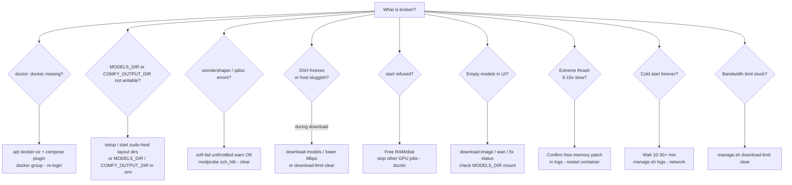
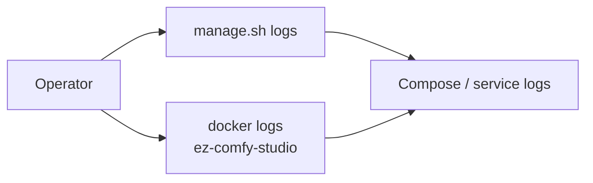
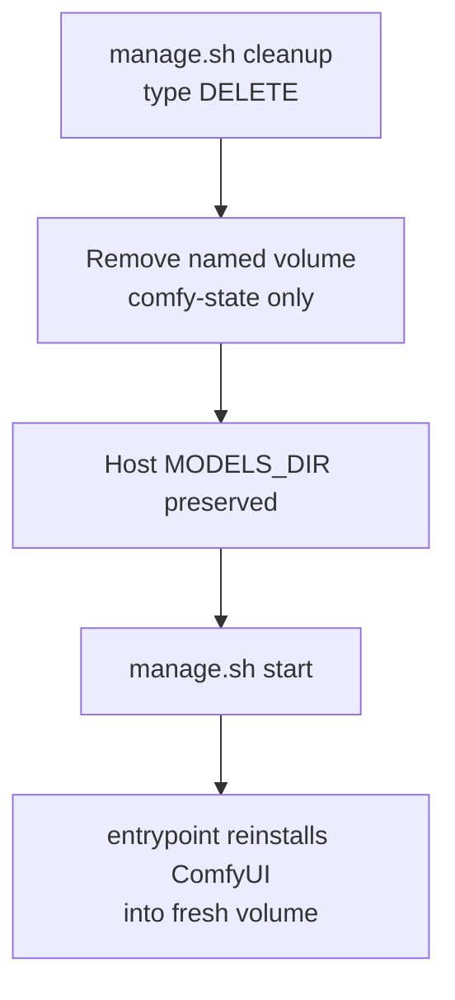

# Troubleshooting overview

**What's on this page**

- **Doctor first** - `bazelisk run //:manage -- doctor` before you hunt rows
- **Find the right page** - symptom router into the six topic pages
- **Symptom decision tree** - the common failures in one diagram
- **Bazel ingress** - missing or stale linters, the `//:setup-host` probe, runfiles, and file-ownership failures
- **Vlo (host video editor)** - Vlo cannot reach ComfyUI, and the Chromium-only rule
- **Editing lane (ez_edit)** - agent offline, a client job stuck `pending`, sidecar preflight refusals
- **Stills (Cubic block world)** - a block study with the people missing
- **Still caption (EZImageDescribe)** - a person or a detail in the prompt that is not in the photo
- **Reference stills (optional refs)** - a picked still that does not apply, and `max_refs`
- **Prompt goal** - a deliverable the Enhancer ignored
- **Quality combo** - a tier that drops to `custom` and the CLI `--quality` seam
- **Dub (clone-translate)** - the rows live on the canvas page
- **Report buttons (ez_feedback)** and **Outputs sidebar (ez_outputs)**
- **update-stack (redeploy refusals)** - exit 3 guardrails and exit 5 repo root
- **Logs** and **Reset Comfy install (keeps models)**

**What this enables**

- **Reaching** the right page in one step from an error string or a failure mode
- **Recovering** from OOM, stuck bandwidth limits, empty models, and long cold starts
- **Jumping** to the matching table instead of scrolling a dump

<Callout type="info" title="Try this first">
  ```bash
  bazelisk run //:manage -- doctor
  ```

  Many rows on the topic pages are hard failures `doctor` already reports. Prefer `bazelisk run //:manage -- setup` when Docker or `${MODELS_DIR}` is missing.
</Callout>

Open this page when something failed and you do not yet know which page owns it. Pick your symptom
in the router below, or read the decision tree. Every topic page is also a collapsible
**Troubleshooting** folder in the Operate tab.

## Find the right page

Find the row that matches what you see. The link takes you straight to the page that owns those
symptoms. Each row names what that page covers, so one hop is enough.

| What you see | Open this page |
| --- | --- |
| `start` is refused, the container dies right after the build, logs still show torch downloading, a `docker pull ghcr.io/...` is denied, or generations run 5-15x slow | [Start and runtime](operate/troubleshooting-start-runtime.md) - headroom refuse, immediate exits, cold start, GHCR / layer cache, Kitchen attention fallback, Nunchaku and VideoHelperSuite boot spam |
| Queue will not start, a preview stays blank, the graph load aborts, Nodes 2.0 sizes look tiny, a dub mix comes back wrong, the occupancy gate refuses, or the :8190 board is empty | [Canvas and studio UI](operate/troubleshooting-canvas.md) - Queue/history/previews, Nodes 2.0 layout, graph load aborts, Enhance and sample recipes, LTX/Wan guides, local dub, occupancy XOR, studio-ui `:8190` (not App Mode), Missing Inputs pickers |
| Empty models in the UI, a CLIP/VAE file that links nowhere, a node that will not import, a Queue dies on a CLIP/latent/Triton error, a film that will not stitch, an audio graph that will not print, or disk-wizard flags a `Lyra-2.0` / `Arete-27B` weight | [Models and workflows](operate/troubleshooting-models-workflows.md) - missing weights and relative links, refused tiers, declined integrations, `IMPORT FAILED`, CLIP/latent/Triton queue errors, App widgets, lab pins, 90s concat, dream-house, ACE-Step and podcast loudness |
| `qdisc kind is unknown`, a bandwidth limit stuck after a kill, `Still waiting to acquire lock`, a resume pinned at `0 MiB/s`, or a gated LTX download | [Downloads and bandwidth](operate/troubleshooting-downloads.md) - wondershaper/qdisc soft-fail, stuck limits, HF locks and hung resume, the `hf` CLI, gated LTX (`HF_TOKEN` is not the license click) |
| `docker missing` in doctor, a nested `Permission denied` under `${MODELS_DIR}` or `${COMFY_OUTPUT_DIR}`, an `nvcr.io` pull refused, or farm SSH over the wrong NIC | [Host and Docker](operate/troubleshooting-host-docker.md) - Docker missing / group / daemon, `MODELS_DIR` and `COMFY_OUTPUT_DIR` permission, NGC oauth, Spark farm SSH (`SPARK_HOSTS` / `SPARK_FABRIC_IPS`) |
| Copy-paste still shows `${SPARK_HOST}` / `${MODELS_DIR}` chips, a wide table lost its horizontal bar, the pinned header stays after the table has scrolled past, or the docs search returns no results | [Docs site widgets](operate/troubleshooting-docs-site.md) - session chips, table chrome, docs search base path, docs CI heap OOM |
| The animatic or the film board still shows missing clay after `blender-guide --film go-see` | [DCC guide pack](dcc-workflows.md) - guide packs live at `guides/go-see/...` |

Rows that are not a topic page live here on this page: the Bazel ingress layer, Vlo, the editing
lane, the Cubic block
world, the still caption, reference stills, **Goal**, the **Quality** combo, `update-stack`, the
report buttons, and the Outputs sidebar. Each has its own section below.

---

## Symptom decision tree



---

## Bazel ingress

`bazelisk` is the ingress for every test, lint, build, and docs action
([Building with Bazel](contribute/building-with-bazel.md)). These are the failures unique to that
layer, before any stack or model is involved.

| Symptom | Cause | Fix |
| --- | --- | --- |
| `bazelisk test //:lint` fails with `shellcheck missing - required in CI/strict mode (apt install shellcheck or brew install shellcheck)` (or `shfmt`, `buildifier`, `pyright`, `mypy`) | Every gate in `lints/BUILD.bazel` sets `REQUIRE_LINT_TOOLS=1`, so a linter that is off `PATH` is fatal instead of printing `missing - skipping` and passing green. The host simply never installed that tool | `bazelisk run //:setup-host`, or `bash scripts/setup-host.sh` on a host with no `bazelisk` yet. Confirm with `bazelisk run //:setup-host -- --check`. Guide: [Set up a contributor host](contribute/host-setup.mdx) |
| `bazelisk test //:lint` is **green** and you suspect it checked nothing | Outside the `//:lint` gates, `scripts/lib/check_tool.sh` is still resilient by design and exits 0 on a missing tool. A run that never went through `//:lint` can skip silently | Run `bazelisk test //:lint --test_tag_filters=manual` and check it names each tool. If a tool is missing, the strict-mode line above tells you what to install |
| `bazelisk test //:lint` is green on a host you have never bootstrapped, and `bazelisk run //:setup-host -- --check` then exits 1 with a `tools missing (N):` line | The linters were never installed on this host. A green lint result proves the gate ran, not that the tools existed - `scripts/lib/check_tool.sh` only asks whether a tool answers to `command -v` | `bazelisk run //:setup-host` (or `bash scripts/setup-host.sh` where `bazelisk` does not exist yet), then re-run the probe and confirm it ends with `every tool the Bazel targets need is on PATH at its pin.` Guide: [Set up a contributor host](contribute/host-setup.mdx) |
| `bazelisk run //:setup-host -- --check` exits 1 printing `tools below pin (N):` and one `stale: <tool> has <got>, pin wants at least <want> (<source>)` line each | A tool is on `PATH` but older than its pin, so the probe fails it even though it is installed. The pin source is named per line: `.devcontainer/tool-versions.env` for `bazelisk`, `buildifier`, `shfmt` and `node`; `tests/requirements.txt` for `pyright` and `mypy`. A distro tool with no pin (`git`, `python3`, `shellcheck`) has no floor and is never listed | `bazelisk run //:setup-host` reinstalls the stale tools from those same pins and re-probes; on a bare host, `bash scripts/setup-host.sh` with no flags. If the re-probe still prints `still below pin`, an older copy earlier on `PATH` is shadowing the new one |
| `bazelisk test //:everything` (or `bazelisk run //:everything`) dies at its first gate with `everything: gate //:setup-host -- --check failed` | The bootstrap probe is gate 1 on purpose, so no analysis, test, or docs gate runs on a host that cannot lint. Any missing **or stale** tool trips it, and the two lines above the failure name those tools | Read the `tools missing` / `tools below pin` lines it just printed, run `bazelisk run //:setup-host`, then re-run. A host that cannot install anything (CI with its own toolchain step) can skip the probe with `bazelisk run //:everything -- --skip-bootstrap` |
| `exec_shell: cannot locate scripts/manage.sh (RUNFILES_DIR=...)` and exit 1 | The generated launcher from `tools/exec_shell.bzl` searched `RUNFILES_DIR`, `TEST_SRCDIR`, and `<argv0>.runfiles` and found none of them. That happens when the runfiles tree was not materialised - invoking the launcher copy in `bazel-bin/` directly, or a stale output tree after a Bazel or `.bazelversion` change | Invoke it through Bazel (`bazelisk run //:manage -- doctor`), never the file under `bazel-bin/`. If it persists, `bazelisk clean --expunge` and re-run |
| `scripts/lib/paths.sh: No such file or directory`, or a `bazelisk run //:manage -- <verb>` that dies before printing anything | `manage.sh` sources `lib/paths.sh` by `dirname "$0"`. Under a plain `sh_binary` the executable sits alone in `bazel-bin/` while its `data` is in `<target>.runfiles/`, so the sibling is missing. `//scripts:manage` is an `exec_shell` target precisely so script and `data` land in runfiles side by side | Run via `bazelisk run //:manage -- <verb>` so the launcher resolves the runfiles copy. Do not `bash` the `bazel-bin/` copy. `bazelisk clean --expunge` clears a runfiles tree left stale by a Bazel upgrade |
| `run-utility: utility name must be a bare name under scripts/utilities/` | `//scripts:run-utility` takes a bare utility name, not a path. A `scripts/utilities/` prefix, a `/` in the name, or a `.sh` suffix is rejected so the target cannot be pointed outside that directory | Drop the path and the suffix: `bazelisk run //scripts:run-utility -- download-limit status`, not `-- scripts/utilities/download-limit.sh status` |
| `bazelisk test //tests:owned_files_check` fails naming a file | A first-party source file is not claimed by any target's `srcs` / `data` / `filegroup`, so it would silently stop being built and linted | Add the file to the owning package's `BUILD.bazel` (or the filegroup that covers it). The guard is in `//:test-fast`, so it also fails the default gate |
| `bazelisk run //:everything` prints `==> //:everything: SKIP docs-site visual lane (the Docker daemon is not reachable)`, or `(no committed baselines under docs-site/tests/visual/goldens)`, and finishes with `all gates passed (1 skipped: ...)` | Gate 4 compares Playwright screenshots inside the pinned container, so it needs a reachable Docker daemon **and** committed baselines. Either one missing is an environment gap, and the sweep reports it rather than failing a gate the host cannot run | Start Docker, or capture the baselines with `bazelisk run //docs-site:visual-linux -- --update`, review the image diff, and commit it. The lane is never silently dropped: `bazelisk test //:test-all` runs both visual targets unfiltered |
| `bazelisk test //docs-site:visual_tooling_test` fails with `desktop: no committed baseline for <page>` | The visual guard enumerates the pages `docs-site/tests/visual/site.spec.mjs` captures and demands a committed PNG for each under `docs-site/tests/visual/goldens/`. Nothing has been captured on this checkout, or a new page landed without its baseline | `bazelisk run //docs-site:visual-linux -- --update` renders the whole set in the same image CI uses (Docker required). Review the added images before committing; a host capture differs in font metrics and reports every page as changed later |
| `bazelisk test //tests:pytest` fails with `run_pytest: python3 cannot import pytest_cov; refusing to run the suite unmeasured` (or `pytest` on the same line) | The 100% floor is measured by `pytest-cov`. A host that never installed the pinned Python tools used to run the suite with no coverage flag at all and still report green; the runner now stops and names the repair instead | `bazelisk run //:setup-host`, or `python3 -m pip install -r tests/requirements.txt`, then re-run. CI installs that same pin as part of its lint-tools step, so a runner that skipped it fails here rather than passing unmeasured |
| `bazelisk test //tests:pytest` fails inside `test_coverage_gate.py` with `unmeasured first-party Python (join COV_SCOPE or GATED_ELSEWHERE): [...]`, `COV_SCOPE names <tree>, which holds no production Python`, or `tests/.coveragerc omits <pattern>, which is not a test module` | The auditor keeps the floor honest: a new package arrived outside every measured tree, a tree in scope was renamed or emptied, or an omit rule started hiding production code. Any of those lets coverage report a flattering number while real code goes untested | Add the tree to `COV_SCOPE` in the pytest runner and give `//tests:pytest` its sources in `data`, or name the Bazel target that already measures it in `GATED_ELSEWHERE`. Drop a stale omit line instead of widening one. Rationale: [Building with Bazel](contribute/building-with-bazel.md) |
| `bazelisk test //lints:mypy` prints `Explicit "Any" is not allowed  [explicit-any]` | `mypy.ini` sets `disallow_any_explicit = True` for production Python, so `Any` has to be a declared boundary rather than a convenience. The pytest tree is checked separately by `mypy-tests.ini` under a committed ledger, which lifts the rule for test fakes | Replace it with a `TypedDict`, a `Literal`, `object`, or a `TYPE_CHECKING` alias of the real third-party class (`ImageTensor: TypeAlias = "torch.Tensor"`). A genuine third-party boundary gets a `[mypy-<module>]` section with `disallow_any_explicit = False` plus a row in the boundary table of [Strong types](contribute/typing.md); work that is merely unfinished gets the same section with `disable_error_code = explicit-any` and goes on the debt ledger |
| `bazelisk test //lints:mypy` prints `Missing type arguments for generic type "dict"  [type-arg]` (same shape for `list`, `set`, `tuple`, `Callable`) | `disallow_any_generics = True`: a bare container means `Any` in its parameters, which is the broad type in disguise | Write the parameters (`dict[str, int]`, `Callable[[str], None]`). For a genuinely open payload reuse the named aliases in `custom_nodes/ez_common/` (`Json`, `JsonObject`, `ComfyInputTypes`) instead of inventing a fresh `dict[str, Any]` |
| `bazelisk test //tests:python_tests` fails inside `test_strong_types.py` with `explicit Any outside a declared boundary or debt module` naming files, or with `mypy.ini exempts these modules ... delete the section`, or with `the budget is N` | The AST inventory is the config-independent backstop, so it runs where mypy is not installed: it flags any `Any` in production whose module `mypy.ini` exempts as neither a boundary nor a debt module, it flags an exemption that no longer carries `Any` (a dead section silently licenses the next one), and it ratchets `PRODUCTION_ANY_BUDGET`, `PRODUCTION_CAST_BUDGET`, and `DEBT_MODULE_BUDGET` | Repair the annotations the same way as the `[explicit-any]` row. When a sweep legitimately lowers a count, lower that budget in the same commit - all three only ever move down. Delete a section that the second message names |
| `bazelisk test //lints:mypy_tests` or `//lints:pyright_tests` prints `... ratchet failed:` with a `has N diagnostics, baseline allows M` line | The pytest tree is held to the same type law as production but carries a backlog, so each lane compares per-file diagnostic counts with its committed ledger (`lints/mypy_tests_baseline.json`, `lints/pyright_tests_baseline.json`). A file that grew, or a new test file with no entry, fails the gate | Narrow what the test hands a production signature (`assert isinstance`, or a typed helper) rather than raising a baseline number or widening the signature to suit the fake. When a file genuinely drops to zero, set its entry to `0` in the same commit - the gate fails a clean file whose baseline is still nonzero |
| `bazelisk test //lints:js_types` prints `JS typecheck ratchet failed:` with a `has N diagnostics, baseline allows M` line | `tsc --checkJs` type-checks the custom-node frontends against their JSDoc and compares per-file diagnostic counts with `lints/js_types_baseline.json`. A file that grew, or a new `.js` with no entry, fails the gate | Fix the JSDoc: a type expression on every `@param` / `@returns`, and a real `@typedef {object}` where the tag says `{object}`. Raising a baseline number is the wrong fix. When a file genuinely drops to zero, set its entry to `0` in the same commit - the gate fails a clean file whose baseline is still nonzero |
| `bazelisk test //lints:js_types` prints `tsc missing - required in CI/strict mode` | The gate type-checks the frontends with the TypeScript the docs-site lockfile pins, so it needs that install, and `//:lint` sets `REQUIRE_LINT_TOOLS=1`, which turns a missing tool into a failure instead of a skip | `bazelisk run //docs-site:install` - the same `npm ci --legacy-peer-deps` the docs job and the CI core job run before the lint lane. A `tsc` on the `PATH` also satisfies the gate when the checkout carries none, but the pinned compiler is what keeps the counts comparable with `lints/js_types_baseline.json` |

---

## Vlo (host video editor)

Vlo (`PxTicks/vlo`, AGPL-3.0) is a host browser app that queues into this stack's ComfyUI over its bridge. Install and settings: [Vlo video editor](vlo.md).

| Symptom | Cause | Fix |
| --- | --- | --- |
| Vlo cannot reach ComfyUI - every generation fails to connect or the app shows ComfyUI offline | Compose is not up, or ComfyUI is published on a port other than the `http://127.0.0.1:8188` Vlo assumes by default | `bazelisk run //:manage -- start` (type **yes**) and confirm the UI itself loads at `http://127.0.0.1:${COMFY_PORT}` before blaming Vlo. Then set **App settings -> Runtime settings** to `http://127.0.0.1:${COMFY_PORT}` - the shipped default **8188** is only right when `COMFY_PORT=8188`. `backend/.env` `COMFYUI_URL` holds the same value; the in-app setting wins once you change it. Remote Spark: forward the port (`ssh -L "${COMFY_PORT}:127.0.0.1:${COMFY_PORT}" ...`) |
| Vlo's **Launch ComfyUI** starts a second ComfyUI, or start is refused on headroom | That button drives a folder install Vlo created itself. This stack owns the container lifecycle, so a second ComfyUI means two heavy GPU jobs | Start ComfyUI with `bazelisk run //:manage -- start` only. On first launch skip **Install ComfyUI** and just set the URL in **App settings -> Runtime settings**. Skip Vlo's model downloader for the same reason - weights stay on `bazelisk run //:manage -- download-models` |
| Vlo will not open, or the timeline will not play/render, in Firefox or Safari | The editor needs the File System Access API and WebCodecs (its media renderer wraps mediabunny), which those browsers do not give it | Use a Chromium-based browser: Chrome or Edge (Opera may work). See [Vlo video editor](vlo.md) |

---

## Editing lane (ez_edit)

The in-browser editing lane (`custom_nodes/ez_edit/`): panel chat with an agent, server renders on
the Spark, client renders in the open tab, plus optional laptop-local MCP. Guide:
[Editing lane](edit-agent.md).

| Symptom | Cause | Fix |
| --- | --- | --- |
| The panel says the agent is offline and **Send** returns nothing usable | No OpenAI-compatible server answers `EZ_AGENT_LLM_URL` (the sidecar is stopped, the URL lost its `/v1` suffix, or it points at a non-loopback origin). Import, trim, and render do not need the agent, so the rest of the panel still works | `bazelisk run //:manage -- agent-model status --json` (expect `state: ready` and `url` on `127.0.0.1:30001`), then `bazelisk run //:manage -- agent-model run`. Confirm `.env` sets `EZ_AGENT_LLM_URL=http://host.docker.internal:30001/v1` and `EZ_AGENT_MODEL=Qwen3.8-Flash-Next`, then `bazelisk run //:manage -- restart`. To drive the editor with the 35B desk instead, point `EZ_AGENT_LLM_URL` at `EZ_LLM_SIDECAR_URL`'s server ([MCP and SSH tunnels](operate/mcp.md)) |
| `http://127.0.0.1:30001/v1/models` does not answer, or answers `404` / connection refused | The sidecar is still doing its first load (weights are tens of GiB and the wait is capped by `AGENT_MODEL_READY_S`, default 900 s), or `start.sh` died after the preflight, or `AGENT_MODEL_PORT` moved and the URL still says `30001` | `bazelisk run //:manage -- agent-model status --json` for the state, then re-run `agent-model run` and read the refuse/heartbeat lines. Check the container: `docker logs ez-agent-model`. If you set `AGENT_MODEL_PORT`, update `EZ_AGENT_LLM_URL` to the same port and restart Comfy. `30000` is the llm-desk and never serves this model |
| A client render sits at `pending` forever; the row reads `queued for the browser panel (WebCodecs)` and the panel says to connect the executor | A `mode=client` job is only claimed by the browser tab that owns the `client_id` - the Spark does not render it. No tab is polling `/ez_edit/exec/pending`, the tab was closed or backgrounded, or the browser has no `MediaRecorder` | In the panel press **Connect executor** and keep the tab in the foreground until the row reads `ok` (`claimed by the browser panel` means it is running). Use a Chromium-based browser (Chrome, Edge). Re-press **Render client** if the row is old, or switch to **Render server** for an mp4 ffmpeg pass on the Spark that needs no browser at all |
| Local MCP **Discover** fails for an endpoint you can curl by hand | The panel fetches MCP from the browser and refuses anything that is not loopback (`127.0.0.1` / `localhost` / `::1`); the bridge answers SSE or WebSocket only instead of Streamable HTTP; or the bridge sends no `Access-Control-Allow-Origin` for the ComfyUI origin, so `initialize` dies on CORS | Add the endpoint as `http://127.0.0.1:<port>/<path>` pointing at a bridge running **on the laptop** (e.g. `npx -y mcp-proxy --port 7231 -- <server-command>`), not at a LAN address. Bind the bridge to loopback, make sure it speaks Streamable HTTP, and let it answer CORS for `http://127.0.0.1:${COMFY_PORT}`. Pattern and rules: [Editing lane - laptop-local MCP](edit-agent.md#laptop-local-mcp-tools) |
| `agent-model run` refuses before it downloads anything | A preflight: free disk under `AGENT_MODEL_MIN_DISK_GB` (**160 GB**) on `${HF_HOME:-$HOME/.cache/huggingface}`, `MemAvailable` under `AGENT_MODEL_MIN_MEM_GIB` (**110 GiB**), or a heavy occupancy mode (wan / ltx / trellis / klein) holds the Spark, or `docker` / `git` is missing | Read the refuse line. Disk: `df -h "${HF_HOME:-$HOME/.cache/huggingface}"` and clear old HF snapshots. Memory: stop the other tenant (`bazelisk run //:manage -- occupancy enter idle`, or stop Compose) and re-check `MemAvailable` in `/proc/meminfo`; the sidecar does not shrink the reserve - `MEM_FLOOR_GIB=9` stays. Occupancy: the model is a co-tenant, so heavy modes refuse by design. Only override a preflight when the number is genuinely wrong for this host (`AGENT_MODEL_MIN_DISK_GB` with a different `HF_HOME`), never the memory floor |
| The agent chat refuses with `occupancy is <mode>; the agent model is a co-tenant` | A heavy GPU job holds the GB10 while the sidecar is up - one heavy tenant at a time | `bazelisk run //:manage -- occupancy enter idle`, then chat again. The same XOR gates `edit_generate_clip` from the panel; a cutaway row that fails naming the mode needs the same release |
| **EZ Edit** is missing from the topbar, or the panel shows `Editing lane is disabled` | `EZ_EDIT_ENABLED=0` hides the panel and refuses every `/ez_edit` route, or the frontend is serving a cached extension bundle | Set `EZ_EDIT_ENABLED=1` in `.env`, then `bazelisk run //:manage -- restart` and hard-refresh the Comfy tab so `custom_nodes/ez_edit/js/` recopies |

---

## Stills (Cubic block world)

| Symptom | Cause | Fix |
| --- | --- | --- |
| **photos/background-swap** Cubic block world output has no people at all | The optional BSD-3 DeepLabV3 person mask could not load (weights missing, torch/torchvision missing, or `EZ_PERSON_MASK=off`), so the swap failed closed to the photo-anchored people-kept rebuild instead of erasing and pasting. Check the Enhance status: `photo-anchored block world (person mask unavailable)` means that mode ran | `bazelisk run //:manage -- doctor` or canvas **Check models** shows a `person-mask` row. Stage the checkpoint with the printed curl command into `$MODELS_DIR/comfy/ez-person/` (the first cubic Queue also auto-downloads it), then re-Queue with **Cubic block world** selected - the Enhance status should read `precise background instruction` and the paste reinserts the people. Set `EZ_PERSON_MASK=off` deliberately only if you want the people-kept rebuild. |
| Queue dies on the **KSampler** with `'dict' object has no attribute 'size'` (App `photos/background-swap`, any prompt) | **Cubic or photo reference** (`EZCubicCondition`) handed the whole LATENT container (`{"samples": ...}`) to the conditioning `reference_latents` list. ComfyUI measures every entry with `.size()` in its pre-flight memory estimate, so a container there aborts the run before the first step. The node now stores the tensor itself, the way the stock reference nodes do | Update the stack, then `bazelisk run //:manage -- restart` and hard-refresh the Comfy tab (the entrypoint copies `custom_nodes/` on start). The node keeps its name and sockets, so a graph saved from the old pack loads unchanged - re-Queue the same prompt |

---

## Still caption (EZImageDescribe)

**Describe image** (`EZImageDescribe`) captions the source still with the opt-in Qwen2.5-VL-3B GGUF and hands
the text to Enhance `image_desc`. Only **photos/background-swap** defaults it On. That small vision model
invents whole subjects at temperature 0, so the caption is an unverified claim: it is gated before anything
reads it, and the rewriter is told the still - not the caption - is the authority on who and what is in the
plate (`Image caption (unverified)`). Node row: [Custom nodes](reference/custom-nodes.md#ez_prompt_enhance).

| Symptom | Cause | Fix |
| --- | --- | --- |
| Enhance or Describe put a person, a wardrobe, or a scene detail in the prompt that is not in the photo | The caption invented it. A sentence that names a person survives only when the optional BSD-3 DeepLabV3 person mask finds someone in the same still (any mask cell `>= 0.5`); hedged sentences (`appears`, `seems`, `looks like`, `possibly`) and atmosphere clauses (`creating a peaceful atmosphere`) are cut, and what is left is capped at 60 words. When the mask cannot answer (weights absent, `EZ_PERSON_MASK=off`, no torch) the gate is fail-closed and no person survives at all | Read the **Describe** status line - it names which cut it made: `caption people dropped (no person in still)`, `caption guesswork dropped`, `caption trimmed to the visible inventory`, `caption dropped (nothing grounded left)`. Multiple cuts join with ` + `, and an empty status means the caption passed through untouched. Turn **Describe image** **Off** when your own sentence is enough, or install the weights (next row) so the mask can confirm a real person. If the status is empty and a person still shows up, the name came from the **Prompt** textarea, a **Sample** recipe, or **Context** - fix it there |
| The caption lost my subject - the photo has a person in it and nothing names them | Expected fail-closed default: with no person-mask weights the gate cannot confirm anyone, so it drops every person sentence. Status reads `caption people dropped (no person in still)`, or `caption dropped (nothing grounded left)` when the caption was only people prose | Install both halves: `bazelisk run //:manage -- download-llm --tier describe` for the caption GGUF, and the same opt-in DeepLabV3 checkpoint the Cubic block world paste uses (canvas **Check models** shows the `person-mask` row and prints the curl into `$MODELS_DIR/comfy/ez-person/`; the first cubic Queue also fetches it). Restart, re-Queue, and the status must stop naming the people cut. Or leave **Describe image** **Off** and name the subject yourself in **Prompt** |
| The caption reads as a bare inventory list, or much shorter than the still | Working as intended: hedges, mood prose, and everything past 60 words are cut so the caption cannot out-shout the operator instruction. Status reads `caption guesswork dropped` or `caption trimmed to the visible inventory` | Keep the cut. Anything you want in the picture that the caption cannot see belongs in the **Prompt** textarea (or the **Style** dropdown), not in the caption |
| **photos/background-swap** **Cubic block world** has a person you never asked for, with **Describe image** On | Not the caption on that route: when the mask runs, people are erased and pasted back, and the caption is deliberately withheld from both the CLIP line and the rewriter so the empty block plate is never primed with the source people | Check the Enhance status. `photo-anchored block world (person mask unavailable)` means the mask could not run, so the photo-anchored people-kept rebuild ran and the `Source still:` caption trailer was appended - stage the person-mask weights (row above). That lane's own rows: [Stills (Cubic block world)](#stills-cubic-block-world) |

---

## Reference stills (optional refs)

**Example / reference (optional)** (**Optional reference stills**, `EZOptionalImage`) is empty by default and every failure path is fail-soft: a bad pick, a missing file, or a muted node never raises and never blocks Queue. Read the node status text and the **count** / **has_image** outputs before blaming the sampler. Widget guide: [ComfyUI Apps](studio-apps.md#reference-stills-optional).

| Symptom | Cause | Fix |
| --- | --- | --- |
| You picked a still and the output looks like plain text-to-image | The **Use reference stills** mute is off (**References off**). The node returns `count 0` / `has_image false` and reports `references off`, so **Klein canvas (optional ref)** passes the empty Flux2 latent through | Turn the mute back on (**Use references**) - or just pick a still again, which turns it back on. The mute never clears what you picked. Confirm the card status line lists stills rather than `Reference stills muted` before you Queue |
| You cleared a picker to A/B a run and lost the pick | Clearing a picker drops the file; only the mute is non-destructive | Use the mute for A/B (off, Queue, on, Queue). To restore a cleared slot, pick the file again or re-upload it |
| A picked file behaves as if you never picked it, with no error anywhere | The load fails soft and yields nothing: the file is gone from Comfy `input/` (cleaned, renamed, moved), it is not a readable image, or the wired IMAGE is an empty batch. Zero stills is a legal text-to-image Queue | Re-pick a file that exists, use **Upload media**, or send one from the Outputs sidebar (**Use as start image** copies it into `input/`). Trust the status line and `count`, not the picker text |
| More stills reach the model than the slots you filled | A wired IMAGE batch counts by its leading batch dim and each non-empty picker counts, so `count` can sit well above the number of slots you touched. The Klein canvas node then attaches up to `max_refs` frames | Set **max_refs** on **Klein canvas (optional ref)** (1-4, default 3) to how many you want - `1` is the old single-reference behavior. Unwire the batch or remove the extra picks you did not mean to send |
| Fewer stills attach than slots you filled | The same file picked twice is one still (duplicates skip by normalized filename), and anything past **max_refs** is cut | Pick distinct files, or raise **max_refs** (max 4) |
| A graph you saved before this change shows one picker and no mute | Saved `widgets_values` carry only the old single picker (`[""]`). The mute and the two extra pickers come from the node definition, so they land at their defaults once the updated `ez_image` pack is loaded | `bazelisk run //:manage -- restart`, then hard-refresh the Comfy tab (the entrypoint copies `custom_nodes/` on start). If the node still shows one widget, add a fresh **Optional reference stills** node. Node name, outputs, and the App label are unchanged, so the graph keeps loading |

---

## Prompt goal

**Goal** on an Enhance node names the deliverable the picture has to survive. It arrives on its own: the node reads the lane id already stamped in the graph's **catalog** widget and looks it up in `custom_nodes/ez_prompt_enhance/goal_index.json`. The resolved goal is appended to the system prompt after the model rules and before any style. Widget and prose: [Prompting](prompting.md#prompt-the-job-not-only-the-model).

| Symptom | Cause | Fix |
| --- | --- | --- |
| Every Queue looks the same however you set **Goal** | The node is a motion or audio Enhance, which has no **Goal** widget. Only the visual Enhance nodes take a deliverable | Expected. Video lanes are timed shots; the craft lives in the duration hint and the motion prompt instead |
| **Goal** reads `None` on a photos lane you expected to be goal-aware | Someone set the combo to **None**, which refuses the lane, or that lane has no row in `goal_index.json` so nothing could be derived. Roughly a third of the catalog maps by lane; the rest are deliberately goal-neutral drafts, sheets, and grids | Put the combo back on **Auto (from lane)**. To make a lane goal-aware for everyone, add its id to `goal_index.json` |
| A vertical lane came back looking like a crowded landscape cover | The lane is mapped, but you picked a sample from the shared generic catalog, and those rows are written 16:9 | Pick the row set made for the deliverable (`klein_vertical`, `klein_plate`, `klein_banner`, `klein_thumbnail`, `klein_portrait`) or write your own. The Goal block steers the Enhancer; it cannot un-crop a row that specified a landscape frame |
| You set **Goal** to **None** and lost the lane's advice as well | **None** is an explicit opt-out and outranks the lane, by design | Put the combo back on **Auto (from lane)** to keep the derived goal, and pick a named goal when the deliverable differs from the lane |
| No **Goal** combo on a graph you saved before this existed | Saved `widgets_values` carry only the widgets that existed when the graph was written; new ones come from the node definition at their default | `bazelisk run //:manage -- restart`, then hard-refresh the Comfy tab. **Goal** is an optional widget, so old graphs load unchanged and resolve from the lane |
| Text landed where a title has to sit later | The goal asked for a quiet band, the sampler did not honor it, and nothing forces it | Re-Queue with the goal set, or take the still into the text lane. Goal language biases the Enhancer; a hard layout rule belongs in the prompt you wrote, not in the goal block |

---

## Quality combo

The **Quality** combo is read back from the widgets, not written and forgotten: it re-derives on graph load, on graph change, on widget edit, and at Queue, and a value it cannot write is a failed apply rather than a dropped one. Tiers and what each family owns: [ComfyUI Apps](studio-apps.md#graph-vs-app).

| Symptom | Cause | Fix |
| --- | --- | --- |
| The combo drops to **custom** the moment you pick a named tier, and the caption names a filename | That tier's model file is not in the loader's combo list (or the widget was not built yet), so the write is refused instead of silently keeping the old weights. The caption names what diverged | Read the filename in the caption, then stage it: `bazelisk run //:manage -- download-models`, or the printed opt-in pack (`download-image --tier 9b` for `ultra` / `max`, or `bazelisk run //scripts:run-utility -- download-image run --tier qwen-image` for the `qwen-image*` tiers, which `download-models` never pulls). Click **Check models** to see every file the graph plus that tier needs, restart Comfy so `models/*` re-links, then pick the tier again |
| The combo changed by itself on load, with nothing edited | The widgets never matched a tier or the authored values when the graph loaded, so the derivation reports **custom** (or the tier they actually hold). An older build showed whatever was last typed into the combo | Expected, not a failure: the combo now reports what Queue would send. Pick the tier you want and re-check, or pick **lab** to return the owned widgets to the values the graph was authored with |
| You edited Steps / CFG and the level did not move | Only the parameters that family's tiers own are compared, so a change outside that set keeps the level (CFG on a Wan graph, where the tiers own steps only) | Expected. To force **custom**, edit a widget the tiers own (Steps on Wan; Steps / CFG / Image model / CLIP / VAE on Klein) |
| You put the widgets back on a tier's numbers and the combo still reads **custom** | Only the owned widgets count, and a value left off-tier (an unrounded CFG, a different VAE) keeps the derivation at **custom** | Set every owned widget on that tier's values - the caption under the combo names them - and the tier re-derives. **custom** is not absorbing |
| One KSampler or loader kept its old value while another moved | Pre-fix extension JS resolved the tier from the first loader only, so extra instances were never written | Pull, `bazelisk run //:manage -- stop` then `start`, then hard-refresh the tab so the extension bundle reloads. Every instance of every sampler and loader is written now |
| Picking a Klein tier on a FLUX 3 Image still (`labs/opt-in/still-flux3-fast`, `still-flux3-quality`) does nothing | Those graphs pin flux3-image weights, so only `flux3-fast`, `flux3-quality`, and `flux3-nvfp4` apply. The Klein ladder is a no-op there by design | Pick one of the `flux3-*` tiers. Do not hand-edit the graph to take Klein 4B weights |
| A tier you used to see is gone from an App's combo | The combo now lists only the tiers this graph's family can honor, so a tier that would write no widget here is no longer offered. An all-null overlay used to stamp itself as applied, which is how a Wan App came to offer a Klein `ultra` | Expected. The family's own ladder is still there. If a tier you need is missing, the graph is the wrong family for it - use the App built for that model |
| An App has no **Quality** row at all | The graph holds no sampler and no loader the overlay can write (album renders, Labs desks, a dub), so every tier was a no-op there and the combo is gone rather than decorative | Expected. Edit the widgets the graph actually owns. If you expected a tier to apply, the graph is missing its loader or sampler |
| `--quality TIER` printed `cannot honor` and changed nothing | The named tier belongs to a different family than the graph, so the CLI refuses rather than writing an unchanged graph and reporting success | Pick a tier this graph's family owns, or run the command against the App built for that model |
| `max` left one TRELLIS sampler at its authored step count | The TRELLIS ladder writes the three guided stages; the unguided texture stage (`KSampler (texture)`, CFG 1) keeps its own recipe | Expected. Set the texture stage's Steps by hand if you need it off 12 |
| Picking a Klein or `flux3-*` tier on a graph that pins Qwen-Image 2.1 weights (`qwen_image_2.1_*`) does nothing | Those graphs pin opt-in Qwen weights, so only `qwen-image`, `qwen-image-turbo`, `qwen-image-nvfp4`, and `qwen-image-turbo-nvfp4` apply. The Klein ladder and the `flux3-*` tiers are a no-op there by design | Pick one of the `qwen-image*` tiers, staging the pack first: `bazelisk run //scripts:run-utility -- download-image run --tier qwen-image` (or `qwen-image-turbo` / `qwen-image-nvfp4` / `qwen-image-turbo-nvfp4`), then restart so `models/*` re-link. Those packs are opt-in and never come from `download-models`. Do not hand-edit the graph to take Klein 4B weights |
| Picking a Klein tier on a film **plate** changes nothing on the print pass (or an LTX tier on an act does nothing to the plate) | Each film app holds one family: the plate (`film/<slug>/00-plate`) moves Klein tiers, the act / feature app moves LTX tiers. The seam between them is `ez_<slug>_plate.png` on disk, so no widget write crosses it | Expected - they are separate Queues. Set the tier in the App you are about to Queue. See [ComfyUI Apps](studio-apps.md#graph-vs-app) |
| The film act / feature app refuses at **Load identity plate**, or starts from a frame you did not just make | The plate was never Queued, so `ez_<slug>_plate.png` is missing, or it is the plate an earlier seed wrote because the plate was re-Queued after the act ran | Queue `film/<slug>/00-plate` first (one 4-step Klein still), then the act / feature app. Changed the plate seed? Re-Queue the plate, then re-Queue forward - acts 02-05 chain from the previous act's last frame (`ez_<slug>_b<n>_s3_last.png`), not from the plate. See [Short films](shorts.md) |
| `print-shot` / `album-render` posted different weights than the browser showed | Both default to the tier the graph records, not the tier last picked in the browser | Pass `--quality TIER` (or `EZ_QUALITY=TIER`) on `bazelisk run //scripts:run-utility -- print-shot` / `bazelisk run //scripts:run-utility -- album-render`; the overlay runs before each POST, and an unknown tier name fails the run (`quality_apply: unknown quality tier: ...`, shot marked `failed`) |
| The browser tiers disagree with the table after someone edited presets | `custom_nodes/ez_quality/js/ez_quality_presets.js` is generated from `custom_nodes/ez_quality/presets.py` and was left stale (or hand-edited, which is a defect) | From the repo root: `bazelisk run //tests:build_quality_js`, then `bazelisk run //:manage -- restart` and hard-refresh. Never edit the generated file |

---

## Dub (clone-translate)

The dub lane is owned by the canvas page: ingest rights, wheels, clone CFG, mix loudness, and the
MLA file. Start at [Canvas and studio UI](operate/troubleshooting-canvas.md#local-dub). Vlo, the
host editor that queues into this stack, has its own rows below.

---

## Report buttons (ez_feedback)

Buttons live in the App widgets host, the Outputs toolbar and lightbox, the Check models
node, and the film board; the **Feedback** sidebar panel and the load-abort modal file the
same report. Operator guide: [Reporting issues](operate/reporting-issues.md).

| Symptom | Cause | Fix |
| --- | --- | --- |
| No **Report a bug** / **Request a feature** buttons | `custom_nodes/ez_feedback/` did not load, or the frontend served a cached extension bundle | Hard-reload the browser. Confirm the pack is in the Comfy `custom_nodes` copy and that ComfyUI logged it. |
| Buttons show but clicking opens nothing | Popup blocker also blocks the prefilled `issues/new` tab | Allow popups for the ComfyUI origin, or use **Copy markdown** and paste into a new issue. |
| **File directly** never appears | `EZ_GITHUB_TOKEN` unset, or the container was not restarted after it was set | Set it in `.env`, then `bazelisk run //:manage -- stop && bazelisk run //:manage -- start`. Everything else works without a token. |
| Report body is missing the app name | The graph has no `extra.lab_rel` - true of hand-saved graphs, not lab apps | Name the workflow in the report; surface, environment, and browser facts still arrive. |
| Body ends with `[report trimmed to fit the GitHub URL limit]` | Context plus traceback exceeded the prefilled-URL budget, which GitHub answers with `414 URI Too Long` | Expected, not a failure. The dialog copies the full markdown to the clipboard at the same time - paste it into the opened tab, or use **Copy markdown**. **File directly** never trims. |
| No **Feedback** tab in the left dock | The frontend exposes no sidebar tabs, or it is serving a cached extension bundle | Hard-refresh the Comfy tab. A frontend without sidebar tabs registers nothing there and every **Report a bug** / **Request a feature** button still files the same report. |
| **Enhance with LLM** in the panel says the model is unavailable | Same GGUF and `EZ_LLM_*` knobs as prompt enhancement: GGUF missing, `llama.cpp unavailable`, or the 35B sidecar is down | `bazelisk run //:manage -- download-models` then restart; see [Models and workflows](operate/troubleshooting-models-workflows.md). Fail-soft by design - it writes a status line, keeps your text, and the panel files without it. |
| No **Report this error** on the `Loading aborted due to error reloading workflow data` modal | Old `ez_feedback/js/` in the container - the button is appended when that modal appears | `bazelisk run //:manage -- restart` so the pack JS recopies, then hard-refresh. The canvas row: [Studio canvas](operate/troubleshooting-canvas.md). |

---

## Outputs sidebar (ez_outputs)

The explorer lists `${COMFY_OUTPUT_DIR}` through the pack's own routes and degrades to a status
line rather than an exception. Pack reference: [Custom nodes](reference/custom-nodes.md#ez_outputs-outputs-sidebar).

| Symptom | Cause | Fix |
| --- | --- | --- |
| Outputs panel shows `Could not list outputs - ...` and the grid is gone | `GET /ez_outputs/list` did not answer: Compose is down, ComfyUI is still booting, or `custom_nodes/ez_outputs/` did not reach the container so the route is not registered. The stale grid is cleared on purpose - a dead list must not leave rows for files that no longer exist | Click **Retry** once the ComfyUI UI itself loads (`bazelisk run //:manage -- start`, then `bazelisk run //:manage -- doctor` if it will not come up). `bazelisk run //:manage -- restart` recopies `custom_nodes/`, then hard-refresh the Comfy tab. **Report this problem** (beside **Retry**) opens a prefilled issue carrying the failing endpoint, HTTP status, and the active filters |
| **Copy paths** reports `Clipboard blocked - paths are selected, press Ctrl/Cmd+C` | The browser refused `navigator.clipboard` - usual cause is a plain-`http://` origin that is not `127.0.0.1`, or you denied clipboard permission. Nothing is lost: the fallback textarea already holds the paths and keeps them selected | Press **Ctrl/Cmd+C** while the fallback holds the selection. For a real clipboard write, reach ComfyUI over `https://` or `127.0.0.1`, which is a secure context. **Download** and **Copy to input** never touch the clipboard, so bulk work is unaffected |
| The folder rail with the per-folder counts is missing | The panel is narrower than 560px. The rail appears only in the **wide** tier; below that the layout is **cozy** (380-559px) or **compact** (under 380px), where the folder control is chips by design | Widen the ComfyUI sidebar past 560px and the rail returns with its counts. Below that width, use the folder chips - `F` focuses the rail when it is showing and the chips when it is not, so the keyboard route works at every width |

---

## update-stack (redeploy refusals)

`bazelisk run //:manage -- update-stack` (or `bazelisk run //scripts:update-stack --`) redeploys the stack
from the branch you are standing on, and the image lane follows that branch. Exit codes: `0` success
or nothing to do, `1` failure, `2` usage error, `3` guardrail refusal, `5` the repo root could not be
proven. Flags: [manage.sh reference](manage-cli.md#catalog).

| Symptom | Cause | Fix |
| --- | --- | --- |
| `update-stack` exits **3** before it touches anything and prints the changed paths (up to 20) | The flow only deploys a checkout it can `git pull --ff-only`. A dirty worktree means the redeploy would ship edits nobody reviewed, so it refuses | `git status`, commit or stash the paths it listed, then re-run. `--dry-run` shows the plan without mutating, but the same guardrails still execute, so it refuses too. `--allow-dirty` is for a deliberate local experiment, never for forcing an unreviewed deploy out |
| `update-stack` exits **3** naming an image ref that does not match the branch | The image lane must match the branch: `main` -> `us-safe-studio`, any other branch -> `us-safe-studio-development`. An `EZ_COMFY_IMAGE` or `--image` pointing at the other lane, or a stale `LAB_GIT_BRANCH`, breaks that invariant | Drop `--image` and unset `EZ_COMFY_IMAGE` / `LAB_GIT_BRANCH`, then re-run on the branch whose lane you want. Pass `--allow-lane-mismatch` only when you deliberately want the other lane's tag |
| `update-stack` exits **3** and reports the branch as `unknown` | HEAD is detached, so `stack_git_branch()` cannot name a branch and the image lane cannot be derived from it | `git switch development` (or `main`) and re-run, or pass `--branch NAME`, which switches to NAME first. `--branch` is the only supported way to run on a detached HEAD |
| In CI, cron, or a detached tmux session, `update-stack` exits **3** at the redeploy step and names `--yes` | The redeploy delegates to `bazelisk run //:manage -- restart`, or `stop` + `start`, and that start keeps the heavy `yes` confirm and the headroom preflight. With no TTY the confirm cannot be answered, so the flow fails closed instead of assuming | Re-run interactively and type `yes`, or pass `--yes` for automation (it exports `LAB_NON_INTERACTIVE=1` and `LAB_CONFIRM_TOKEN=yes`, the supported path). Do not call `docker compose up` by hand to get around it |
| `update-stack` exits **5** with `cannot find scripts/lib/paths.sh`, before any git or docker work | The flow needs its own `scripts/lib` and a real checkout. Under `bazel run` the binary lives in Bazel's output tree, where the sibling `../lib` does not exist, so it resolves libraries from `BUILD_WORKSPACE_DIRECTORY`; without that variable, or from outside a checkout, neither the libraries nor the `scripts/manage.sh` + `docker/docker-compose.yml` markers are there | Re-run with `bazelisk run //scripts:update-stack --` from inside the repo (bazel run sets `BUILD_WORKSPACE_DIRECTORY`) or `bazelisk run //:manage -- update-stack` from the repo root. The error names both entry points. Never `bash` the file under `bazel-bin/` directly |
| A warning says the image pull failed, but the run carries on and still finishes with the doctor check | Pull failure is a warning by design, not a hard failure: a locally built image stays viable. `--skip-image-pull` and `LAB_STACK_SKIP_PULL=1` skip the pull the same way | Check registry reachability and your GHCR `docker login`, then re-run. To build locally instead, pass `--force-build` (exports `LAB_STACK_FORCE_BUILD=1` for the delegated start) and confirm the result with `bazelisk run //:manage -- doctor` |
| After `update-stack` the stack is on the wrong image lane (`status` shows `us-safe-studio-development` where you expected `us-safe-studio`, or the reverse) | The lane follows the checked-out branch, so the run happened on a branch other than `main`. A leftover `EZ_COMFY_IMAGE` / `LAB_GIT_BRANCH`, or `--allow-lane-mismatch`, also lands you on the other lane | Check `git branch --show-current` and `bazelisk run //:manage -- status` first. Clear `EZ_COMFY_IMAGE` / `LAB_GIT_BRANCH`, then re-run from the branch you want, with `--branch NAME` to switch and `--force-recreate` to force stop + start. `main` deploys the production lane; any other branch deploys the development lane |

`update-stack` never merges, rebases, resets, removes a volume, or calls `docker` directly. If a row
above does not match, run `bazelisk run //:manage -- doctor` and read [Start and runtime](operate/troubleshooting-start-runtime.md).

---

## Logs

```bash
bazelisk run //:manage -- logs
docker logs ez-comfy-studio
```



---

## Reset Comfy install (keeps models)

```bash
bazelisk run //:manage -- cleanup # type DELETE
bazelisk run //:manage -- start
```



---

## Related

The six topic pages, in side-nav order:

- [Start and runtime](operate/troubleshooting-start-runtime.md) - refused starts, immediate exits, cold installs, GHCR pulls, attention fallback
- [Canvas and studio UI](operate/troubleshooting-canvas.md) - canvas, dub, occupancy, and the board
- [Models and workflows](operate/troubleshooting-models-workflows.md) - weights, nodes, and graphs
- [Downloads and bandwidth](operate/troubleshooting-downloads.md) - qdisc, stuck limits, HF locks, gated pulls
- [Host and Docker](operate/troubleshooting-host-docker.md) - Docker install, tree permissions, farm SSH
- [Docs site widgets](operate/troubleshooting-docs-site.md) - session chips, table chrome, docs search

For app failures worth filing, use the report buttons ([Reporting issues](operate/reporting-issues.md));
for every verb and flag named above, see the [manage.sh reference](manage-cli.md).
